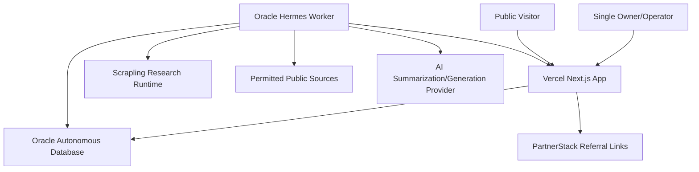

# 05 — Architecture Map

## System Context

## Component Responsibilities

### Vercel Next.js App

- Single-owner dashboard and control plane.
- Product Vault and Affiliate Link Vault UI.
- Manual approval queue.
- Public direct-review landing pages.
- API routes for admin mutations, Hermes job lifecycle, tracking events, and ISR revalidation.
- Fixed page rendering from approved structured JSON.
- Disclosure enforcement and publication gate checks.

### Oracle Autonomous Database

- System of record.
- Job queue with lock fields.
- Product, affiliate, compliance, evidence, page, tracking, recommendation, and audit storage.
- Initial evidence graph via relational tables and Oracle JSON columns.

### Oracle Hermes Worker

- Existing Oracle-hosted Hermes daemon/process configured with MiniMax.
- 3-hour refresh scheduler.
- Daily optimization scheduler.
- Weekly/manual deep research jobs.
- Scrapling crawlers and source refresh checks.
- Budget guard and AI-call gating.
- Evidence extraction, page JSON drafting, quality/compliance scoring, and recommendation creation.
- PartnerStack resource analysis from uploaded PDFs, images/screenshots, links, and video references.

## Key Data Flow

1. Admin creates product and original PartnerStack affiliate link.
2. System creates or updates the Oracle Offer Intelligence Folder linking affiliate URL, resources, rules, research, evidence, and destination review state.
3. Owner uploads or enters PartnerStack program rules/resources.
4. Existing Hermes/MiniMax analyzes resources and drafts structured restrictions.
5. Hermes reviews the affiliate purchase destination for message match, information scent, visual congruence, trust continuity, friction, and compliance.
6. Compliance profile/program rules are reviewed.
7. Owner or Hermes queues research jobs.
8. Hermes claims jobs and runs cheap change checks.
9. Hermes runs Scrapling only when source policy and budget allow.
10. Hermes stores sources and evidence claims.
11. Hermes generates structured page JSON draft, including approved design/motion variant recommendations guided by the purchase destination review.
12. Compliance gate scores the draft and creates manual review tasks when needed.
13. Operator approves first publication.
14. Vercel renders public page from approved JSON and tracks first-party events.
15. Hermes reviews daily metrics and suggests low-risk improvements.

## Architectural Decisions

### ADR-001: Deployment ownership is environment-specific

Dependencies are installed where their runtime executes: Vercel for app, Oracle Autonomous Database for data, Oracle worker host/container for Hermes. Local setup is optional.

### ADR-002: AI output boundary is JSON-only

Runtime AI page generation is JSON-only. AI-generated React/CSS is allowed during reviewed application development for approved component variants, but generated page drafts must validate against the direct-review page schema before rendering.

### ADR-003: Default-deny compliance model

Unknown program rules, unsupported claims, unclear source permissions, and suspicious affiliate redirects must create manual review tasks or block publication.

### ADR-004: Oracle database-backed queue for MVP

The MVP uses `generation_jobs` with lock fields and Oracle-compatible row-claim semantics before introducing external queue infrastructure.

### ADR-005: Scrapling lives in Oracle worker plane

Scrapling is not a Vercel runtime dependency. It runs as an Oracle-hosted Python runner/container controlled by Hermes due to crawl duration, scheduling, dependency isolation, and source-policy requirements.
