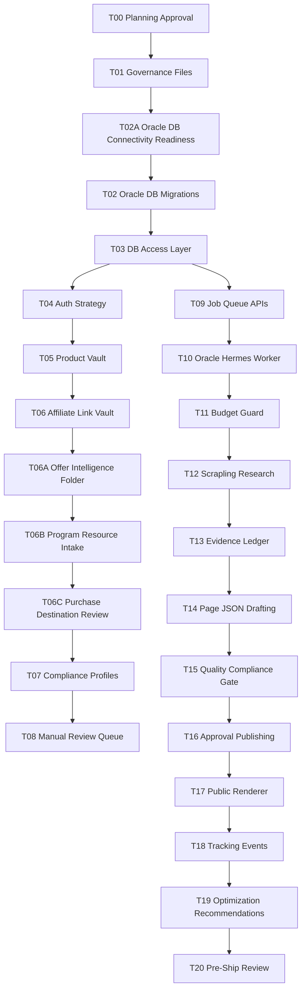

# 11 — Task Graph

## Dependency Order

## Task Sizing Rule

No task card should modify more than three source files or require more than three implementation steps. If a task exceeds this, split it before Step 2 execution.

## Critical Path

Planning approval → database foundation → auth → product/link/compliance workflows → jobs → Hermes → evidence → page drafting → approval/publishing → tracking → optimization.

## Parallelizable Areas After Auth/DB Foundation

- Admin UI surfaces.
- Hermes worker internals.
- Compliance/evidence tests.
- Public renderer polish.
- Deployment documentation.
