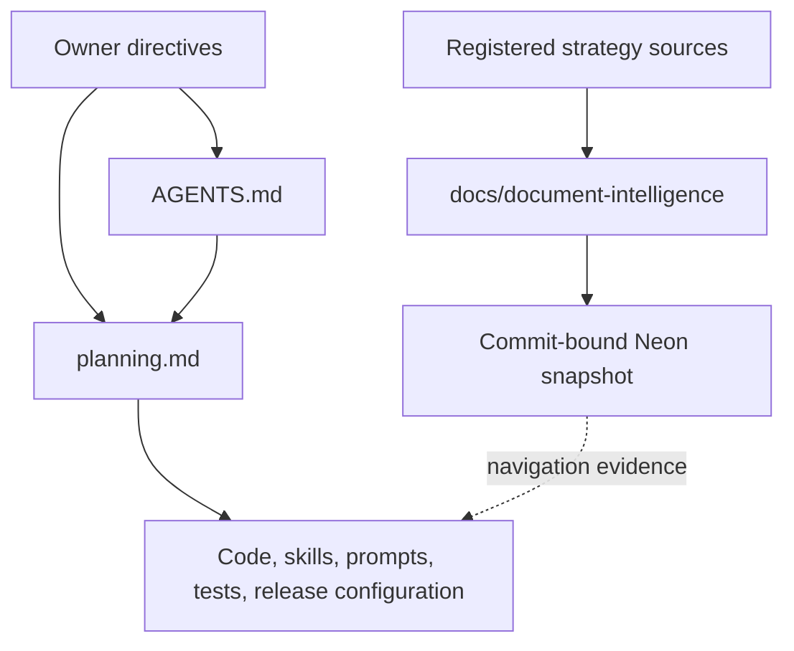

# Authority map

## Policy authority

| Policy | Controlling authority | Adopted meaning | Current consumers |
|---|---|---|---|
| Release | `AGENTS.md`, `planning.md` | Merge and deploy only after required gates and independent review of the exact head | PR and deployment workflow |
| Automation retirement | Owner directive, `planning.md` | No scheduled research, editorial, optimisation, rescue, or watchdog programme | prompts, skills, tests, runtime |
| Trigger | `AGENTS.md`, `planning.md` | Article-to-page execution requires an explicit manual or API trigger | import command and API surfaces |
| Planning | `planning.md` | Only registered implementation packets may execute | BuildRunner and agents |
| Source meaning | 12 registered strategy sources | Source sections supply product meaning; silence is not a requirement | document intelligence and requirements |
| Repository intelligence | `AGENTS.md`, Plan 2 | Deterministic snapshots stored in Neon provide navigation evidence, never semantic authority | discovery, impact analysis, review |
| Editorial quality | `AGENTS.md` | Full editorial passes, different-model-family cleanse, fidelity review, and 5/5 CLEAN | supervised authoring |
| Frontend quality | `AGENTS.md` | Required design skills, rendered inspection, critique, audit, and detection | page-building work |

## Current derived records

| Artifact | Producer | Inputs | Validator |
|---|---|---|---|
| `SOURCE_MANIFEST.json` and `DOCUMENT_INVENTORY.md` | `build-document-inventory.ps1` | 12 registered source documents | `verify-document-intelligence.ps1` |
| `RELATIONSHIP_CANDIDATES.json` | `extract-relationship-candidates.ps1` | source manifest and aliases | document verifier |
| `DOCUMENT_GRAPH.json` | `build-document-graph.ps1` | manifest, candidates, directives, findings | canonical graph checks |
| Neon snapshot | `npm run intelligence:sync` | document graph plus repository files and imports | repository-intelligence tests and migration verifier |
| build-pack contracts | `generate-globalsetup-intake.py` and `prepare-vetted-execution-state.mjs` | source manifest, graph, requirements, planning | Python and repository contract tests |

## Authority flow

