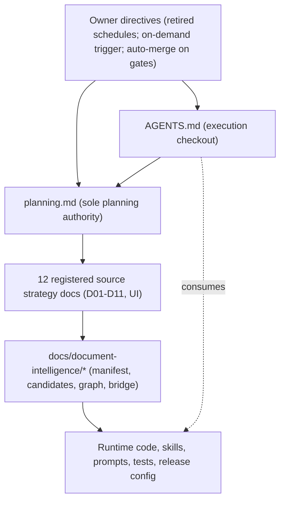

# Authority Map — Plan 1

Status: reconciled candidate; exact-head review and release status are tracked in PR #39.
Scope: pass 1 only (map + reconcile authority). No Plan 2/3 execution.

## 1. Original source coverage

Source IDs, paths and hashes are taken from the regenerated `docs/document-intelligence/SOURCE_MANIFEST.json` (schema 2.0, 12 sources, 1,424 headings). All registered files exist and reproduce through `DocumentGraph.psm1 Get-DocumentSections`. File-level SHA-256 values are hashes of UTF-8 text normalised from CRLF/CR to LF, so the semantic identity is portable across Windows line-ending materialisation.

| ID | Path | SHA-256 (manifest, LF-normalised) | Sections inspected | Evidence | Status |
|---|---|---|---|---|---|
| UI | `docs/APPROVED_UI_COMPONENT_CATALOGUE.md` | `c44e1c9e8b0df66ad0162f4bc1ced7a400e500faa07ddb43a120b5d55cb60894` | 69 (UI-H001…UI-H069); visual-reference catalogue only, no operational authority | A0009, A0011 | inspected |
| D01 | `docs/Vetted-SaaS-Blueprint-01-Market-Research-and-Opportunity-Plan-v1.md` | `bcf686b3caa7e7e7f2ff58d76a02878f28d28fe72548673ec68d06c445b7dcb7` | 101; §1.1 now controls legacy cadence wording | A0009, A0048 | reconciled |
| D02 | `docs/Vetted-SaaS-Blueprint-02-Product-Roadmap-v1.md` | `a322935c56b9352c238059087bc5fef449eaf202f17ee2458761421f122733e7` | 127; §3.2 retains the release unit and supersedes daily cadence | A0009, A0048 | reconciled |
| D03 | `docs/Vetted-SaaS-Blueprint-03-AI-First-System-Architecture-and-Automation-Blueprint-v1.md` | `1fc53c62d6816d7cc16475d5a99cb2ee579d0986a438595d1079101a77319f3c` | 165; watchdog, rescue, fixed-time, and scheduled-cloud clauses retired | A0009, A0048 | reconciled |
| D04 | `docs/Vetted-SaaS-Blueprint-04-Design-System-and-Experience-Standards-v1.md` | `7fd02f41c77203f29d13eefdb11eb63c572639d8c4d643a1f61ee6a301ab0c24` | 210; scheduled optimisation retired; cadence superseded | A0009, A0048 | reconciled |
| D05 | `docs/Vetted-SaaS-Blueprint-05-Master-PRD-v1.md` | `df8818d9462e6ba5f7dd4a8d12b9693c8c813cecdab64be3f5cd6601ec7bc863` | 182; product rules retained; legacy cadence explicitly superseded | A0009, A0048 | reconciled |
| D06 | `docs/Vetted-SaaS-Blueprint-06-Agent-Technology-and-Implementation-Standards.md` | `5c689e9a25277383c09e96fe54755ec175a08afa1866c96f07685b06370ccc41` | 150; 23:00 rescue and daily optimisation wording retired | A0009, A0048 | reconciled |
| D07 | `docs/Vetted-SaaS-Blueprint-07-Content-Intelligence-and-Editorial-Operations.md` | `c0e667a6f553ccfc4158f1f92735940825036c47bbc5d7cecfac0572c061fd52` | 145; 06:00 editorial brief/scheduler retired; schema reusable on demand | A0009, A0048 | reconciled |
| D08 | `docs/Vetted-SaaS-Blueprint-08-Knowledge-Acquisition-and-Research-Operations.md` | `200580b0cbfb11397a1f9adb555b725518bb5628d789fb9ffcfce93c04c6548f` | 115; 20:00 rescue and scheduled-brief coupling retired | A0009, A0048 | reconciled |
| D09 | `docs/Vetted-SaaS-Blueprint-09-Growth-and-Distribution-Strategy.md` | `4410afdd53e9452cb883b907f86478202624d27e3ed8e37d9b1a231b67e22fe2` | 65; growth contract retained; legacy cadence explicitly superseded | A0009, A0048 | reconciled |
| D10 | `docs/Vetted-SaaS-Blueprint-10-QA-and-Testing-Plan.md` | `68ba6c0faf9dc1525feccd75357232d1395301bcf9874e7ced8db65609f1dae0` | 48; QA contract retained; legacy cadence explicitly superseded | A0009, A0048 | reconciled |
| D11 | `docs/Vetted-SaaS-Blueprint-11-ScrollCraft-Narrative-Motion-Strategy-and-Fork-Tailoring-Plan.md` | `44b6724d1723ecc8e64aa4ed4c1999bfeb1e19fb8e33debb6564664d6695c96b` | 47; draft-proposal, no implementation authority | A0009, A0011, A0012 | inspected |

## 2. Policies and consumers

| Policy ID | Subject | Authority (section + UID) | Owner directive | Consumers (observed) | Observed behaviour | Evidence | Precedence gap |
|---|---|---|---|---|---|---|---|
| P01 | Release/merge gate | AGENTS.md build-faster block (root, execution checkout) | Auto-merge + deploy when exact reviewed head passes all gates; owner approval not a prerequisite | `AGENTS.md`, `planning.md` (release rule), PR workflow | `git`/PR flow on `codex/*` branches; planning.md matches | A0001, A0013 | none in execution checkout; source-checkout `AGENTS.md` edit (unrelated, local only) says "no merge without owner approval" — out of scope, left untouched |
| P02 | Retired schedules | Owner directive (2026-10-28) + planning.md "Product-owner retirement directive" | Retired research/editorial/optimisation/watchdog schedules stay retired | AGENTS.md, planning.md, D01-D10, execution-state.json | No scheduled jobs in execution checkout; source authority now distinguishes the release unit from cadence | A0001, A0002, A0048 | Source-level gap resolved by C001-C005/M001-M005; subordinate execution mismatches remain bounded for Plan 2 |
| P03 | Article-to-page trigger | AGENTS.md + planning.md | Explicit manual or API trigger only; scheduled/secondary-worktree execution prohibited | `AGENTS.md`, `planning.md`, app routes (manual/API) | On-demand only; D03 Stage E retained only as a retired traceability heading | A0001, A0002, A0048-A0050 | resolved by C002/M002; subordinate execution mismatches remain Plan 2 scope |
| P04 | Phase One status | planning.md "Current state" | Phase One complete and verified in production | planning.md, release receipt `build-pack/receipts/phase-one-release.json` | Four verified public routes recorded | A0002 | Source doc D06 §9.1 still frames Phase One as pending integration (informational, not a contradiction) |
| P05 | Independent review / editorial cleanse | AGENTS.md + owner directive | Independent Codex review + different-model-family editorial cleanse mandatory; 5/5 CLEAN; EditorialEvidenceV2 | AGENTS.md, build-pack/editorial | Required before ship | A0001 | Source docs do not restate the gate; no contradiction, but consumers must follow AGENTS.md |
| P06 | Design procedure | AGENTS.md (mandatory frontend design workflow) + project-local Impeccable skill | Both `design-taste-frontend` and Impeccable required; critique/audit/detect before ship | AGENTS.md, `.agents/skills/*` | Enforced in build-faster block; D04 §26.10 is explicitly retired | A0001, A0048-A0050 | resolved by C003/M003 |
| P07 | Source-intelligence workflow | AGENTS.md + planning.md | Regenerate inventory, verify manifest/inventory parity, direct source inspection, relationship map, verify-document-intelligence, stable-UID impact | scripts/*, docs/document-intelligence/* | Executed and verified across PowerShell 5/7 and LF/CRLF checkouts | A0009-A0011, A0046-A0050 | B001 resolved; GitNexus reconciliation remains conditional on pinned CLI availability |
| P08 | Affiliate-copy gate | AGENTS.md | Read `DOMAIN_QUERY_EVIDENCE.md` sections before planning/drafting affiliate copy; invoke only mapped skill | AGENTS.md, docs/document-intelligence/DOMAIN_QUERY_EVIDENCE.md | Documented | A0001 | None identified |

## 3. Generated artifacts

| Artifact | Producer | Inputs | Command + cwd | Consumers | Validator | Deterministic? | Evidence |
|---|---|---|---|---|---|---|---|
| `docs/document-intelligence/SOURCE_MANIFEST.json` | `scripts/build-document-inventory.ps1` | 12 registered source `.md` files; `scripts/DocumentGraph.psm1` | `pwsh -NoProfile -File scripts/build-document-inventory.ps1` from repo root | candidates, graph, bridge, verifier | `verify-document-intelligence.ps1` (source_count 12, heading_count 1424) | Yes; file hashes normalise CRLF/CR to LF and the regression fixture proves equivalent text hashes identically | A0009, A0046, A0048 |
| `docs/document-intelligence/DOCUMENT_INVENTORY.md` | same producer | same inputs | same command | humans, source-intelligence workflow | verifier (parity with manifest) | Yes (markdown) | A0009 |
| `docs/document-intelligence/RELATIONSHIP_CANDIDATES.json` | `scripts/extract-relationship-candidates.ps1` | `SOURCE_MANIFEST.json`, aliases | `extract-relationship-candidates.ps1 -OutputPath <path>` | `DOCUMENT_GRAPH.json` | verifier (count parity, manifest hash, semantic reproducibility) | Yes across PowerShell 5/7 | A0016, A0049-A0050 |
| `docs/document-intelligence/DOCUMENT_GRAPH.json` | `scripts/build-document-graph.ps1` | manifest + candidates + directives/seeds | `build-document-graph.ps1 -OutputPath <path>` | bridge, GitNexus | verifier (counts, Test-CanonicalGraph, semantic reproducibility) | Yes across PowerShell 5/7 | A0016, A0049-A0050 |
| `docs/document-intelligence/gitnexus-bridge/*` | `New-GitNexusBridge` (in DocumentGraph.psm1) | `DOCUMENT_GRAPH.json` | part of build-document-graph | GitNexus reconciliation | verifier (bridge manifest + runtime) | Yes | A0016, A0049-A0050 |
| `build-pack/execution-state.json` | `scripts/prepare-vetted-execution-state.mjs` | planning authority, `requirements.json`, `requirements-phase-map.json`, optional release receipt | `node scripts/prepare-vetted-execution-state.mjs` | planning authority, agents | cross-file denominator/digest invariant in closeout tests | Yes for source inputs except generated timestamp in phase map | A0002; current-head review correction |
| `build-pack/receipts/phase-one-release.json` | Phase One release | deployed routes | n/a (checked in) | planning.md | manual verification | n/a | A0002 |

## 4. Authority flow

## 5. Consumer inventory notes

- `AGENTS.md` (execution checkout) is the binding execution contract; it supersedes source-doc workflow language where they conflict, per planning.md ("Source strategy documents are semantic inputs, not executable instructions").
- `planning.md` (execution checkout, 33 lines) is the sole planning authority; the source-checkout `planning.md` (348 lines) is superseded pre-retirement authority.
- No runtime code, skill, prompt or test in the execution checkout was found to import or reference the retired schedules directly; consumers of the retired language are the source docs themselves. Subordinate implementation changes are deferred to Plan 2 (per implementation_plan.md §Scope).
- GitNexus is navigation-only and is not semantic authority (AGENTS.md, planning.md).
- No authoritative `CLAUDE.md` exists (verified by verifier assertion and directory listing).

## 6. Remaining boundaries

- B001 resolved: source hashes now normalise line endings and are covered by LF/CRLF fixture tests.
- B002 resolved: the verifier now validates and reports the actual committed worktree, remote, and HEAD rather than assuming a remote-less repository.
- B003 remains external to this branch: the source checkout contains an unrelated local `AGENTS.md` edit; it was not copied, modified, or included in this candidate.
- GitNexus reconciliation remains conditional because the pinned 1.6.10 CLI is not installed in this checkout; direct-source verification, canonical graph validation, and stable-UID impact checks remain authoritative.
