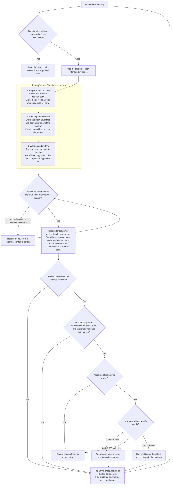

# Manual article intake

Run `npm run import:article -- --intake` from the primary checkout. This captures the regular Markdown and text files currently in `Article Intake` in stable filename order. The captured source bytes and hashes define the run; files added later wait for another manual start.

For the returned run ID, use `npm run import:article -- --intake-resume <run-id>`. Continue each selected article through its recorded research, transformation, editorial, validation, release, merge, deployment, and production-verification actions before selecting the next entry. Record every result and keep unresolved entries visible.

Use `npm run import:article -- --intake-status <run-id>` to inspect the run. Article-specific failures are recorded and skipped. Shared Git, credential, editorial-tool, or deployment failures stop the run for explicit later resumption. `PROCESSING_PASS_FINISHED` means the captured set was processed; it does not mean every eligible article was published unless every entry is verified `LIVE`.

## Refining workflow

Eleanor applies the three SlopMonster passes to every editable prose field. For a direct review with an approved affiliate destination, each pass receives the accepted buyer brief, retained research and approved URL. The diagram shows where those inputs affect the edit and what happens when a check fails.

The count excludes metadata, URLs, repeated buttons and boilerplate disclosure. An in-range article can still fail independent review for padding, unsupported claims, a misleading call to action or an unresolved buyer objection. Editing approved prose requires fresh review.
