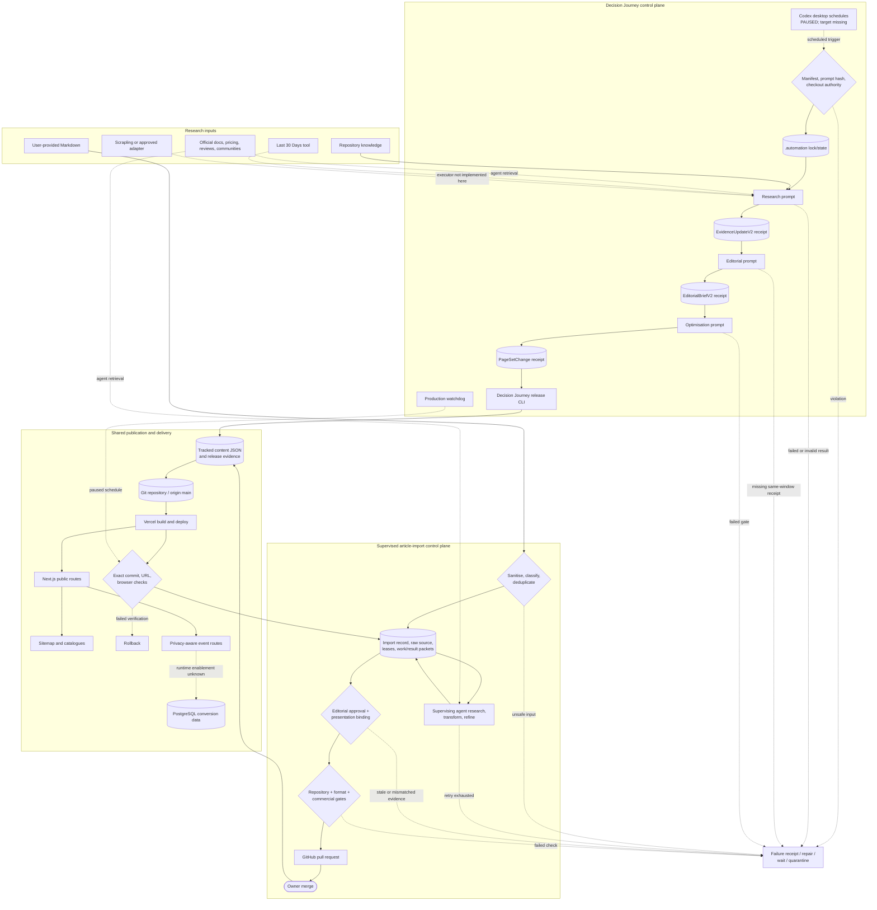

# VettedSaaS Blueprint architecture audit

**Audit date:** 2026-10-26 (Africa/Johannesburg)

**Audited revision:** `e8ee1c7aa61db43dc917c67dc23204415973a502` (`origin/main`)

**Mode:** Read-only architecture and operational-evidence audit

**Scope:** Topic discovery through an accessible production article

## Status and evidence rules

| Label | Meaning in this report |
|---|---|
| **ACTIVE** | Direct evidence shows the component is operating in the current production workflow. |
| **IMPLEMENTED** | Code, tests, or configuration exists, but current operation was not proved. |
| **PLANNED** | The planning authority describes the component, but executable implementation is absent or blocked. |
| **LEGACY** | Evidence shows the component has been superseded, disconnected, or retained only for historical compatibility. |
| **UNKNOWN** | Available evidence cannot establish the component's existence or current operation. |

Repository code proves capability, not operation. Current host automation configuration and live HTTP responses are treated as stronger operational evidence. Assertions derived from those sources are labelled explicitly. No secrets, secret values, paid calls, writes to production, schedule changes, deployments, or application-code changes were made.

## 1. Executive summary

VettedSaaS Blueprint is an npm-managed Next.js 16 application deployed on Vercel. Public content is compiled from version-controlled JSON and TypeScript catalogues. The audited production site responds successfully, and its `/api/deployment` endpoint reports the audited `origin/main` commit. That makes the website and its current content-delivery path **ACTIVE**.

Two distinct production-capable content paths exist:

1. A four-window Decision Journey automation contract: research at 02:00, editorial planning at 06:00, optimisation at 20:00, and production watchdog at 23:00 SAST. It has typed receipts, local locking, retry limits, a release CLI, and production verification. The repository describes this as active, but the current Codex host has all four schedules paused and each points to a missing `buyer-journeys` worktree. The repository manifest instead points to the existing `phase-two` worktree. The scheduled workflow is therefore **IMPLEMENTED, not currently ACTIVE**.
2. A supervised external-article import path. It accepts a user-provided Markdown file, sanitises it, delegates research/transformation/refinement to a supervising agent through work/result packets, validates approval and presentation evidence, creates a PR, waits for owner merge, deploys the exact merged commit, verifies production, and can roll back. A Switcher Studio direct-review page proves this route has produced a live article. The capability is **IMPLEMENTED** and one historical execution is verified; no evidence establishes that it runs continuously.

The repository also contains a broader multi-module workflow engine, model router, provider gateway, rescue controller, and in-memory metrics collector. No active composition root connects that stack to the current scheduler or article importer. It is best classified as **IMPLEMENTED/SCAFFOLD**, not part of the proven production path.

The principal architectural issue is not a lack of controls. It is parallel control planes with overlapping responsibilities and conflicting operational truth. Planning says scheduled Phase Two operation is active; current host state says paused; tracked manifest and host configuration disagree on the checkout; the article-import quality document requires independent review while the release implementation says that gate was removed; the current repository operating contract requires it again. These conflicts create a high risk of false confidence.

This audit identifies **17 verified processing stages** across the two proven content paths. Most stages have deterministic gates. Research execution, AI cost/token accounting, current schedule health, post-publication performance feedback, and external systems such as Google Opal, Gemini, Search Console, or Braintrust remain unproved or absent.

## 2. Current technology stack

| Component | Purpose | Status | Evidence | Complexity | Potential action |
|---|---|---:|---|---:|---|
| Next.js 16.3.4 / React 19.2.7 / TypeScript 6.0.3 | Public site and server routes | **ACTIVE** | `package.json:71-102`; live `/`, `/blog`, `/decision-hub`, and article checks returned HTTP 200 on 2026-10-26 | Medium | KEEP |
| npm 12 / Node 24 | Package and runtime contract | **IMPLEMENTED** | `package.json:104-108` | Low | KEEP |
| Tailwind CSS 4, GSAP, Motion | Styling and motion | **IMPLEMENTED** | `package.json:81-82,90,100` | Medium | KEEP |
| Zod | Runtime contracts for automation and content | **IMPLEMENTED** | `package.json:87`; `src/lib/automation/workflows.ts:11-18` | Low | KEEP |
| PostgreSQL (`pg`) | Persistent admin/conversion data | **IMPLEMENTED** | `package.json:84`; `src/lib/db/client.ts:5-13`; `src/lib/tracking/events.ts:35-42` | Medium | INVESTIGATE |
| Neon control database | Landing research/control procedures | **IMPLEMENTED** | `src/lib/landing-research/neon.ts`; `scripts/validate-landing-research-preflight.ts` | High | INVESTIGATE |
| Vercel | Build and production hosting | **ACTIVE** | `vercel.json:2-16`; live `/api/deployment` reported the audited commit | Low | KEEP |
| Playwright | Browser and visual verification | **IMPLEMENTED** | `package.json:90`; `scripts/verify-decision-journey-production.ts`; `scripts/verify-landing-deployment.ts` | Medium | KEEP |
| Codex desktop cron | Four scheduled automation windows | **IMPLEMENTED / PAUSED** | `automation/codex/manifest.json:1-39`; current host TOML files under `C:/Users/micha/.codex/automations/` all say `status = "PAUSED"` | High | INVESTIGATE |
| GitHub CLI / PRs | Review and owner-merge release gate | **IMPLEMENTED** | `src/lib/article-import/release.ts:386-538`; article-import adapter PR methods | Medium | KEEP |
| Repository JSON | Published blog, landing, visibility, and Decision Journey content | **ACTIVE** | `src/generated/blog-posts/posts.json`; `src/generated/landing-pages/index.json`; `src/content/decision-journeys/sets/`; `src/app/sitemap.ts:70-79` | Medium | KEEP |
| Local `.automation` state | Locks, run state, receipts, import work packets | **IMPLEMENTED** | `src/lib/automation/local-store.ts:23-31`; `src/lib/article-import/engine.ts:169-245` | High | CONSOLIDATE |
| OpenAI / Anthropic provider adapters | Optional direct model calls | **IMPLEMENTED, UNCONFIRMED** | `src/lib/automation/providers.ts`; `src/lib/automation/model-gateway.ts` | High | INVESTIGATE |
| Google Opal / Gemini / Braintrust | Requested external possibilities | **UNKNOWN / NOT IMPLEMENTED** | No executable repository integration found; no inspectable external configuration supplied | Unknown | INVESTIGATE |

Environment variable names referenced by code include `DATABASE_URL`, `LANDING_CONTROL_DATABASE_URL`, `LANDING_AUTOMATION_DATABASE_URL`, `NEXT_PUBLIC_TRACKING_BASE_URL`, `VERCEL_ENV`, `VERCEL_TOKEN`, `VERCEL_PROJECT_ID`, `VERCEL_PREVIOUS_DEPLOYMENT_ID`, `HERMES_API_TOKEN`, `AUTOMATION_KILL_SWITCH`, `AUTOMATION_PRODUCT_IDENTITY_COMMAND`, `AUTOMATION_RESEARCH_COMMAND`, `OPENAI_API_KEY`, `ANTHROPIC_API_KEY`, `SESSION_SECRET`, `NEXTAUTH_SECRET`, `APP_USER`, `APP_PASSWORD_HASH`, `PYTHON`, and `CI`. Presence in source does not prove that a value is configured.

## 3. Repository architecture

The main architectural boundaries are:

- `src/app/`: Next.js App Router pages and API routes. Public route catalogues are rendered here. `src/app/sitemap.ts:18-64` combines static routes and published review, visibility, and blog entries; `src/app/sitemap.ts:70-79` adds Decision Journey pages.
- `src/generated/`: version-controlled publication artefacts. Landing pages include an index, blueprint, release receipt, evidence, compliance, conversion, uniqueness, visual, and quality files.
- `src/content/decision-journeys/`: published three-page Decision Journey sets.
- `src/lib/automation/`: schedule authority, typed contracts, local state, release policy, an older/broader workflow engine, provider gateway, rescue logic, and audit scaffolding.
- `src/lib/article-import/`: the supervised Markdown import state machine, approval binding, presentation checks, release orchestration, and local external-tool adapter.
- `src/lib/generated/`, `src/lib/blog/`, `src/lib/visibility-pages/`, and `src/lib/decision-journey/`: validated loaders and public catalogues.
- `scripts/`: command-line entry points, deterministic gates, release scripts, browser verification, and source/document-intelligence checks.
- `automation/codex/`: tracked prompt files and the four-window schedule manifest.
- `build-pack/`: planning-derived execution state, requirements, receipts, and article-import evidence.
- `.automation/` and `.stage2/`: ignored runtime state. State is checkout-local, so each worktree can hold a different operational history.

There is no tracked `.github/workflows` release workflow at the audited revision. Deployment is driven by direct Vercel CLI calls in release tooling or by Vercel's repository integration, whose external configuration is not inspectable here. The tracked Vercel build command runs the public-site validator before `next build` (`vercel.json:3-6`).

## 4. End-to-end production workflow

### Verified stage inventory

The following 17 stages have direct implementation or operational evidence. A stage may be verified as implemented without being currently scheduled.

| # | Stage | Path | Mode | Status | Evidence |
|---:|---|---|---|---|---|
| 1 | Load authority and verify prompt hashes | Decision Journey | Deterministic | **IMPLEMENTED** | `src/lib/automation/authority.ts:42-63` |
| 2 | Acquire idempotent run lock | Decision Journey | Deterministic | **IMPLEMENTED** | `src/lib/automation/local-store.ts:12,23-31,70-108` |
| 3 | Discover topics and assemble evidence | Decision Journey | Agent/manual tool use | **IMPLEMENTED, PAUSED** | `automation/codex/daily-research.md:3-9` |
| 4 | Validate `EvidenceUpdateV2` and persist receipt | Decision Journey | Deterministic | **IMPLEMENTED** | `src/lib/automation/workflows.ts:11-18`; `scripts/run-automation.ts:19-49` |
| 5 | Produce exactly 12/7/12 editorial blueprints | Decision Journey | Agent | **IMPLEMENTED, PAUSED** | `automation/codex/editorial-brief.md:3-9` |
| 6 | Enforce same-window prerequisite | Decision Journey | Deterministic | **IMPLEMENTED** | `src/lib/automation/workflows.ts:27-39` |
| 7 | Optimise eligible Decision Journey content | Decision Journey | Agent | **IMPLEMENTED, PAUSED** | `automation/codex/optimisation.md:3-7` |
| 8 | Commit, run gates, and deploy eligible changes | Decision Journey | CLI + manual invocation | **IMPLEMENTED** | `scripts/release-decision-journey.ts:29-79`; `src/lib/automation/release-policy.ts` |
| 9 | Verify production routes and browser behaviour | Decision Journey | Browser + deterministic assertions | **IMPLEMENTED, PAUSED** | `automation/codex/production-watchdog.md:3-7`; `scripts/verify-decision-journey-production.ts` |
| 10 | Ingest and sanitise user Markdown | Article import | Deterministic | **IMPLEMENTED** | `src/lib/article-import/engine.ts:50-137,303-334` |
| 11 | Research and transform via supervised work packets | Article import | Agent + schema validation | **IMPLEMENTED** | `src/lib/article-import/supervised-executor.ts:12-23,33-97` |
| 12 | Refine and bind editorial approval | Article import | Agent + cryptographic binding | **IMPLEMENTED** | `src/lib/article-import/content-approval.ts:37-66` |
| 13 | Validate presentation and release binding | Article import | Deterministic + human evidence | **IMPLEMENTED** | `src/lib/article-import/presentation.ts:9-54` |
| 14 | Run format-specific and repository gates | Article import | Deterministic | **IMPLEMENTED** | `src/lib/article-import/release.ts:80-135,386-438` |
| 15 | Create PR and wait for owner merge | Article import | GitHub + human | **IMPLEMENTED; historical run verified** | `src/lib/article-import/release.ts:439-482`; merged Switcher article commits and PR #30 in Git history |
| 16 | Deploy exact merge commit and verify production | Both | Vercel + HTTP/browser | **ACTIVE delivery capability** | `src/lib/article-import/release.ts:483-538`; live `/api/deployment`; `vercel.json:3-6` |
| 17 | Expose article through route catalogue and sitemap | Both | Next.js build/runtime | **ACTIVE** | `src/generated/landing-pages/index.json`; `src/app/sitemap.ts:46-64,70-79`; live article and `/sitemap.xml` returned 200 |

### Stage A — topic discovery

The Decision Journey research prompt is the only tracked scheduled topic-discovery authority. It tells the agent to inspect existing repository knowledge, use Last 30 Days and Scrapling or an approved adapter, preserve provenance, and emit `EvidenceUpdateV2` (`automation/codex/daily-research.md:3-9`). Duplicate prevention is achieved later through content catalogues, stable slugs/fingerprints, same-window receipts, and the importer's source fingerprint reuse (`src/lib/article-import/engine.ts:303-334`).

What is not proved:

- No executable Last 30 Days adapter was found in the repository.
- `src/lib/research/scrapling.ts:1-28` defines and validates crawl plans but performs no crawl.
- No repository-owned keyword-volume provider, competitor-ranking API, search-intent classifier, or topic-scoring implementation was found.
- No current successful scheduled research run was proved. Historical `.automation` receipts exist in the `phase-two` worktree, but the current schedules are paused.

Therefore topic discovery is **IMPLEMENTED as a prompt-led agent responsibility**, while automated source acquisition and prioritisation are **UNKNOWN**.

### Stage B — research and evidence

The prompt requires existing knowledge, recent web/community material, provenance, freshness, and bounded inference. Evidence packet schemas enforce structure, and editorial work must consume a same-window research receipt (`src/lib/automation/workflows.ts:27-34`). Landing-page evidence artefacts record official product evidence separately from editorial and commercial review.

Independent verification is partial. Schema, provenance fields, allowlists, hashes, and browser checks are deterministic. Whether a source actually supports a factual claim remains an agent/editorial judgment unless a product-specific evidence record or later review establishes it. Reddit, reviews, pricing pages, official documentation, competitor pages, and affiliate programme terms may be used by the agent, but the repository does not prove which were queried in a current run.

### Stage C — editorial planning

Editorial planning is prompt-driven and receipt-gated. The scheduled brief requires a current research receipt and creates 12 decision-hub, 7 solution-hub, and 12 scenario blueprints with references, composition, and motion decisions (`automation/codex/editorial-brief.md:3-9`). Article-import formats are `direct-review`, `blog`, `visibility`, and `decision-set` (`src/lib/article-import/contracts.ts:11-12`). SEO/AEO, links, disclosures, uniqueness, evidence status, and visual direction are represented in format schemas and quality artefacts.

This planning is automatic only when a human or schedule launches an agent that follows the prompt. The repository CLI does not itself call an LLM for the four-window workflow.

### Stage D — content generation

The current content-generation mechanics are supervisory:

- The four-window CLI starts a run and validates an externally authored JSON result; it does not generate that result (`scripts/run-automation.ts:19-49`).
- The article importer writes a work packet and expects the supervising Codex session to write a schema-valid result (`src/lib/article-import/supervised-executor.ts:33-67`).
- Import stages are `INGESTING`, `RESEARCHING`, `TRANSFORMING`, `REFINING`, `VALIDATING`, `RELEASING`, `VERIFYING`, `REPAIRING`, `WAITING_EXTERNAL`, `ROLLED_BACK`, `LIVE`, and `QUARANTINED` (`src/lib/article-import/contracts.ts:4-8`).
- Atomic files, lease claims, stage receipts, fingerprints, and strategy attempts make work resumable (`src/lib/article-import/engine.ts:169-289`).

The broader provider gateway can call OpenAI, Anthropic, or a generic adapter and contains model-routing policy. It is not referenced by the active CLIs, so provider/model selection for current article authoring is an external Codex host concern. Current host automation files name `gpt-5.6-terra`, but all four schedules are paused. The exact model used for the historical Switcher article cannot be proved from tracked release artefacts.

Retry behaviour is bounded. The schedule store limits a run to three attempts and uses a three-hour lock (`src/lib/automation/local-store.ts:12,70-108`). The importer tracks attempts per strategy and changes state to repair, wait, rollback, live, or quarantine. A weakness is that the importer catches executor errors as transient in its generic retry wrapper, so deterministic schema failures can consume transient retries before being classified (`src/lib/article-import/engine.ts:253-289`). No complete token-budget or cost-budget enforcement was found in the proven path.

### Stage E — quality assurance

Deterministic controls include:

- Zod validation of research, editorial, optimisation, watchdog, deployment, and import-stage outputs.
- Prompt and manifest SHA-256 checks and checkout-drift rejection (`src/lib/automation/authority.ts:47-86`).
- Same-window prerequisite receipts (`src/lib/automation/workflows.ts:21-43`).
- Source sanitisation and prompt-injection classification (`src/lib/article-import/engine.ts:50-137`).
- Cryptographic binding of source, artefact, editorial approval, presentation evidence, route, and release (`src/lib/article-import/content-approval.ts:37-66`; `src/lib/article-import/presentation.ts:9-54`).
- Exact-path release allowlists, commercial-mode and affiliate-destination checks (`src/lib/article-import/release.ts:105-193`).
- Lint, typecheck, test, build, public-site, and format-specific gates (`src/lib/article-import/release.ts:80-92`).
- Static scanners for structure, hero, CTA, SEO, accessibility, links, forms, compliance, uniqueness, conversion copy, responsiveness, assets, and publish readiness (`package.json:15-47`).
- Browser checks for status, canonical URL, structure, responsive overflow, console/page errors, reduced motion, no-JavaScript behaviour, screenshots, and accessibility-oriented assertions.

Judgment-based controls include research credibility, factual support, editorial quality, differentiation, conversion copy, visual critique, and owner merge approval. These are supported by artefacts but cannot be reduced to a clean scanner result.

Failed scheduled runs retain failure receipts and escalate after the third attempt (`src/lib/automation/local-store.ts:142-165`). Import failures can retry, enter repair, wait on an external dependency, roll back, or quarantine (`src/lib/article-import/engine.ts:439-473`). Release does not continue past failed gates.

One governance conflict is material: the article-import release source says the independent Codex review gate was owner-removed on 2026-10-22 (`src/lib/article-import/release.ts:470-473`), while `build-pack/article-import/QUALITY_AUDIT.md` and the current repository `AGENTS.md` require an independent current-head review. The release code therefore does not enforce the current operating contract.

### Stage F — content delivery

The Decision Journey release script assesses the candidate, runs repository gates, commits the eligible content path, and invokes a direct Vercel production deployment (`scripts/release-decision-journey.ts:29-79`). It does not create/push a PR or persist its printed deployment receipt. That path predates the repository's current PR-and-review operating contract.

The article importer has the stronger delivery sequence: exact declared diff, origin refresh, prior deployment capture, commit, PR, owner merge, gates on the merge commit, authority/content binding, Vercel deploy of the exact SHA, production checks, rollback on failure, and `LIVE` state (`src/lib/article-import/release.ts:386-538`). Manual interventions are source submission, supervising-agent execution, editorial/presentation approval evidence, PR owner merge, and any external-wait resolution.

Published files are compiled into Next.js routes. The sitemap adds catalogue entries automatically (`src/app/sitemap.ts:46-64,70-79`). There is no separate sitemap submission or search-engine indexing job in the repository.

### Stage G — post-publication

The watchdog prompt and browser scripts verify public URLs, page sections, evidence, motion, mobile layout, reduced-motion behaviour, no-JavaScript behaviour, console errors, canonicals, and overflow. The import release path also verifies the final production URL and exact deployed commit, and rolls back when verification fails.

Client event endpoints support `page_view`, `cta_click`, `faq_expand`, `link_error`, and `affiliate_click`; tracking respects privacy signals and can forward to `/ingest/events` (`src/lib/tracking/public-event-handler.ts:5-26`; `src/lib/tracking/public-tracking-endpoints.ts:1-37`). A separate persistence path inserts conversion events into PostgreSQL (`src/lib/tracking/events.ts:12-42`). Runtime enablement and the external base URL were not verified, so analytics and affiliate conversion tracking are **IMPLEMENTED, not confirmed ACTIVE**.

No active Search Console integration, indexing submission, automated content-refresh scheduler, or broken-link monitor beyond release/watchdog checks was found. Error recovery exists at release time; continuous production monitoring is unproved because the watchdog schedule is paused.

## 5. Complete architecture diagram

Legend: solid arrows are verified code/data integrations; dashed arrows are prompt-led, external, paused, or otherwise unverified at runtime. `[(...)]` denotes persisted state. Red nodes are known failure points; diamonds are gates; human-shaped nodes require intervention.

## 6. AI models, prompts, and responsibilities

| Item | Responsibility | Status | Evidence |
|---|---|---:|---|
| Daily research prompt | Discover/update evidence with provenance and bounded inference | **IMPLEMENTED, PAUSED** | `automation/codex/daily-research.md:3-9` |
| Editorial brief prompt | Convert same-window evidence into 31 typed page blueprints | **IMPLEMENTED, PAUSED** | `automation/codex/editorial-brief.md:3-9` |
| Optimisation prompt | Apply eligible changes to Decision Journey content only | **IMPLEMENTED, PAUSED** | `automation/codex/optimisation.md:3-7` |
| Production watchdog prompt | Verify public production surfaces and record evidence | **IMPLEMENTED, PAUSED** | `automation/codex/production-watchdog.md:3-7` |
| Import supervising agent | Write schema-valid stage results from work packets | **IMPLEMENTED** | `src/lib/article-import/supervised-executor.ts:33-97` |
| Model gateway/provider adapters | Direct provider routing, fallbacks, economics | **IMPLEMENTED, UNCONFIRMED** | `src/lib/automation/model-gateway.ts`; `src/lib/automation/providers.ts` |
| Current Codex host model | Host-level execution setting | **UNKNOWN operationally** | Host TOML names `gpt-5.6-terra`, but tasks are paused; repository does not bind content receipts to a model identity |

The separations are mostly prompt stages, not autonomous agents with independent long-lived services. The supervising host performs tool use and authors outputs; repository code validates and persists them. Multiple stages may be useful for provenance and separation of duties, but the current evidence does not show that multiple provider-level agents are necessary.

## 7. Research and evidence pipeline

Research authority is strongest where an output is bound to a typed evidence artefact and later content. The system preserves source provenance, evidence freshness fields, outcomes such as changed/partial/conflicting, and product/release receipts. Commercial activation is fail-closed when required rights or exact affiliate destinations are not bound.

The weak point is acquisition. The repository specifies which research tools an agent should use but does not implement or log a complete acquisition adapter. Consequently, source completeness, query coverage, keyword analysis, competitor sampling, and freshness cannot be independently reconstructed for a current run. Historical output receipts prove that structured packets have existed, not that the current discovery process is operating or exhaustive.

## 8. Editorial and article generation pipeline

The Decision Journey pipeline produces three connected page classes from a same-window editorial brief. The importer instead maps an external Markdown source into one of four repository formats. Both use typed content contracts and tracked artefacts rather than publishing raw model prose directly.

Intermediate artefacts are numerous but serve distinct controls: evidence, blueprint, editorial approval, visual review, compliance review, conversion review, uniqueness review, quality evidence, release receipt, PR, and production verification. Consolidation should preserve their separate attestations even if their storage envelope is simplified.

Frontmatter is not the universal publication unit. Blog-like inputs may begin as Markdown, but public content is normalised into repository-specific JSON/catalogue structures. That is why Markdown correctness alone does not prove publication readiness.

## 9. Quality assurance mechanisms

| Control | Type | Failure outcome | Status |
|---|---|---|---:|
| Schema validation | Deterministic | Reject stage output | **IMPLEMENTED** |
| Prompt/manifest fingerprint | Deterministic | Authority violation | **IMPLEMENTED** |
| Same-window prerequisites | Deterministic | Stop dependent stage | **IMPLEMENTED** |
| Source sanitisation/injection screening | Deterministic + policy | Reject/quarantine unsafe input | **IMPLEMENTED** |
| Evidence/editorial/presentation hashes | Deterministic | Reject stale or altered evidence | **IMPLEMENTED** |
| Path and affiliate binding | Deterministic | Reject release | **IMPLEMENTED** |
| Lint/typecheck/tests/build/site validation | Deterministic | Reject release | **IMPLEMENTED** |
| SEO/AEO/link/accessibility/static scanners | Deterministic heuristics | Reject candidate or produce findings | **IMPLEMENTED** |
| Browser/mobile/reduced-motion checks | Deterministic observations | Reject/rollback | **IMPLEMENTED** |
| Factual support and editorial quality | Agent/human judgment | Revise, reject, or withhold approval | **IMPLEMENTED, execution not always proved** |
| Independent current-head Codex review | Independent judgment | Contract says block shipment | **CONFLICTED**: required by `AGENTS.md`, removed in importer source |
| Owner PR merge | Human | Wait externally | **IMPLEMENTED** |

## 10. Publishing and deployment pipeline

The public build is fail-closed on `validate:public-site` and Next.js compilation (`vercel.json:3-6`). Routes load validated version-controlled catalogues, and sitemap generation includes published entries. The production deployment metadata endpoint enables exact-commit verification (`src/app/api/deployment/route.ts:4-10`).

Live read-only checks on 2026-10-26 established:

- `/`, `/blog`, `/decision-hub`, `/sitemap.xml`, and `/landing-page-builders/how-can-content-creators-and-brands-stream-live-multi-camera-video` returned HTTP 200.
- `/api/deployment` returned commit `e8ee1c7aa61db43dc917c67dc23204415973a502` and environment `production`.
- The Switcher page is in the tracked landing-page index and has release evidence under `src/generated/landing-pages/releases/how-can-content-creators-and-brands-stream-live-multi-camera-video/`.

These checks prove current delivery, not how often new content is produced.

## 11. External automation dependencies

| Mechanism | Trigger | Inputs / processing | Outputs / state / retry | Human intervention | Operational evidence |
|---|---|---|---|---|---|
| Codex desktop cron | 02:00/06:00/20:00/23:00 SAST | Tracked prompt, repository, preceding receipt | Checkout-local `.automation`; locks; max three attempts; failure receipt | Resolve escalation after retry limit | **Not active:** all four host tasks paused and target missing checkout |
| Manual automation canary | Operator command in separate window | Same manifest/prompt with canary window | Same local store and receipts | Launch and inspect | **IMPLEMENTED; historical receipts** |
| Article import CLI | User supplies Markdown or resume command | Sanitation, supervised stages, approval, release | Import record, leases, work/results, PR, deployment receipt; retry/repair/quarantine | Source submission, stage supervision, approval, owner merge | **IMPLEMENTED; one live article verified** |
| GitHub | Import release creates PR; owner merge | Exact candidate diff | PR state and merge commit | Mandatory owner merge | **IMPLEMENTED; historical PR #30 evidence** |
| Vercel | Release CLI or external repository integration | Exact commit and Vercel project configuration | Deployment plus `/api/deployment`; rollback support | Token/project configuration and incident response | **ACTIVE hosting; trigger configuration partly external** |
| PostgreSQL/Neon | API or landing workflow calls | Events, admin data, control procedures | Database state | Credentials/migrations | **IMPLEMENTED, runtime activity unverified** |
| Google Opal / Gemini | No inspectable trigger | Unknown | Unknown | Unknown | **UNKNOWN** |
| Search Console | No integration found | Unknown | Unknown | Unknown | **UNKNOWN / absent from repository** |
| Email delivery/webhooks | No production content-workflow integration proved | Unknown | Unknown | Unknown | **UNKNOWN** |

Exact external evidence required to promote an unknown to active: exported workflow definition, owner/account, trigger and schedule, target repository/checkout, input/output schema, credential names, state store, retry policy, last successful execution ID and timestamp, failure log, and a downstream receipt bound to a published commit.

## 12. State management and recovery mechanisms

Scheduled automation state is keyed and hashed under `.automation`, with separate state, lock, and receipt directories (`src/lib/automation/local-store.ts:23-31`). A three-hour TTL prevents abandoned locks from blocking forever. Idempotency combines job type and scheduled window, and three failed attempts cause escalation rather than silent continuation.

Article imports use atomic file replacement, lease claims, source fingerprints, per-stage work and result packets, strategy attempts, and state transitions. Release captures the previous deployment, verifies the exact new commit, and can roll back. `WAITING_EXTERNAL` correctly models PR merge or another dependency without pretending a stage failed.

The principal state risk is location: ignored state is checkout-local. The host manifest, repository manifest, `phase-two` worktree, stale article-import worktree, and current audit checkout can each expose different records. There is no single current-run registry. Historical `phase-two/.automation` receipts stop at 2026-09-30, while the active host configuration now points to nonexistent `buyer-journeys`. This makes operational status hard to establish and recovery dependent on knowing the correct checkout.

## 13. Complexity and bottleneck analysis

### Finding 1 — parallel control planes

**CURRENT BEHAVIOR:** Decision Journey schedules, article import, landing research, and a broader workflow engine each define stages, state, retries, models, and validation in different forms.

**EVIDENCE:** `src/lib/automation/local-store.ts`; `src/lib/article-import/engine.ts`; `src/lib/landing-research/`; `src/lib/automation/workflow-engine.ts`.

**PROBLEM:** Operators must know which orchestration path and state root governs a content type. Shared concerns can drift.

**POTENTIAL SIMPLIFICATION:** Use one small execution envelope for run identity, stage receipt, lease, retry classification, external wait, and terminal status while retaining format-specific validators.

**RISK:** Premature unification could erase distinct commercial, editorial, or release controls.

**CONFIDENCE:** High.

### Finding 2 — scheduled authority does not match host reality

**CURRENT BEHAVIOR:** Planning and the tracked manifest describe active schedules in `phase-two`; all current host tasks are paused and point to missing `buyer-journeys`.

**EVIDENCE:** `planning.md:312-413`; `automation/codex/manifest.json:3-5`; current host `C:/Users/micha/.codex/automations/*/automation.toml`.

**PROBLEM:** Code can pass manifest checks while no scheduled work runs; resumption would fail checkout authority.

**POTENTIAL SIMPLIFICATION:** Establish one inspectable schedule registry and reconcile status/checkout as a proof step before calling the workflow active.

**RISK:** Changing the wrong authority could reactivate jobs unintentionally; investigation must be read-only until the owner decides.

**CONFIDENCE:** High.

### Finding 3 — research acquisition is specified, not integrated

**CURRENT BEHAVIOR:** Prompts tell an agent to use Last 30 Days and Scrapling or an adapter. The Scrapling module only creates and validates plans.

**EVIDENCE:** `automation/codex/daily-research.md:3-9`; `src/lib/research/scrapling.ts:1-28`.

**PROBLEM:** Coverage, freshness, request policy, and failures are not reproducible from repository evidence.

**POTENTIAL SIMPLIFICATION:** Define one research-adapter receipt containing query, source URL, retrieval time, method, status, and content hash; keep tool choice external.

**RISK:** A narrow adapter contract may omit tool-specific evidence needed later.

**CONFIDENCE:** High.

### Finding 4 — multiple implementations of model orchestration

**CURRENT BEHAVIOR:** Proven workflows rely on a supervising Codex session, while an internal provider gateway and multi-module engine also exist.

**EVIDENCE:** `src/lib/article-import/supervised-executor.ts:33-67`; `src/lib/automation/model-gateway.ts`; `src/lib/automation/workflow-engine.ts`.

**PROBLEM:** The unused stack increases maintenance and implies capabilities not demonstrated in production.

**POTENTIAL SIMPLIFICATION:** Mark the provider/engine stack explicitly experimental or connect it through one tested composition root after a deliberate decision.

**RISK:** Removing it before checking planned packets could discard future Phase Three work.

**CONFIDENCE:** Medium.

### Finding 5 — release governance drift

**CURRENT BEHAVIOR:** Import release waits for owner merge but no longer enforces independent Codex review; current operating instructions require that review. The older Decision Journey release bypasses PR creation entirely.

**EVIDENCE:** `src/lib/article-import/release.ts:439-482`; `scripts/release-decision-journey.ts:56-79`; `AGENTS.md` mandatory workflow.

**PROBLEM:** Different release paths satisfy different governance contracts.

**POTENTIAL SIMPLIFICATION:** Express one release policy used by both paths, with explicit required attestations.

**RISK:** Over-consolidation could force inappropriate gates on manual canaries or non-public artefacts.

**CONFIDENCE:** High.

### Finding 6 — many artefacts, weak run-level observability

**CURRENT BEHAVIOR:** Rich per-page evidence and receipts exist, but there is no cross-worktree run index or current dashboard.

**EVIDENCE:** checkout-local `.automation`; release directories under `src/generated/landing-pages/releases/`; metrics collector in `src/lib/automation/audit/index.ts:97-220`.

**PROBLEM:** It is easy to verify one artefact and hard to answer whether the whole system is running, how long it takes, or how often it fails.

**POTENTIAL SIMPLIFICATION:** Add a single append-only run ledger referencing existing artefacts instead of duplicating their contents.

**RISK:** A central ledger becomes another authority unless entries are cryptographically bound to source receipts.

**CONFIDENCE:** High.

### Finding 7 — metrics implementation overstates measurement

**CURRENT BEHAVIOR:** The metrics collector declares delivery, automation, economics, quality, and production measures, but it is in-memory and not wired to proven CLIs. Some fields are never updated; `tokenTrends` counts model calls, not tokens (`src/lib/automation/audit/index.ts:146-206`).

**EVIDENCE:** `src/lib/automation/audit/index.ts:5-64,97-220`; usage search finds no production composition root.

**PROBLEM:** Metric names suggest evidence that the system does not persist or calculate accurately.

**POTENTIAL SIMPLIFICATION:** Record raw immutable events first and derive aggregates separately.

**RISK:** Removing current interfaces may break planned workflow-engine work.

**CONFIDENCE:** High.

### Finding 8 — generic retry classification

**CURRENT BEHAVIOR:** Import executor exceptions are caught as transient within the retry strategy.

**EVIDENCE:** `src/lib/article-import/engine.ts:253-289`.

**PROBLEM:** Invalid deterministic output may be retried like a temporary network failure, adding latency and obscuring root cause.

**POTENTIAL SIMPLIFICATION:** Classify schema/policy errors as deterministic and network/provider errors as transient before incrementing strategy counters.

**RISK:** Incorrect classification could quarantine a recoverable provider failure.

**CONFIDENCE:** Medium.

## 14. Interview → Toolbox → Proof assessment

| Role | Existing components that fit | Consolidation candidate | Controls that must remain independent |
|---|---|---|---|
| **INTERVIEW** | Planning authority, source-intelligence IDs, page-format contracts, editorial brief, user Markdown input, owner approval | One bounded intake record covering objective, audience, format, research questions, commercial mode, and acceptance criteria | Product-owner adjudication, commercial-rights authority, unresolved source conflicts |
| **TOOLBOX** | Supervising agent, research prompts, repository loaders, format transformers, static scanners, GitHub and Vercel adapters | One execution envelope and one explicit research-adapter contract; select only tools required by the intake | Source acquisition provenance, format-specific transformations, privacy/commercial boundaries |
| **PROOF** | Hash bindings, Zod contracts, tests, browser checks, PR/owner merge, exact-commit deployment check, rollback | One proof manifest that references existing evidence and states pass/fail/unknown | Independent factual/editorial judgment, deterministic gates, accessibility/browser evidence, owner merge, exact production verification |

The current system already contains most Proof controls. The best future simplification target is coordination and evidence indexing, not removal of validation. External services that remain necessary in the proven path are source-access tools chosen by the research agent, Git/GitHub for controlled change, Vercel for hosting, and a browser for production proof. A database is necessary only for features that require persistent administration or event tracking; it is not required to render the current version-controlled articles.

## 15. Existing performance metrics

| Metric | Classification | Evidence and limitation | Instrumentation needed for future Braintrust evaluation |
|---|---|---|---|
| Research duration | **DERIVABLE** | Start/completion timestamps may exist in retained receipts, but state is split across worktrees | Standard run/stage IDs and start/end events |
| Article generation duration | **DERIVABLE** | Import stage records can contain timestamps when the full record survives | Persist per-stage start/end and model call IDs |
| Total production duration | **DERIVABLE** | Import `createdAt` through production verification can be compared | One run ledger spanning PR wait and deploy |
| AI token consumption | **NOT CURRENTLY AVAILABLE** | Active supervisory paths do not persist provider usage; `tokenTrends` counts calls | Capture provider usage metadata per call without prompt secrets |
| Cost per article | **NOT CURRENTLY AVAILABLE** | No complete token/pricing/agent-time record | Model cost events plus external-tool and human-time policy |
| Research accuracy | **NOT CURRENTLY AVAILABLE** | Evidence structure exists, but no sampled truth label or correction denominator | Claim-level evidence labels, reviewer outcome, later correction linkage |
| QA pass rate | **DERIVABLE** | Gate results and receipts exist per candidate, not as a complete aggregate | Emit standard gate result events for every attempt |
| Retry frequency | **DERIVABLE** | Schedule attempts and importer strategy attempts are persisted locally | Centralise attempt events across worktrees |
| Failed article rate | **DERIVABLE, INCOMPLETE** | Terminal import states can be counted only if all records are retained and located | Durable run registry with terminal status |
| Successful deployment rate | **DERIVABLE, INCOMPLETE** | Deployment receipts and failures exist, with no authoritative denominator | One deployment-attempt event stream |
| Manual intervention frequency | **NOT CURRENTLY AVAILABLE** | Owner merge and approvals are visible individually; other interventions are not counted | Explicit human-action events and reason codes |
| Articles published per day | **DERIVABLE** | Git/catalogue publication timestamps can be counted | Normalised publication event and timezone |

No actual aggregate performance values are defensible from the available evidence. Braintrust would need stable run, trace, stage, model-call, tool-call, artefact, reviewer, deployment, and production-verification identifiers. The evaluation dataset should bind input brief, source set, generated artefact, deterministic checks, human judgments, final URL, and later corrections. The current audit does not install or configure Braintrust.

## 16. Missing evidence and unresolved questions

1. Why were the four Codex schedules paused, who owns reactivation, and when did each last complete successfully?
2. Is `phase-two` or `buyer-journeys` the intended scheduled checkout? The tracked and host authorities conflict.
3. Where are the complete current run logs and receipts for scheduled research, editorial, optimisation, and watchdog jobs?
4. Which exact research adapters execute Last 30 Days, Scrapling, official-doc, review, Reddit/community, keyword, and competitor queries? Their invocation logs are absent.
5. Which model and model settings produced each published article, and what were token usage and cost?
6. Is the provider gateway planned for activation, experimental, or superseded by supervised Codex execution?
7. Which release-review policy is authoritative: current `AGENTS.md`, the older quality audit, or the 2026-10-22 removal in release code?
8. Is Vercel's repository integration enabled, and can it deploy outside the audited release CLIs?
9. Are public analytics and PostgreSQL conversion writes enabled in production? No event or database read was performed.
10. Is there any external Google Opal, Gemini, Search Console, email, webhook, or other automation? Exported configuration and recent run evidence are required.
11. Which stale importer records are safe to archive, and which represent resumable work? One worktree record remained at `VALIDATING` while a separately identified import of the same article was already live.
12. What is the intended owner-approved baseline for accuracy, QA pass rate, throughput, and cost before any simplification experiment?

## 17. Opportunities for future simplification

These are investigation candidates, not implementation instructions.

1. **Unify operational status and run indexing.** Establish one read-only view of schedule status, selected checkout, run identity, current stage, receipts, retry count, and terminal outcome. This has the highest value because it resolves the current false-active condition without weakening content controls.
2. **Share a minimal execution envelope.** Reuse one state/lease/retry/external-wait contract across scheduled Decision Journeys and article imports while preserving their different schemas and gates.
3. **Separate research acquisition from research judgment.** Standardise a small source-retrieval receipt and let the editorial agent evaluate it. This would make Last 30 Days, Scrapling, or another adapter interchangeable and auditable.
4. **Converge release policy.** Reuse one attestation checklist for exact diff, required review, owner merge, gates, exact-commit deploy, verification, and rollback.
5. **Replace speculative aggregate metrics with raw events.** Keep the current metrics interface only if it is backed by persisted events; otherwise label it experimental.
6. **Classify or retire disconnected scaffolding.** Determine whether the multi-module engine/provider gateway belongs to a dependency-ready planning packet before maintaining two AI orchestration designs.

## 18. Recommended next investigation steps

1. **Owner interview:** resolve the schedule checkout, pause reason, and release-review authority. Record decisions without changing schedules.
2. **Toolbox inventory:** obtain exports or read-only screenshots/logs for any claimed Opal, Gemini, Search Console, Vercel repository integration, analytics, and research-adapter configuration.
3. **Proof sample:** select one historical Decision Journey run and the Switcher import, then assemble a timestamped chain from intake through sources, model/tool calls, approvals, commit, PR, deployment, URL, and corrections.
4. **Metric baseline:** derive the twelve requested metrics from that sample and mark every missing field. Do not choose Braintrust until the event contract is known.
5. **Simplification decision:** compare the two proven paths by responsibility. Consolidate only duplicated coordination mechanics; preserve independent evidence, editorial, accessibility, commercial, owner, and production gates.

## Audit conclusion

The production website is healthy at the audited commit, and the repository has strong publication and verification controls. The content factory is not a single active pipeline: it is a set of implemented paths with one verified historical article import and a currently paused scheduled Decision Journey system. The highest risks are scheduler/checkout drift, release-policy drift, unverifiable research acquisition, and fragmented local state. The three highest-value simplification opportunities are a unified operational run index, a shared minimal execution envelope, and a tool-neutral research receipt. No workflow redesign or implementation should begin until the owner resolves the schedule and review-authority conflicts.
