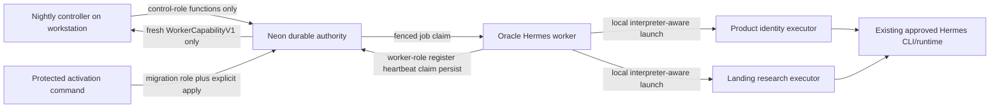
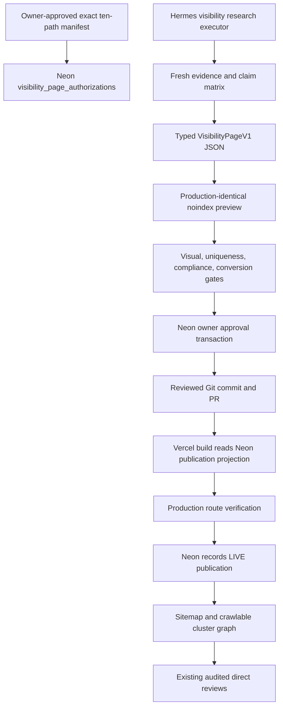

# VettedSaaSBlueprint Visibility Clusters and Hermes Research Authority — Planning and Execution Document

## Plan metadata

- protocol_version: 3.5
- model_routing_policy_version: 1.0
- plan_version: 1.1.0
- document_state: IMPLEMENTATION ACTIVE
- implementation_state: SOURCE REMEDIATION MERGED; EXTERNAL PROOF PENDING
- plan_approval_state: OWNER AUTHORIZED V1.1 IMPLEMENTATION ON 2026-08-12
- activation_state: EXTERNAL ACTION REQUIRED
- completion_gate_status: NOT STARTED
- planning_model_route: ROUTE-PREMIUM-REASONING
- planning_route_reason: Public content-contract expansion, affiliate compliance, Neon workflow authority, external worker integration, production release, and rollback require cross-system reasoning.
- default_implementation_model_route: ROUTE-STANDARD-REASONING
- current_model_route: ROUTE-PREMIUM-REASONING
- current_model_route_reason: Plan amendment resolves a cross-host Neon/Oracle authority defect, security boundary, migration dependency, and release-blocking activation sequence.
- model_escalation_count: 0
- base_commit: b5a1a64733eef1036e593cdb1cf6d0123b286f88
- current_head: 7a37525518a6eab7ba2432e9859c7eac335b5792
- current_checkout_head_observed: 7a37525518a6eab7ba2432e9859c7eac335b5792
- current_branch_observed: codex/nightly-hermes-planning-sync-20260813
- current_worktree_state: CLEAN DISPOSABLE WORKTREE FROM CURRENT REMOTE MAIN; DIRTY OPERATOR CHECKOUT PRESERVED
- current_environment_fingerprint: windows-10.0.26200|pwsh-7.6.4|node-24.18.0|isolated-worktree|landing-control-authority-absent
- last_verified_commit: 7a37525518a6eab7ba2432e9859c7eac335b5792
- best_verified_commit: 7a37525518a6eab7ba2432e9859c7eac335b5792
- total_mandatory_tasks: 27
- verified_mandatory_tasks: 0
- remaining_mandatory_tasks: 27
- total_mandatory_acceptance_criteria: 28
- verified_mandatory_acceptance_criteria: 0
- remaining_mandatory_acceptance_criteria: 28
- current_task: TASK-024
- current_acceptance_id: AC-HRA-DB-001
- loop_iteration: 1
- no_progress_count: 0
- strategy_fingerprint: plan-v1.1-neon-mediated-hermes-capability-authority
- active_impediment: IMP-001; IMP-002
- recovery_tier: 5
- recovery_iteration: 0
- resume_state: IMPLEMENTATION ACTIVE
- last_progress_at: 2026-08-13T22:39:35+02:00
- updated_at: 2026-08-13T22:39:35+02:00
- next_action: Obtain the separately scoped disposable Neon and bounded Oracle scratch authority for TASK-024, then prove V001/R001, worker capability, activation refusal controls, and one synthetic non-affiliate job. Do not mutate production, configure Oracle services, dispatch an approved URL, draft, or publish under this approval boundary.
- plan_owner: VettedSaaSBlueprint operator
- implementation_owner: One named repository-capable implementer per packet
- verification_owner: A distinct named reviewer per packet
- production_origin: https://vettedsaasblueprint.online

The owner authorized plan version 1.0.0 implementation on 2026-08-08 and amendment v1.1.0 implementation on 2026-08-12. The TASK-019 through TASK-023 source repair was delivered by PR #19 and merged to remote `main` as `7a37525518a6eab7ba2432e9859c7eac335b5792`; external proof remains at TASK-024. Activation/publication cannot pass TASK-005 or any release packet until IMP-001 and TASK-019 through TASK-027 are resolved, and global completion cannot pass until IMP-002 access plus the day-56 observation are satisfied.

For existing direct-review pages, the unchanged resumable URL-to-live command is `npm run landing:run -- --url <exact-https-affiliate-url>`. VisibilityPageV1 pages use their separate Neon authority workflow and do not alter that direct-review contract.

## Plan Amendment v1.1.0 — Hermes Research Authority Remediation

### Decision and scope

The best solution is not to place four missing values into the nightly workstation environment. The control-plane preflight currently treats Oracle-local executable paths as if they were workstation-local, the checked-in `.mjs` executor paths are invoked as binaries without a Node interpreter, the live Neon project has not applied the landing-control V001 migration, and no reviewed activation command exists for the disabled pipeline and kill switch. Configuring values alone would either continue to fail or create a false-positive preflight against the wrong machine.

Amendment v1.1.0 adds the smallest durable authority bridge:

1. Oracle keeps sole ownership of Hermes executor paths and probes them locally.
2. The Oracle worker writes a fenced, non-secret capability heartbeat to Neon through a least-privilege function.
3. The workstation control preflight reads that fresh Neon capability record instead of attempting to execute Oracle-local paths.
4. A protected repository activation command enables research only when exact migration, worker, bundle, executor-contract, and kill-switch preconditions pass in one transaction.
5. The source repair is delivered through a focused PR and merge before any external deployment or production activation.
6. A disposable Neon branch and approved Oracle runtime prove the contract before production; Oracle, systemd, networking, packages, storage, and `/michael-core/hermes` remain untouched without separate approval.
7. One exact URL from `approved-urls.md` is the production canary. The remaining exact URLs enter research only after the canary produces fresh durable product identity, research evidence, and `ResearchSourceSnapshotBundleV1` artifacts in Neon.

This amendment does not authorize credentials, database mutation, Oracle changes, service changes, URL dispatch, drafting, publication, or release. It is a remediation plan awaiting owner approval.

### Current evidence snapshot

- Remote-main and isolated planning base: `b5a1a64733eef1036e593cdb1cf6d0123b286f88` on 2026-08-12.
- Authorization source: seven exact HTTPS affiliate URLs in root `approved-urls.md`; SHA-256 `92D0E250749C10E1993DAF59D28C30D8914618C1C5428A23CCDAE9091220FDBE`.
- Local authority presence, recorded as booleans only: `LANDING_CONTROL_DATABASE_URL=false`, `LANDING_ORACLE_WORKER_DATABASE_URL=false`, `HERMES_PRODUCT_IDENTITY_COMMAND=false`, `HERMES_LANDING_RESEARCH_COMMAND=false`.
- Live Neon read-only observation on project `VettedSaaSBlueprint`, primary branch `main`, PostgreSQL 17: only migration `P001` is recorded as applied; `central_orchestrator_v1` is disabled; `global_kill_switch` is true; landing job count is zero; `ResearchSourceSnapshotBundleV1` artifact count is zero.
- Repository source contains the V001 landing-control migration, product-identity executor, landing-research executor, worker, bundle builder, focused tests, and systemd source. Source is present; production authority and deployment proof are absent.
- `scripts/build-hermes-worker.mjs` emits `.mjs` bundles, while both executor launch and preflight use the configured path as the executable. The checked-in systemd environment points those variables directly to `.mjs` files, so the source contract lacks a proven interpreter invocation.
- `landing:research:preflight` probes the two executor commands in its own process environment. In the nightly workstation job this cannot prove the Oracle worker that actually owns and runs Hermes.
- V001 creates NOLOGIN privilege roles and seeds research disabled with the kill switch on. It does not provision external login principals, deploy the Oracle bundle, or provide a reviewed activation command.
- No product page was drafted, no job was dispatched, no artifact receipt was manufactured, and no live/publication state was advanced during planning.

### Amendment source register

| ID | Source | Authority and use | Freshness/result |
|---|---|---|---|
| SRC-017 | Owner remediation request and preceding nightly report | Defines the four observed blockers and plan-only scope | Current 2026-08-12 |
| SRC-018 | `approved-urls.md` at remote main | Sole recurring exact-URL authority | Seven URLs; current hash recorded above |
| SRC-019 | `hermes/landing-research-worker.ts` and executor modules | Actual worker, probe, launch, lease, persist, and completion behavior | Current at `b5a1a647` |
| SRC-020 | `scripts/validate-landing-research-preflight.ts` and `src/lib/landing-research/executor.ts` | Demonstrates workstation-local command probing and direct path execution | Current at `b5a1a647` |
| SRC-021 | `scripts/build-hermes-worker.mjs` and `ops/systemd/vettedsaas-hermes-research-worker.service` | Demonstrates `.mjs` bundle output and configured runtime paths | Current at `b5a1a647` |
| SRC-022 | `db/neon-landing-control-v001.sql` and rollback | Defines durable roles, functions, disabled pipeline, and kill-switch defaults | Source verifier previously passes; production row absent |
| SRC-023 | Read-only Neon project/table/status inspection | Current durable control-plane truth | Observed 2026-08-12; P001 only, disabled, killed, zero jobs/artifacts |
| SRC-024 | Git history for durable Hermes authority (`ad47cbf`) and preflight (`1156f6c`) | Confirms partial source implementation and intent | Historical commits, rechecked against current main |
| SRC-025 | GitNexus 1.6.9 index and symbol context | Current caller/callee and workflow blast-radius map | 2,692 nodes, 6,100 edges, 211 flows at `b5a1a647`; full-text query degraded but symbol context succeeded |
| SRC-026 | Official Neon branching, database-role, and protected-branch documentation | Supports disposable branch rehearsal and least-privilege role strategy | Checked 2026-08-12 |
| SRC-027 | Repository planning protocol v3.5, AGENTS.md, landing workflow docs, and orchestrator skill | Defines Full-profile, single-plan, fail-closed, external-authority, and delivery gates | Current repository/operator authority |

### Bounded research assignments RSH-011 through RSH-020

| ID | Independent lens | Finding | Planning consequence |
|---|---|---|---|
| RSH-011 | Repository execution path and code graph | Controller dispatch reaches Neon reconciliation; worker alone claims and runs product identity/research | Preserve controller/worker separation and make Neon the only cross-host rendezvous |
| RSH-012 | Database migration and role boundary | Live production has P001 only; V001 source exists but is unapplied; V001 roles are NOLOGIN | Plan explicit V001 rehearsal/application plus separately provisioned login principals; never infer authority from source |
| RSH-013 | Oracle bundle/runtime invocation | `.mjs` bundles have no proven executable wrapper while source launches paths directly | Add one shared interpreter-aware invocation resolver and Linux bundle smoke test |
| RSH-014 | Automation/preflight semantics | Workstation preflight cannot prove Oracle-local commands | Replace local command checks with fresh Neon worker capability status; keep executor probes on Oracle |
| RSH-015 | CI coverage versus production | CI proves `--probe` on built bundles but not deployed path, systemd environment, role access, heartbeat, or Hermes CLI output | Add deployment-manifest, disposable runtime, and post-deploy canary gates |
| RSH-016 | Security and secrets | Control, migration, and worker duties require separate privileges; output must remain names/hashes/booleans only | Add negative privilege tests, redacted receipts, credential rotation/rollback instructions |
| RSH-017 | Reliability and fencing | Existing leases/idempotency are useful, but no durable worker availability/capability authority exists | Add expiring worker registration with lease/fencing and fail closed when stale |
| RSH-018 | Prior implementation/history | Source repair was merged previously but never activated or proven against production authority | Treat source presence as partial implementation, not completion; require Git-backed deployment evidence |
| RSH-019 | Candidate feasibility | Env-only and manual SQL approaches are faster but non-durable and cannot prove cross-host capability | Select the Neon-mediated capability bridge and protected activation command |
| RSH-020 | Adversarial falsification | A stale heartbeat, wrong bundle hash, wrong repository SHA, executable probe failure, unavailable Hermes CLI, or revoked role could otherwise appear ready | Encode each as a negative test and activation refusal condition |

Sequential independent lenses were used because no delegation authority was granted for this planning turn. Each assignment uses a distinct evidence boundary and result; no result is counted as implementation proof.

### Hypotheses, alternatives, and distinguishing tests

| Candidate | Hypothesis | Distinguishing test | Decision |
|---|---|---|---|
| A — Configure four values only | The pipeline is blocked only by absent workstation environment | Run current preflight with Oracle paths and inspect live Neon migration/pipeline state | Rejected: wrong-host probing, absent V001, disabled pipeline, and `.mjs` invocation defect remain |
| B — Manually apply SQL and edit systemd | Direct operator action is sufficient | Attempt to reproduce, audit, rollback, and rerun from current remote main | Rejected: non-repeatable, bypasses reviewed Git delivery, and requires ungranted Oracle authority |
| C — Modify or replace `/michael-core/hermes` | Hermes core must change to satisfy the contracts | Probe repository adapter contract against the existing approved CLI | Rejected unless the bounded adapter probe proves incompatibility; explicit guardrail forbids this expansion |
| D — Run Hermes executors on the workstation | Local executors can stand in for Oracle | Compare resulting capability/deployment identity with the designated worker owner | Rejected: violates dependency ownership and would produce false authority |
| E — Neon-mediated worker capability plus protected activation | Oracle can prove local capability once, Neon can durably expose freshness, and controller can fail closed | Disposable V001+R001, role-negative tests, wrong-hash/stale-heartbeat tests, real worker probe, and one exact-URL canary | Selected: smallest design that proves the correct host without weakening gates |

### Council deliberation

#### Question and context

What is the simplest safe remediation that lets nightly Hermes research resume from durable Neon state when the workstation lacks control/worker credentials and Oracle-local executor commands, without changing Hermes core or weakening publication gates?

#### Stage 1 — Independent answers

**Einstein — Constraint-first simplification.** The four missing values are symptoms, not the invariant. The invariant is that only the Oracle worker can prove its local Hermes executors, while only Neon can communicate that fact durably to the workstation. Add a worker capability lease in Neon, have the worker register only after local database and executor probes pass, and make the controller require a fresh matching lease. Fix `.mjs` execution once in a shared resolver. Everything else—activation, canary, and rollback—should be conditional on those two facts.

**Leonardo — Systems composition.** Treat this as three surfaces: controller, durable state, and worker. Give each one an observable contract and a single owner. The worker emits a minimal capability portrait—repository SHA, bundle hash, contract versions, health, expiry—through a security-definer function; Neon holds it; the controller reads it. A protected activation command composes migration identity, worker portrait, pipeline state, and kill switch into one decision. Show the composition in status output without exposing paths or secrets.

**Curie — Empirical proof.** Do not design from the error strings alone. First reproduce the `.mjs` launch failure and the wrong-host preflight behavior with focused fixtures. Then apply V001 and an additive capability migration to a disposable Neon branch, create least-privilege login principals, and run the actual built worker against the approved Hermes CLI. Inject stale heartbeat, wrong hash, revoked privilege, lease loss, and malformed executor output. Production activation is warranted only after the negative controls fail closed and a one-URL canary persists all three required artifacts.

**Lovelace — Executable contract.** Introduce `WorkerCapabilityV1` and an additive R001 migration with register, heartbeat, inspect, and deactivate functions. Centralize command resolution so absolute `.mjs` paths execute through Node and all other approved executables remain shell-free. Split preflight into `controller` and `worker` modes; controller mode never executes Hermes, worker mode never has migration authority. Add `landing:research:activate --check` and a separately authorized `--apply` transaction. Pin every state change to source migration hashes, repository SHA, and bundle manifest hash.

**Confucius — Governance and reversibility.** The repair succeeds only if operators cannot accidentally turn source readiness into production authority. Keep the global kill switch on through source merge and disposable proof. Require separate recorded approval for production Neon changes and Oracle deployment. Activate only after an independent reviewer sees redacted evidence, and canary one allowlisted URL before the remaining URLs. The first rollback action is kill-switch reactivation, not destructive schema removal; preserve durable evidence for audit.

#### Stage 2 — Blind review

Neutral labels: A=Einstein, B=Leonardo, C=Curie, D=Lovelace, E=Confucius.

**Einstein ranks the other four:**

1. D — Strongest executable boundary, but it should state heartbeat expiry and replacement-worker fencing explicitly.
2. C — Excellent falsification discipline, but it risks delaying the source repair unless the test matrix stays bounded.
3. E — Correct governance, but it leaves the controller/worker contract underspecified.
4. B — Clear composition, but a capability portrait without exact activation and fencing semantics could become decorative telemetry.

**Leonardo ranks the other four:**

1. D — It turns the architecture into concrete interfaces, though the operator-facing status projection needs equal emphasis.
2. A — It identifies the irreducible invariant, though it compresses deployment and role proof too aggressively.
3. E — It protects authority well, though it says little about repairing the current executable mismatch.
4. C — Its experiments are valuable, but they do not by themselves define the durable interface that future automation will consume.

**Curie ranks the other four:**

1. D — It is most testable, but every claimed hash binding must be verified against independently computed bytes.
2. A — It is parsimonious, but assumes a worker registration is trustworthy before specifying negative privilege tests.
3. E — It provides safe sequencing, but human review alone cannot detect a stale or impersonated worker.
4. B — It is visually coherent, but “health” is too ambiguous without adversarial failure cases.

**Lovelace ranks the other four:**

1. A — It captures the correct invariant, but needs a versioned schema and command surface to prevent drift.
2. C — It supplies the missing negative suite, but should separate source CI from externally authorized runtime validation.
3. E — It makes activation reversible, but the exact database transaction and identities remain unstated.
4. B — It names the right components, but a portrait model alone does not guarantee lease fencing or command safety.

**Confucius ranks the other four:**

1. D — It best enforces separation of duties, but `--apply` must remain outside unattended default execution.
2. A — It rejects symptom treatment correctly, but does not spell out the owner approval boundary.
3. C — It earns confidence empirically, but testing the actual Oracle runtime still requires separate authority.
4. B — It improves observability, but operators also need an explicit stop and rollback procedure.

#### Stage 3 — Debate

The council converged on four non-negotiables: executor probes occur only on the worker host; Neon holds a short-lived fenced capability record; activation is an explicit protected transaction; and one allowlisted URL proves the production path before batch research. The main disagreement was whether a capability record is needless schema. Candidate A was tested against the current topology and failed because a workstation cannot prove Oracle-local files. The council therefore accepted the small R001 extension as necessary, but bounded it to one table or equivalent durable record, four security-definer operations, no secret/path fields, an expiry, a worker identity, repository SHA, bundle hash, and contract versions. Curie's broader integrity concerns are retained as negative tests; database-side recomputation of all artifact payload hashes is deferred unless canary evidence shows the trusted worker boundary is insufficient.

#### Stage 4 — Chair’s verdict

Adopt Candidate E with Lovelace's executable contract, Curie's negative controls, and Confucius's approval/rollback boundary. Reject env-only configuration, local stand-ins, manual production SQL, and Hermes-core changes. Source implementation is nine bounded tasks. Production work remains fail-closed until the owner separately approves Neon and Oracle actions. Success means the workstation can obtain a fresh, hash-bound worker capability from Neon; the approved Oracle worker can run both repository executors; a protected activation transaction succeeds; one exact URL reaches `RESEARCH_COMPLETE` with current durable artifacts; and no page drafting or publication begins in this remediation.

### Frozen remediation architecture



`WorkerCapabilityV1` contains only a generated worker identity, repository SHA, bundle manifest SHA-256, product-identity contract version, research contract version, status enum, fencing generation, observed timestamp, and expiry. It contains no command path, hostname, connection string, token, wallet path, raw environment value, provider credential, or Hermes request/response content.

The controller preflight passes only when V001 and R001 identities match source, pipeline state is known, the kill switch is known, a healthy capability is unexpired, repository/bundle/contract identities match the approved deployment manifest, and the control role can call only its approved functions. Worker preflight passes only when the worker role can probe Neon, both local approved executors pass `--probe`, the Hermes adapter contract passes a bounded non-secret fixture, and registration/heartbeat succeeds. Neither preflight activates the pipeline.

Activation uses an explicit `--apply` path with a migration credential and an independent approval receipt. In one transaction it locks the relevant settings/pipeline/capability rows, rechecks source migration hashes and worker freshness, records the approved repository and bundle identities, changes `research_prep_v1` to approved, clears the research-specific switch, verifies every non-research pipeline is disabled, and only then clears the existing global master switch required by V001 claims. Every downstream publish gate and pipeline remains disabled or independently gated. Default execution is `--check` and read-only.

### Security, recovery, and rollback invariants

- Control, worker, and migration credentials are separate; login principals inherit only the existing or new NOLOGIN privilege roles they require.
- Negative tests must prove the controller cannot register capability, claim work, persist artifacts, or activate; the worker cannot migrate, activate, publish, or write tables directly; and public/application roles cannot access the capability record.
- A worker heartbeat expires automatically and cannot be renewed with an old fencing generation after replacement or deactivation.
- The first operational rollback is to set the global master and research-specific switches true through the protected function and stop new claims; durable jobs, events, evidence, and artifacts are retained.
- Source rollback reverts the PR through normal Git review. Database rollback may remove R001 only on a disposable branch or when its rollback verifier proves there are no capability or research records; production evidence is never destructively removed merely to simplify rollback.
- Any real Hermes CLI incompatibility is reported as an external blocker. It does not authorize modifying `/michael-core/hermes`, installing packages, or changing Oracle/systemd/networking without separate approval.
- The seven URLs remain byte-for-byte as authorized. The remediation command accepts only an exact current allowlist entry and preserves every tracking parameter.


## Executive Summary

Build ten genuinely useful, evidence-led visibility pages as two tightly connected topical clusters around the two audited reviews already live on the site. Preserve the existing direct-review and exact-affiliate-URL system. Add a narrow sibling visibility-page system with typed JSON content, approved code renderers, a type-aware quality loop, and Neon-backed publication authority. Publish one exemplar, then one three-page calibration batch, then three bounded waves of three, two, and one page.

The plan deliberately rejects ten bespoke TSX pages, a widened direct-review schema, a CMS, embedded vendor price tables, and Git-authored release receipts. Those shortcuts either duplicate logic, weaken existing gates, fabricate a fit with direct-review fields, or violate the repository rule that Neon owns durable gate and publication state.

## Planning Profile and Rationale

- Classification: Level 3 cross-system capability using the Full planning profile.
- Triggers: new public page contracts, product-policy amendment, affiliate/compliance boundary, durable Neon migration, Oracle/Hermes worker integration, GitHub/Vercel release changes, rollback, and ten route/content deliverables.
- Research floor: ten bounded independent assignments; completed as RSH-001 through RSH-010, followed by corrective RSH-009B.
- Planning route: ROUTE-PREMIUM-REASONING because the solution spans authority, evidence, database, worker, frontend, search discovery, deployment, and rollback.
- Implementation routing: premium for high-risk decisions/releases, standard for bounded typed implementation, and no fast packet until a current Spark-Ready gate passes.
- Stop boundary: this document plans the work only. No source implementation, migration, worker change, credential use, PR, deployment, or publication is authorized by plan creation.

## Authority, scope, and assumptions

### Authority order

1. The owner's current request and the ten approved page paths.
2. Root AGENTS.md and project_rules.md.
3. docs/VetterSaaSBlueprint_PRD.md and approved versioned amendments.
4. Root approved-urls.md for exact affiliate URL authority.
5. The repository planning protocol v3.5.
6. Existing code, tests, migration source, workflow documents, and clean origin/main.
7. Current production observations and official platform documentation.
8. Historical planning.md content and memory only as prior context requiring re-verification.

### Explicit assumptions

- The business goal is qualified organic discovery and useful decision support, not a guaranteed ranking increase.
- The ten paths are the canonical target set and may change only through versioned change control.
- Visibility pages will not own direct affiliate destinations in V1. They link internally to the relevant audited review, which remains the sole canonical owner of its exact affiliate URL.
- External official HTTPS links are evidence citations, not sponsored CTAs.
- Existing direct-review contracts remain byte-for-byte semantically intact unless an independently approved direct-review change is required.
- Search Console access is useful for measurement but is not a build or publication authority.
- The repository's npm engine range takes precedence over the current local npm 12 installation. Full build, lint, typecheck, and release gates run in the supported GitHub/Vercel environment.
- If fresh evidence cannot support a competitor, policy, integration, security, limitation, or numeric claim, the claim is omitted or softened. The page never self-attests truth.
- A page can remain a noindex preview indefinitely without being considered published or complete.

### In scope

- Governance amendments for non-direct-review visibility pages.
- An additive Neon visibility workflow and least-privilege publication projection.
- Typed structured content, evidence, catalogue, renderers, metadata, previews, validation, and release verification.
- Ten exact production paths.
- Two-way internal linking between hubs, spokes, and existing reviews.
- Homepage/header discovery, truthful sitemap dates, and code-owned breadcrumb structured data.
- A vendor-neutral, user-input-only email cost calculator.
- Removal of unaudited affiliate exits from existing noindex studio pages and removal of the studio catalogue from primary homepage navigation.
- Tests, CI, production verification, release evidence, rollback, and post-release observation.

### Out of scope

- More than the ten approved visibility pages.
- Public signup, accounts, teams, billing, newsletter capture, lead forms, a CMS, or public workflow mutation APIs.
- Direct affiliate CTAs on visibility pages.
- New affiliate URLs or reuse of an approved exact URL on a second canonical page.
- Vendor price tables, deals, coupons, rankings, star ratings, synthetic product scores, deliverability winners, or unproved audio-quality winners.
- Raw HTML, MDX, generated JSX/CSS/JavaScript, page-authored robots directives, or page-authored JSON-LD.
- Third-party tracking pixels, fingerprinting, calculator-input telemetry, persistence, cookies, localStorage, database writes from the calculator, or query-string serialization of user inputs.
- Refactoring the existing PageBlueprint, LandingReleaseReceiptV1, direct-review scanner, or landing-page route taxonomy.
- Changing Oracle instance shape, networking, firewall, packages, systemd, or /michael-core/hermes without separate approval.
- Claiming ranking or traffic uplift as a release gate.

## Current-state findings

### Repository and deployment

- The operator checkout is not a safe base: it remains on `codex/getresponse-artistic-landing-20260802` at `7a996aa`, is seven commits behind remote main `b5a1a647`, and contains extensive user-owned tracked and untracked changes.
- Historical v1.0.0 inspection found dirty homepage/header and landing-manifest changes that would overwrite or conflict with tracked source; those user-owned changes remain outside this plan.
- Production `/api/deployment` and GitHub production verification run 31025668122 reported commit `5923ad2` on 2026-08-08. This is historical release evidence, not proof that current remote main `b5a1a647` is deployed.
- Implementation must begin in a new isolated worktree from freshly fetched remote main. The current dirty worktree and all unrelated modifications are preserved untouched.
- Node is available locally, but npm 12.0.0 is outside package.json's supported npm range. Local full install/build/typecheck is prohibited by project_rules.md and is not accepted as release evidence.

### Live site

Observed against https://vettedsaasblueprint.online on 2026-08-08:

- All ten target visibility routes return 404 and are absent from the sitemap.
- Two audited direct reviews return 200, self-canonical, and index/follow:
  - /landing-page-builders/elevenlabs-ai-voice-generator
  - /landing-page-builders/moosend-email-marketing-automation
- The sitemap contains ten URLs: home, seven trust/legal/contact pages, and the two direct reviews.
- The homepage exposes thirty-nine unique links; twenty-five lead to noindex /studio/* pages and only two lead to audited reviews.
- The two reviews link to home/trust/legal pages and their affiliate CTA, but do not link into topical support content.
- The sitemap emits future lastmod values for legal pages because src/app/sitemap.ts uses a future policy review date rather than a truthful material-modification date.
- No JSON-LD was observed on the homepage or reviews. This is not the root visibility problem; missing useful pages and a sparse topical graph are.
- The noindex studio routes and /getresponse-studio contain direct affiliate exits outside the audited direct-review publication contract. Noindex is not a compliance waiver.

### Contract and workflow conflict

- src/lib/schemas/contracts.ts hard-codes PageBlueprint.metadata.page_type to direct_review and requires product, affiliate disclosure, CTA, proof, benefit, and limitation fields.
- src/lib/generated/landing-pages.ts accepts only /landing-page-builders/<slug> and requires an exact approved affiliate URL plus LandingReleaseReceiptV1.
- The existing public route always renders DirectReviewPage, and the static/release/deployment scanners are direct-review and affiliate-CTA specific.
- docs/VetterSaaSBlueprint_PRD.md currently limits MVP 1 to direct reviews and excludes versus, alternatives, use-case, and pricing pages.
- The PRD requires manual approval for competitor comparisons, pricing conclusions, and new page types. It also allows each exact affiliate URL to authorize at most one canonical page.
- AGENTS.md and project_rules.md mandate a direct-review-specific skill sequence for current landing work.
- AGENTS.md makes Neon the durable authority for workflow progression, gates, publication, and completion. Generated files or Git-authored receipts cannot substitute.
- Existing Neon V001 is research-only and its job, attempt, and artifact tables are bound to affiliate-URL jobs. It cannot safely be widened into a visibility publication system.

## Source Intake and Authority Gate

### Source Register

| ID | Source | Type | Currentness | Authority/use | Key evidence |
|---|---|---|---|---|---|
| SRC-001 | Owner request and prior ten-page analysis | Primary requirement | 2026-08-08 | Defines goal and exact path set | Ten pages, value rationale, stop after plan |
| SRC-002 | REPOSITORY-PLANNING-PROTOCOL-v3.5-MODEL-ROUTED-SPARK-READY.md | Process authority | Current supplied version | Defines Level 3 plan, research, routing, evidence loop, validation | Single root planning.md and independent review |
| SRC-003 | AGENTS.md | Repository authority | Current checkout and origin/main reconciled | Controls affiliate, orchestration, Neon, Stage 0, quality, and release | Neon is durable authority; direct-review loop is mandatory today |
| SRC-004 | project_rules.md | Repository authority | Current origin/main | Controls hosted verification and public content gates | No local full build; evidence before publication |
| SRC-005 | docs/VetterSaaSBlueprint_PRD.md | Product authority | Current origin/main | Defines MVP boundary, high-risk claims, approval, pricing, privacy | New page types require explicit amendment and manual approval |
| SRC-006 | approved-urls.md | Exact URL authority | Current origin/main; must be rehashed at execution | Sole recurring affiliate URL authority | One exact URL per canonical affiliate page |
| SRC-007 | src/lib/schemas/contracts.ts and src/lib/generated/landing-pages.ts | Executable contract | remote main `b5a1a647` | Proves direct-review coupling and receipt semantics | Do not widen PageBlueprint |
| SRC-008 | direct-review routes, renderers, scanners, tests | Executable behavior | remote main `b5a1a647` | Shows route/render/verification blast radius | Add sibling system and related-link adapter |
| SRC-009 | db/neon-landing-control-v001.sql and workflow docs | Durable workflow source | remote main `b5a1a647`; production row absent | Proves V001 research-only boundary and migration order | Add R001 for worker capability and V002 for visibility; never alter V001 checksum |
| SRC-010 | production HTTP, sitemap, HTML, /api/deployment | Runtime evidence | Observed 2026-08-08 | Establishes live topology and exact production SHA | Ten targets missing; two reviews live; studio dominates home |
| SRC-011 | GitHub production verification run 31025668122 | Hosted release evidence | 2026-08-08 | Confirms origin/main production verification at 5923ad2 | Base is production-aligned |
| SRC-012 | Git status, log, origin/main, focused source inspection | Repository evidence | 2026-08-08 | Proves unsafe dirty checkout and clean base | New worktree required |
| SRC-013 | GitNexus 1.6.9 index of clean origin/main | Derived code graph | 2026-08-08 | Cross-checks call graph and change impact | 2,414 nodes, 5,576 edges, 148 clusters, 188 flows |
| SRC-014 | Google Search Central documentation | External primary docs | Retrieved 2026-08-08 | Search discovery, internal links, sitemap, helpful content, reviews, structured data | No guaranteed indexing/ranking; crawlable links and truthful lastmod |
| SRC-015 | Next.js 16 documentation | External primary docs | Retrieved 2026-08-08 | Metadata, sitemap, JSON-LD, server/client boundaries | Code-owned metadata and escaped JSON-LD |
| SRC-016 | Existing root planning.md | Historical context | Stale and superseded | Preserves unresolved V001/Hermes/Neon authority context | Prior local artifacts are not publication authority |

### Source authority details

| ID | Location/version/date | Owner | Relevance | Authority/current state | Supported claims and limitations | Sensitivity and intended use |
|---|---|---|---|---|---|---|
| SRC-001 | This task, 2026-08-08 | VettedSaaSBlueprint operator | Defines desired outcome and exact ten paths | Current primary requirement | Supports page scope and plan-only stop; does not authorize publication claims | Nonsecret; requirements and acceptance scope |
| SRC-002 | C:\Users\micha\.buzz\REPOS\Antigravity Applications Created\REPOSITORY-PLANNING-PROTOCOL-v3.5-MODEL-ROUTED-SPARK-READY.md | Protocol author/operator | Defines planning method | Current supplied process authority | Supports Full/Level 3 research, routing, validation, and loop; does not define product behavior | Nonsecret; planning control |
| SRC-003 | Repository root AGENTS.md at remote main `b5a1a647` | Repository owner | Controls implementation and release | Current repository authority | Supports Neon, exact URL, Stage 0, gate, privacy, and Oracle rules; direct-review wording needs approved extension | Nonsecret; policy and task boundaries |
| SRC-004 | Repository project_rules.md at remote main `b5a1a647` | Repository owner | Controls verification environment | Current repository authority | Supports hosted full checks and evidence gates; does not authorize new page types | Nonsecret; verification placement |
| SRC-005 | docs/VetterSaaSBlueprint_PRD.md at remote main `b5a1a647` | Product owner | Defines product/public-content boundary | Current, requiring versioned amendment | Supports exclusions, manual approvals, claim classes, privacy, and pricing; conflicts with requested scope until amended | Nonsecret; product requirements |
| SRC-006 | approved-urls.md at remote main `b5a1a647` | Product owner | Exact affiliate destination authority | Current hash recorded in v1.1.0 amendment; rehash at execution | Supports authorized exact URLs only; does not authorize a second canonical page or new claims | Sensitive commercial tracking values; compare byte-for-byte and never normalize |
| SRC-007 | src/lib/schemas/contracts.ts and src/lib/generated/landing-pages.ts at remote main `b5a1a647` | Repository | Defines executable direct-review schema/loader | Current executable authority | Supports direct_review coupling and receipt behavior; does not support visibility kinds | Nonsecret code; architecture boundary |
| SRC-008 | Landing routes/renderers/scanners/tests at remote main `b5a1a647` | Repository | Defines producers, consumers, and regression perimeter | Current executable authority | Supports blast-radius claims; scanner coverage is direct-review-specific | Nonsecret code; file/task/test scope |
| SRC-009 | db/neon-landing-control-v001.sql and workflow docs at remote main `b5a1a647` | Repository/database owner | Defines durable workflow baseline | Source current; production V001 row confirmed absent 2026-08-12 | Supports V001 research-only, schema order, and checksum requirement; cannot prove installation from source | Database schema is nonsecret; use redacted probes for runtime |
| SRC-010 | https://vettedsaasblueprint.online, 2026-08-08 | Production operator | Establishes runtime behavior | Historical observation bound to 5923ad2 | Supports the original 404, route, link, sitemap, studio, and metadata baseline only; must be refreshed before release | Public data; historical runtime baseline |
| SRC-011 | GitHub run 31025668122, 2026-08-08 | Repository CI | Establishes hosted verification | Current for 5923ad2 only | Supports successful production verification at that SHA; not evidence for future changes | Repository metadata; release baseline |
| SRC-012 | Local git/source inspection, 2026-08-08 | Current workstation/operator | Establishes checkout risk | Current at plan creation; must recheck | Supports dirty/stale checkout and conflict claims; local state can change | Local paths/status only; preserve user work |
| SRC-013 | GitNexus 1.6.9 indexes, refreshed 2026-08-12 | Planning process | Cross-checks code graph | Current amendment index derived from clean `b5a1a647`; disposable | Supports dispatcher/preflight/Neon/worker call edges; FTS query was unavailable, so critical edges were verified in source | Nonsecret derived graph; impact analysis only |
| SRC-014 | Google Search Central pages listed below, retrieved 2026-08-08 | Google | Defines search eligibility guidance | Current official docs; may evolve | Supports crawlability, sitemap, helpful-content, review, and schema guidance; never guarantees ranking/indexing | Public docs; requirements and limitations |
| SRC-015 | Next.js official docs listed below, retrieved 2026-08-08 | Vercel/Next.js | Defines framework metadata/JSON-LD behavior | Current for installed Next 16 family | Supports metadata, sitemap, JSON-LD, and component boundaries; implementation must still match installed types | Public docs; interface/test design |
| SRC-016 | Root planning.md before this replacement, last material state 2026-08-05 | Prior planning process | Historical unresolved authority context | Superseded as current plan | Supports prior V001/Hermes/Neon caution only; branch, commit, and runtime facts are stale | Nonsecret historical context; reconciliation only |

Official references:

- Google crawlable links: https://developers.google.com/search/docs/crawling-indexing/links-crawlable
- Google sitemap guidance: https://developers.google.com/search/docs/crawling-indexing/sitemaps/build-sitemap
- Google helpful content: https://developers.google.com/search/docs/fundamentals/creating-helpful-content
- Google high-quality reviews: https://developers.google.com/search/docs/specialty/ecommerce/write-high-quality-reviews
- Google structured-data policies: https://developers.google.com/search/docs/appearance/structured-data/sd-policies
- Google breadcrumb markup: https://developers.google.com/search/docs/appearance/structured-data/breadcrumb
- Next.js metadata: https://nextjs.org/docs/app/api-reference/functions/generate-metadata
- Next.js sitemap: https://nextjs.org/docs/app/api-reference/file-conventions/metadata/sitemap
- Next.js JSON-LD: https://nextjs.org/docs/app/guides/json-ld
- Next.js server/client components: https://nextjs.org/docs/app/getting-started/server-and-client-components

### Source Authority Hierarchy and Currentness

- Current source and production evidence supersede the old planning.md statements about branch, commit, and deployment status.
- The old planning.md's unresolved Neon/Hermes authority findings remain relevant but must be freshly probed; they are not treated as confirmed live state.
- The dirty checkout is evidence of user work, not a valid implementation source.
- Origin/main's studio catalogue is real current behavior even though the current checkout's dirty homepage differs.
- The initial architectural recommendation to use Git-backed visibility release receipts was rejected after adversarial review because it conflicts with AGENTS.md. The selected solution uses Neon authority and treats committed JSON as content only.
- Search documentation supports eligibility and discovery practices, not a promise that the ten pages will rank or be indexed.

### Duplicate and Version Reconciliation

- Repository code family: clean remote main `b5a1a647` is the amendment planning base; dirty operator HEAD `7a996aa` and its variants are preserved but superseded for implementation.
- Plan family: this document supersedes the old Hermes Research Authority Repair as the sole mutable root plan while retaining its still-relevant caution that no local artifact replaces Neon/Hermes authority.
- Runtime family: production /api/deployment at 5923ad2 is current evidence for 2026-08-08; GitHub run 31025668122 corroborates that SHA but does not prove future releases.
- Database family: V001 migration source is authoritative in Git; whether it is installed in the intended Neon environment is unresolved until the read-only probe.
- Contract family: PageBlueprint/LandingReleaseReceiptV1 remain authoritative for direct reviews; VisibilityPageV1/V002 will be a sibling contract after governance approval.
- External-doc family: official Google and Next sources take precedence over recalled SEO/framework behavior.

### Conflict, Missing Context, and Limitation Log

- The owner-requested page kinds conflict with the current direct-review-only PRD. TASK-001 resolves this by amendment before drafting.
- Git-only publication receipts conflict with AGENTS.md. That candidate was withdrawn and replaced by V002.
- Current process credential-name inspection cannot prove whether protected environments are configured. TASK-005 uses redacted probes.
- Existing vendor-only review research cannot support comparisons, alternatives, rankings, prices, or hands-on claims. TASK-004 produces fresh evidence.
- GitNexus FTS was unavailable. Direct source inspection verified all important call edges, so no material dependency is left inferred from FTS.
- Search Console access is not established. It affects AC-OBS-001 measurement, not safe release eligibility.
- Exact live database and Oracle executor state can drift after this plan; top metadata and IMP-001 must be rehydrated before execution.

### Sensitive-data safeguards

- Commands and receipts record credential names, role identity, hashes, commit SHAs, and boolean probe results only.
- Never print database URLs, tokens, wallet paths, private keys, raw environment variables, or Oracle secrets.
- Migrations use approved credentials only after a read-only probe.
- Oracle changes require separate approval and never modify /michael-core/hermes or public networking.
- Browser/live receipts redact query strings and affiliate destinations where disclosure is not required for verification.

### Source-use map

| Decision | Supporting sources |
|---|---|
| Preserve direct-review contracts | SRC-003, SRC-005, SRC-006, SRC-007, SRC-008 |
| Add sibling visibility system | SRC-005, SRC-007, SRC-008, RSH-001, RSH-008, RSH-010 |
| Keep publication in Neon | SRC-003, SRC-009, RSH-009B, RSH-010 |
| Build two topical clusters | SRC-001, SRC-010, SRC-014 |
| Use internal review links, not direct affiliate CTAs | SRC-003, SRC-005, SRC-006 |
| Use truthful sitemap dates | SRC-010, SRC-014, SRC-015 |
| Use vendor-neutral calculator | SRC-005, RSH-004, RSH-008 |
| Start from clean origin/main | SRC-011, SRC-012 |
| Sequence exemplar and calibration | SRC-003, RSH-003, RSH-010 |
| Remove unaudited studio affiliate exits | SRC-003, SRC-005, SRC-010 |

## Independent research register

The task is Level 3. Ten bounded research assignments and one corrective feasibility pass were completed before synthesis.

| ID | Assignment | Independent result | Plan effect |
|---|---|---|---|
| RSH-001 | Architecture/code paths | Existing direct-review contracts are too specialized | Separate typed visibility namespace |
| RSH-002 | Requirements/behavior | PRD excludes requested page types | Mandatory PRD and authority amendment |
| RSH-003 | Testing/quality | Existing gates do not cover new routes or claims | Type-aware validators, visual and live verification |
| RSH-004 | Security/compliance/release | No affiliate URL reuse; preserve evidence expiry; fail closed | Internal links only, claim matrix, privacy and rollback gates |
| RSH-005 | Prior work/completeness | Checkout is dirty, stale, and structurally conflicting | New clean worktree; reconcile prior plan |
| RSH-006 | Live runtime/causal path | Sparse graph, missing routes, studio-heavy home, future sitemap dates | Hubs, backlinks, homepage/sitemap remediation |
| RSH-007 | Dependencies/official docs | Existing dependencies suffice; official docs limit claims | Zero new dependencies; code-owned metadata/JSON-LD |
| RSH-008 | Competing architectures | Sibling typed catalogue beats TSX duplication or schema widening | Selected solution B |
| RSH-009 | Feasibility | Source architecture is feasible | Initial no-DB publication advice withdrawn |
| RSH-010 | Adversarial review | Git release receipts violate Neon authority; hub must be exemplar | Add V002 and correct wave order |
| RSH-009B | Corrective feasibility | Additive fenced V002 is smallest safe publication path; activation blocked today | Selected durable workflow and IMP-001 |

Agreement is not evidence by itself. Each adopted conclusion above is also tied to repository, runtime, or primary documentation in the source register.

## Prior Plan Reconciliation

The former root plan addressed Hermes research-authority repair, not the current ten-page visibility objective. It is superseded as the mutable plan, but the following durable facts transfer:

- approved-urls.md remains sole exact URL authority and must be rehashed before use;
- V001/Hermes/Neon activation was not proven and no local receipt may substitute;
- historical nightly, delivery, preview, or automation evidence does not prove current LIVE authority;
- the publication system must fail closed on missing evidence, credentials, fenced state, CI, preview, deployment identity, or live verification.

The former plan's branch, commit, URL count, database/runtime observations, and exact activation status do not transfer as current facts. TASK-001 and TASK-005 re-establish them. This replacement does not delete or overwrite the unrelated user-owned PLAN (36).md.

## Hypotheses and falsification

| Hypothesis | Evidence status | Falsification condition | Response |
|---|---|---|---|
| Two five-page clusters will improve topical discovery more than ten unrelated product pages | Supported by current two-review topology and crawlable-link guidance | Query research shows distinct user intent does not align with either cluster | Amend path/page set under owner change control before drafting |
| A sibling visibility contract is safer than widening PageBlueprint | Strongly supported by executable schemas and scanners | A minimal discriminated-union spike proves no direct-review fields/gates weaken and blast radius is smaller | Independent design review may amend architecture |
| Internal links to audited reviews preserve exact-URL authority | Supported by PRD and allowlist rules | Owner requires direct affiliate CTAs on visibility pages | Stop; design new exact URL-to-canonical-page authority before publication |
| A user-input-only calculator adds value without price freshness risk | Supported by PRD pricing rules | User research requires vendor presets to meet the page job | Treat presets as separately approved high-risk pricing scope |
| Breadcrumb structured data is safe and useful | Supported by Google/Next guidance | Visible breadcrumb parity or validation cannot be maintained | Omit JSON-LD; never emit misleading markup |
| The pages can improve search visibility | Plausible but unproven | Search Console shows no discovery/impression movement after enough time | Diagnose intent, crawling, quality, and competition; do not mass-generate pages |
| Existing research packs support competitor claims | Rejected | None; vendor-only packs are insufficient | Run fresh symmetric multi-product research |

## Evidence Recovery Status

Tier 4 exhaustive evidence recovery was not triggered. Ordinary Full-profile discovery produced a repository- and runtime-supported causal chain, four distinct architecture candidates, a feasible selected mechanism, an adversarial falsification, and a corrective feasibility design. IMP-001 and IMP-002 are known external prerequisites rather than unresolved solution uncertainty.

| Recovery gate | Result | Reason |
|---|---|---|
| REC-01 | NOT APPLICABLE | No Tier 4 trigger remains after source/runtime discrimination |
| REC-02 | NOT APPLICABLE | Fifteen-assignment exhaustive recovery is not justified; the required Full-profile floor of ten was completed |
| REC-03 | NOT APPLICABLE | Five candidates per researcher are required only for Tier 4; four materially distinct system candidates were sufficient here |
| REC-04 | NOT APPLICABLE | No Tier 4 raw candidate set required mechanism deduplication |
| REC-05 | NOT APPLICABLE | Independent evidence and advisor agreement are already separated under the ordinary research profile |
| REC-06 | NOT APPLICABLE | Minority/adversarial findings were evaluated without Tier 4 |
| REC-07 | NOT APPLICABLE | Leading candidates were directly tested against source/runtime under ordinary research |
| REC-08 | NOT APPLICABLE | Premium synthesis and targeted verification occurred without Tier 4 |
| REC-09 | NOT APPLICABLE | Separate adversarial falsification occurred without Tier 4 |
| REC-10 | NOT APPLICABLE | Solution is established; IMP-001 and IMP-002 have executable prerequisite actions |

## Competing solutions

### A. Ten bespoke TSX pages

Rejected. It is fast to sketch but duplicates metadata, evidence, disclosure, internal-link, freshness, preview, accessibility, and release logic ten times. It conflicts with the structured-JSON/approved-renderer rule and makes future claim audits page-specific.

### B. Sibling typed visibility system plus Neon publication authority

Selected. It preserves PageBlueprint and LandingReleaseReceiptV1, adds five explicit page kinds, reuses approved renderers, binds content and evidence hashes to fenced Neon gate records, and lets a bad visibility artifact fail closed without hiding existing reviews.

### C. Widen PageBlueprint and the existing landing manifest

Rejected. Neutral guides and hubs would need fake product, affiliate, CTA, proof, and limitation data. The receipt would need optional or multiple URLs, the route regex would widen, and at least twenty-four PageBlueprint references plus twenty route references would be affected. A parse regression can already empty the review catalogue.

### D. Ship only two hubs or hard-code static articles

Rejected as the final solution. Two hubs are a valid exemplar/calibration technique but do not satisfy the approved ten-page scope. Hard-coded articles bypass the evidence, fingerprint, preview, owner approval, and publication system.

## Selected architecture



### Architectural boundaries

- src/lib/visibility-pages owns content schemas, exact path catalogue, pure link graph, loader, metadata helpers, and calculator arithmetic.
- src/lib/visibility-workflow owns Neon contracts, state mirror, least-privilege clients, artifact hashing, and publication projection.
- src/components/visibility owns approved renderers. Generated JSON never imports React and never contains HTML.
- src/lib/visibility-pages/runtime-expiry.ts owns a server-only, injected-clock guard over the built Neon-authority summary. It performs no database read or mutation.
- Existing PageBlueprint, LandingReleaseReceiptV1, approved-urls.md, affiliate redirect, and direct-review route semantics remain unchanged.
- Visibility routes have no public mutation API. Workflow mutation occurs through protected workers and security-definer database functions only.
- The build reads a read-only Neon authority projection. A committed page whose hashes are absent or mismatched is excluded and causes the visibility validation/build gate to fail closed.
- Candidate pages render only at production-identical noindex/nofollow preview routes with analytics suppressed.
- A candidate DEPLOYING build may expose canonical production content only as noindex,nofollow and must omit it from sitemap, homepage, header, and review links. Indexability is authorized only after exact content/evidence/quality/owner/source/deployment identities, production-content verification, and the batch retro agree in Neon. A final same-SHA promotion deploys index/follow discovery surfaces; the page is reported LIVE only after that indexable deployment passes the final smoke.
- A malformed visibility catalogue fails the visibility build loudly; it does not return an empty direct-review catalogue or affect the two existing reviews.
- Every released summary contains earliest_expires_at across all visible claims. Missing, malformed, or reached expiry is fail-closed.
- Visibility routes, metadata, homepage cluster cards, PublicHeader cluster links, sitemap entries, and direct-review related links evaluate the same built summary at request time with dynamic/no-store semantics. Just before expiry the authorized page may render; at the exact UTC expiry instant it renders a neutral self-canonical noindex,nofollow under-review response with no content blocks or structured data, and every discovery surface omits it.
- The request-time guard remains effective when Hermes is stopped, the Neon outbox is delayed, or a replacement Vercel build fails because the already deployed server bundle contains the expiry timestamps. The durable REVIEW_REQUIRED transition and noindex redeploy remain defense in depth and recovery authority.
- If the Vercel application runtime itself is unavailable, normal platform outage behavior applies; the plan does not claim a site can serve a guard while its serving platform is down.

### Frozen content interfaces

Canonical path policy: the approved page names are shown in prose with a trailing slash for readability, but the stored VisibilityPath, internal links, canonicals, and sitemap use the no-trailing-slash form because next.config.ts does not enable trailingSlash and the existing public routes follow that convention. A request with a trailing slash may use the framework's single canonical redirect. Tests reject redirecting internal links and any canonical/sitemap disagreement.

```typescript
type VisibilityPageKind =
  | "category_hub"
  | "alternatives"
  | "comparison"
  | "guide"
  | "calculator";

type VisibilityPath =
  | "/ai-voice-generators"
  | "/email-marketing-software"
  | "/ai-voice-generators/elevenlabs-alternatives"
  | "/email-marketing-software/moosend-alternatives"
  | "/comparisons/elevenlabs-vs-murf"
  | "/comparisons/moosend-vs-mailchimp"
  | "/guides/how-to-evaluate-ai-voice-quality"
  | "/guides/ai-voice-generators-for-youtube"
  | "/tools/email-marketing-cost-calculator"
  | "/guides/first-email-automation-workflow";

type VisibilityBlock =
  | ProseBlock
  | ChecklistBlock
  | StepsBlock
  | DecisionTableBlock
  | CalloutBlock
  | FaqBlock
  | InternalLinkCardsBlock
  | CalculatorBlock;

interface VisibilityPageV1 {
  schema_version: "VisibilityPageV1";
  id: string;
  path: VisibilityPath;
  kind: VisibilityPageKind;
  cluster_id: "ai_voice" | "email_marketing";
  layout_variant: string;
  metadata: {
    title: string;
    description: string;
    published_at: string;
    modified_at: string;
  };
  hero: { eyebrow: string; title: string; summary: string };
  blocks: VisibilityBlock[];
  claim_ids: string[];
  related_paths: VisibilityPath[];
  relevant_review_path:
    | "/landing-page-builders/elevenlabs-ai-voice-generator"
    | "/landing-page-builders/moosend-email-marketing-automation";
}
```

Contract invariants:

- The one authoritative VISIBILITY_PAGE_PATHS catalogue contains exactly the ten paths and is consumed by schemas, route adapters, validators, sitemap, link graph, and Neon reconciliation.
- Page JSON contains no raw HTML, script, style, affiliate URL, publication state, robots directive, arbitrary JSON-LD, or generated component name.
- All navigation and conversion links are same-origin paths. Evidence citations may be ordinary HTTPS links and must resolve to an allowed source record.
- Every claim_id resolves to VisibilityEvidencePackV1 with source URL, publisher, retrieved_at, review_by/expires_at, source hash, claim class, allowed wording, and approval requirements.
- Alternatives and comparisons require symmetric evidence across the closed candidate set. Missing or stale evidence removes the claim server-side and blocks release when the page's core job would be lost.
- Metadata dates cannot be future dates. modified_at changes only for material visible content changes.
- PublishedVisibilitySummary carries earliest_expires_at and the exact evidence digest from the Neon build projection. The runtime guard uses server UTC with an injected clock in tests; now >= earliest_expires_at is expired.
- Request-time expired output contains only neutral under-review copy, canonical and noindex,nofollow metadata, and trust navigation. It contains no stale claim string, FAQ, decision table, calculator, JSON-LD, RSC payload content block, related link, or affiliate path.
- Dynamic visibility/discovery responses set no-store behavior so a CDN cache cannot serve a previously fresh representation past earliest_expires_at.
- Layout variants are selected from code-owned type-specific recipes. Unknown variants fail validation; no silent fallback exists.
- Ten explicit route adapters call one shared renderPublishedVisibilityPage(path) and metadataForPublishedVisibilityPage(path). A test proves exact one-to-one route coverage.
- Structured data is code-owned BreadcrumbList only in V1, built from visible breadcrumbs and serialized with less-than characters escaped as \u003c. Review, rating, SoftwareApplication, Offer, Product, and FAQ rich-result markup are forbidden.

### Frozen workflow interfaces

V002 is additive. It must not alter V001 source or checksum.

Tables under landing_control_v2:

1. visibility_page_authorizations
2. visibility_runs
3. visibility_run_pages
4. visibility_stage_attempts
5. visibility_artifacts
6. visibility_events
7. visibility_publications

The migration reuses V001 schema_migrations, pipeline_versions, stages, gates, settings, and outbox. It seeds visibility_pages_v1 disabled, visibility_kill_switch=true, and visibility_daily_publication_limit=1.

visibility_runs.batch_kind is the closed union exemplar, calibration, wave, or refresh. visibility_publications supports approved, release_pr, deploying, content_verifying, live_pending_retro, indexing_deploying, live, review_required, rolled_back, and blocked. Exactly one current row per page is enforced by a partial unique index.

Durable states:

AUTHORIZED → RESEARCHING → RESEARCH_COMPLETE → AUTHORING → PREVIEWING → QUALITY_REVIEW → AWAITING_OWNER_APPROVAL → ELIGIBLE_FOR_RELEASE → RELEASE_PR → DEPLOYING → CONTENT_VERIFYING → LIVE_PENDING_RETRO → INDEXING_DEPLOYING → LIVE

BLOCKED, FAILED, STOPPED, and ROLLED_BACK are terminal or explicitly recoverable states. TypeScript mirrors state for validation but never becomes authority.

Required artifact schemas:

- VisibilityResearchEvidenceV1
- VisibilityIntentBriefV1
- VisibilityPageV1
- VisibilityEvidencePackV1
- VisibilityDesignDirectionV1
- VisibilityPreviewReceiptV1
- VisibilityVisualReviewV1
- VisibilityUniquenessReviewV1
- VisibilityComplianceReviewV1
- VisibilityConversionReviewV1
- VisibilityQualityReceiptV1
- VisibilityOwnerApprovalV1
- VisibilityReleaseAuthorizationV1
- VisibilityDeploymentReceiptV1
- VisibilityContentVerificationReceiptV1
- VisibilityIndexabilityReceiptV1
- VisibilityPublicationReceiptV1
- VisibilityBatchRetroV1
- VisibilityFreshnessReceiptV1

Security-definer functions:

- reconcile_visibility_pages
- dispatch_visibility_run
- claim_visibility_research_stage
- claim_visibility_author_stage
- claim_visibility_release_stage
- claim_visibility_freshness_stage
- heartbeat_visibility_stage
- persist_visibility_artifact
- complete_visibility_stage
- fail_visibility_stage
- approve_visibility_release
- record_visibility_pr_opened
- record_visibility_merge
- record_visibility_deployment
- record_visibility_content_verified
- record_visibility_live
- record_visibility_retro
- dispatch_due_visibility_refreshes
- mark_visibility_evidence_expired
- record_visibility_refresh
- begin_visibility_rollback
- complete_visibility_rollback
- probe_visibility_control
- probe_visibility_worker
- probe_visibility_build
- get_visibility_build_authority

All mutations require row locks, lease token, lease epoch, unexpired lease, allowed prior state, active manifest identity, and matching hashes. The database recomputes SHA-256 from normalized jsonb and rejects caller mismatch. complete_visibility_stage cross-checks every page in the run against every required schema; one missing page or gate blocks the batch.

Roles receive EXECUTE on only their stage functions:

- landing_visibility_control_role
- landing_visibility_research_role
- landing_visibility_author_role
- landing_visibility_release_role
- landing_visibility_build_role

The build role receives only probes and get_visibility_build_authority. No role receives direct DML. Owner approval is restricted to the control role and a protected identity.

Batch and freshness rules enforced in Neon:

- exemplar: exactly one page, and it must be /ai-voice-generators/
- calibration: at most three pages, only after exemplar is LIVE and its retro is recorded
- wave: at most three pages per run, only after calibration is LIVE and its retro is recorded
- later wave cannot start until the preceding wave's retro is recorded
- release attempts are capped at two
- refresh runs contain one currently published page and may be dispatched before review_by or immediately at expires_at
- expires_at atomically moves the current publication to REVIEW_REQUIRED, removes indexability authority, emits an event, and queues a same-SHA noindex redeploy before re-research
- review_by dispatches fenced re-research without changing current indexability; a failed refresh may continue only until expires_at
- an expired core claim cannot remain in HTML, RSC payloads, sitemap, homepage, header, or review links; the page stays noindex with a neutral under-review state until fresh evidence passes the normal claim and approval gates

### Build/publication race

Git and Vercel are delivery mechanisms, not publication authority.

1. Authoring persists canonical artifacts and byte hashes to Neon before PR creation.
2. CI recomputes committed hashes and matches them to the approved Neon records.
3. A protected materializer uses VISIBILITY_BUILD_DATABASE_URL to write ignored .stage2/visibility-publications.json.
4. Existing LIVE pages may materialize on every build. A candidate is omitted until Neon authorizes the exact commit in DEPLOYING state.
5. The first automatic post-merge Vercel build may race before record_visibility_merge. It must safely omit the candidate.
6. record_visibility_merge records the merge SHA and queues an idempotent content-verification deploy of that same reviewed SHA.
7. The second build may materialize the candidate only as canonical noindex,nofollow content, excluded from sitemap, homepage, header, review links, and all indexable projections.
8. Production-content verification checks /api/deployment SHA, rendered content, canonical, noindex/nofollow, omission from discovery surfaces, internal targets, structured-data parity, privacy, accessibility, and browser health. record_visibility_content_verified advances to LIVE_PENDING_RETRO.
9. After the required batch retro, record_visibility_retro advances to INDEXING_DEPLOYING and queues a third idempotent deploy of the same reviewed SHA. Only this Neon state authorizes index/follow, sitemap membership, homepage/header cards, and review backlinks.
10. The final indexability smoke verifies the exact SHA, 200, self-canonical, index/follow, sitemap/home/header/review discovery, internal links, and browser health. record_visibility_live then writes the final receipt/current publication and reports LIVE.
11. A failure during either deploy never creates LIVE. The candidate remains omitted or returns to a noindex projection, and rollback restores the preceding authority.

## Product requirements and page briefs

### Cluster A: AI voice

#### PAGE-001 — /ai-voice-generators/

- Kind: category_hub
- Why: the current ElevenLabs review has no category context or sibling routes. This page becomes the crawlable cluster entry and helps readers choose an evaluation path before a product.
- Standalone value: a decision tree, evaluation dimensions, evidence rubric, workflow fit map, and links to all released AI spokes.
- Internal next step: the audited ElevenLabs review.
- Forbidden: universal best ranking, synthetic scores, unsupported audio-quality conclusions.
- Evidence burden: current category methodology and official capability/policy sources for any named product.

#### PAGE-002 — /ai-voice-generators/elevenlabs-alternatives/

- Kind: alternatives
- Why: captures switcher intent while explaining when ElevenLabs remains the better fit for the stated constraint.
- Standalone value: switching triggers, symmetric decision table, candidate exclusions, and a keep/switch worksheet.
- Initial research pool, not guaranteed inclusions: Murf, Descript, WellSaid, PlayHT, Speechify Studio.
- Forbidden: ordered ranking, winner language, price claims without approved current evidence, or hands-on framing without same-method testing.
- Manual approval: every competitor conclusion and the final candidate set.

#### PAGE-003 — /comparisons/elevenlabs-vs-murf/

- Kind: comparison
- Why: answers a concrete high-intent decision and bridges the hub, review, alternatives page, and evaluation guide.
- Standalone value: symmetric capability/constraint matrix and workflow-specific decision paths.
- Forbidden: audio-quality winner without a documented same-script protocol; fake scoring; generic better-value language.
- Manual approval: all comparative claims.

#### PAGE-004 — /guides/how-to-evaluate-ai-voice-quality/

- Kind: guide
- Why: supplies the durable methodology that makes the commercial pages credible and link-worthy.
- Standalone value: copyable same-script test, pronunciation/accent/pacing checklist, listening panel guidance, and blank scorecard.
- Forbidden: product scores unless an approved test was actually executed and evidenced.
- Evidence burden: methodology and current policy/rights considerations only.

#### PAGE-005 — /guides/ai-voice-generators-for-youtube/

- Kind: guide
- Why: addresses a specific creator workflow and routes users through quality evaluation before product selection.
- Standalone value: script-to-video workflow, review checkpoints, rights/disclosure checklist, and failure modes.
- Forbidden: claiming that a product guarantees monetization, compliance, or platform acceptance.
- Evidence burden: current official YouTube and vendor policy sources where policy claims appear.

### Cluster B: email marketing

#### PAGE-006 — /email-marketing-software/

- Kind: category_hub
- Why: provides the missing category entry point around the Moosend review.
- Standalone value: needs map by team maturity, list size, workflow complexity, constraints, and evidence rubric.
- Internal next step: the audited Moosend review.
- Forbidden: universal best ranking or unsupported deliverability claims.

#### PAGE-007 — /email-marketing-software/moosend-alternatives/

- Kind: alternatives
- Why: captures switching intent and makes the existing review useful in a broader decision.
- Standalone value: switching triggers, fit matrix, exclusions, and when to keep Moosend.
- Initial research pool, not guaranteed inclusions: Mailchimp, Brevo, GetResponse, MailerLite, ActiveCampaign.
- Forbidden: ordered ranking, unsupported price/value/deliverability/ease claims.
- Manual approval: every competitor conclusion and final candidate set.

#### PAGE-008 — /comparisons/moosend-vs-mailchimp/

- Kind: comparison
- Why: answers the clearest high-intent decision adjacent to the Moosend review.
- Standalone value: symmetric documented-fact table and workflow-specific decision paths.
- Forbidden: deliverability or ease-of-use winner without explicit proof; stale numeric pricing.
- Manual approval: all comparative claims.

#### PAGE-009 — /tools/email-marketing-cost-calculator/

- Kind: calculator
- Why: provides a durable non-affiliate utility and helps readers compare any plans using their own inputs.
- Inputs: monthly fee, one-time setup fee, monthly labour hours, hourly labour cost, other monthly costs, contacts, and monthly sends.
- Outputs: twelve-month total, average monthly cost, cost per active contact, and cost per one thousand sends. Optional side-by-side scenario B uses the same user-entered fields.
- Guardrails: finite nonnegative values; documented clamps; zero-denominator states return an explanatory dash, not Infinity or NaN.
- Forbidden: embedded vendor rates, cheapest/winner claims, persistence, analytics of entered values, network requests, or hidden inputs.

#### PAGE-010 — /guides/first-email-automation-workflow/

- Kind: guide
- Why: meets early-stage informational intent and links workflow understanding to the Moosend review without forcing a sale.
- Standalone value: welcome/segmentation state map with triggers, delays, exclusions, exit criteria, test checklist, and useful metrics.
- Forbidden: guaranteed revenue, deliverability, or conversion claims.
- Evidence burden: current official mechanics for any product-specific examples; the core workflow remains vendor-neutral.

## Internal-link contract

Final graph:

- Home links to both hubs.
- PublicHeader exposes a clear Browse guides or Topics entry reaching both hubs.
- AI hub links to the ElevenLabs review and every released AI spoke.
- Email hub links to the Moosend review and every released email spoke.
- Every spoke links to its hub, relevant audited review, and at least one released sibling.
- AI alternatives and comparison cross-link. The comparison and YouTube guide link to the quality guide.
- Email alternatives and comparison link to the calculator. The automation guide links to the calculator.
- Both existing review pages backlink to their hub and at least two released spokes.
- Links use descriptive crawlable anchors rendered as same-origin anchor elements.
- A route is linked only in the atomic index-authorized projection for INDEXING_DEPLOYING or LIVE; the same build materializes the target and every discovery link, so no placeholder or dead link exists. The page is not reported LIVE until the final smoke advances Neon.
- The relation map keys by exact review path, not by the inconsistent historical category_slug values.
- All ten pages must be reachable within two clicks of home after the final wave.

## Governance amendment

TASK-001 must add an approved PRD amendment and update AGENTS.md, project_rules.md, and the production-orchestrator skill before any visibility draft is created.

The amendment must state:

- VisibilityPageV1 is a separate public content class, not a direct review.
- The exact ten-path manifest is owner-authorized content scope but not publication approval.
- Visibility pages V1 have affiliate_mode=internal_review_link and contain no direct affiliate URL.
- Every page's first publication requires a protected manual owner approval.
- Alternatives and comparisons additionally require claim-level approval.
- The type-aware sequence is Stage 0 → VisibilityIntentBriefV1 → visibility-page draft → production-identical preview → visual → uniqueness → compliance → conversion → owner approval → release → deployment → live verification → retro.
- Existing direct-review skills remain mandatory for direct-review pages. New visibility skills/contracts must not silently route these pages through direct-review-page-drafter.
- Generated JSON is content only. Neon owns workflow, gates, approval, publication, rollback, and LIVE state.
- Specific vendor pricing remains prohibited by default. The calculator is user-input-only.
- Unproved high-risk claims are omitted or softened, not converted into unsupported conclusions.
- Existing exact affiliate URLs remain byte-for-byte and one-canonical-page only.
- One exemplar and a successful retro precede calibration; calibration and its retro precede later waves.

The executable skill routing is frozen as:

1. .agents/skills/visibility-page-production-orchestrator/SKILL.md owns Stage 0, dispatch order, receipts, repairs, release handoff, and the one/three/later-wave caps.
2. .agents/skills/visibility-page-intent-brief/SKILL.md emits VisibilityIntentBriefV1 for all five page kinds.
3. .agents/skills/visibility-page-drafter/SKILL.md emits VisibilityPageV1 structured JSON only and cannot set evidence, approval, robots, affiliate, or publication fields.
4. .agents/skills/visibility-page-visual-review/SKILL.md emits VisibilityVisualReviewV1 against the production-identical preview.
5. Existing .agents/skills/landing-page-uniqueness-review/SKILL.md is extended with a visibility mode that emits VisibilityUniquenessReviewV1 without weakening direct-review behavior.
6. Existing .agents/skills/affiliate-compliance-review/SKILL.md is extended with internal_review_link mode and emits VisibilityComplianceReviewV1; it still treats the pages as affiliate-funnel content.
7. Existing .agents/skills/conversion-copy-review/SKILL.md is extended to treat the audited internal review link as the only commercial next step and emits VisibilityConversionReviewV1.
8. Existing .agents/skills/landing-page-batch-retro/SKILL.md is extended to emit VisibilityBatchRetroV1 and block the next wave until recurring failures are repaired or formally changed.

The direct-review-page-drafter skill is never called for VisibilityPageV1. Each new or extended skill gets fixture contracts and routing tests before TASK-010.

Owner approval of this planning document authorizes implementation of the architecture. It does not approve page claims or production publication.

## Acceptance criteria inventory

| ID | Mandatory acceptance criterion | Decisive independent check |
|---|---|---|
| AC-AUTH-001 | PRD, AGENTS.md, project_rules.md, orchestrator, and type-aware skill contract authorize visibility pages before drafts | Reviewer diff plus policy/skill routing tests prove no direct-review bypass |
| AC-NEON-001 | V001 identity is probed; additive V002, roles, leases, hashes, kill switches, batch order, caps, and rollback pass on disposable Neon | Independent SQL integration canary and migration checksum report |
| AC-RESEARCH-001 | Every public claim resolves to current allowed evidence with retrieved/review-by/expiry dates; symmetric high-risk claims have manual approval; exact expiry fails closed at request time even if worker/outbox/build is down | Validator, independent evidence sample, injected-clock boundary suite, and served-output stale-string scan |
| AC-CONTRACT-001 | Exactly ten typed JSON paths exist; no raw HTML, arbitrary schema, robots, affiliate URL, or self-publication state exists | Contract/catalogue tests and static scanner |
| AC-PUB-001 | Neon projection is the only indexability authorization; exact hashes/commit/deployment identities match; its built expiry summary independently fails closed at request time | Build-authority, noindex/index-promotion, old-build expiry, and negative-path integration tests |
| AC-INTENT-001 | Every page has a distinct visitor job, exclusions, decision, and standalone artifact | Independent intent/uniqueness review |
| AC-VALUE-001 | All ten page-specific value artifacts in the briefs are present and usable without an affiliate click | Content review and production DOM probes |
| AC-LINK-001 | Final fresh graph has no orphan, dead, placeholder, stale, or non-crawlable internal link; all ten are within two clicks of home while fresh | Graph validator, deployed link crawl, and exact-expiry dynamic-discovery test |
| AC-META-001 | Every released page returns 200, self-canonical, index/follow, unique title/description/H1, and correct OG/Twitter URL | Deployment verifier at all ten paths |
| AC-SITEMAP-001 | Final sitemap contains the eight static pages, two audited reviews, and ten visibility pages only; no future lastmod | Sitemap tests and production XML inspection |
| AC-SCHEMA-001 | Visible breadcrumbs match escaped BreadcrumbList JSON-LD; forbidden schema types are absent | Structured-data unit test and production HTML scan |
| AC-CALC-001 | Calculator is deterministic, vendor-neutral, accessible, finite/clamped, and emits no persistence/network/telemetry | Unit, keyboard, JS, network, and storage probes |
| AC-PRIV-001 | No new tracking beyond existing allowed events; no calculator values, pixels, fingerprinting, or third-party profiling | Privacy tests and browser request audit |
| AC-VIS-001 | All page kinds pass desktop/mobile, 320/390/768/1024/1440, 200% zoom, keyboard/focus, reduced motion, and overflow checks | Independent visual receipt and Playwright evidence |
| AC-PREVIEW-001 | Candidate previews use production renderers, noindex/nofollow, analytics off, and never appear in sitemap or home links | Preview verifier and negative discovery tests |
| AC-REG-001 | Existing reviews, exact affiliate URLs, redirects, disclosures, and review catalogue remain valid after backlinks, with fresh current-commit LandingReleaseReceiptV1 evidence for both | Existing direct-review suite, receipt validator, hosted live verification, and byte-for-byte URL comparison |
| AC-STUDIO-001 | Studio pages remain noindex/noncanonical previews but expose no affiliate exit, and home no longer promotes the studio catalogue | Static scanner and production browser crawl |
| AC-SEQ-001 | Exemplar, calibration, later waves, owner approval, live verification, and retro order is enforced durably | Neon state-machine integration tests and receipts |
| AC-REL-001 | Clean SHA passes hosted checks, Vercel preview, controlled production deploy, canonical verification, and tested rollback | GitHub/Vercel/Neon release packet |
| AC-OBS-001 | Search Console baseline, per-wave day 0, and final-release day 7/28/56 observations are recorded without claiming guaranteed rankings | Read-only property-bound ledger, URL inspection receipts, elapsed-window dates, and independent verification |
| AC-HRA-AUTH-001 | Controller, Neon, and worker authority are separated; no workstation-local executor path can attest Oracle capability | Architecture tests, command-mode tests, and independent policy review |
| AC-HRA-DB-001 | Exact V001 and additive R001 source identities pass on disposable Neon; worker capability is fenced, expiring, least-privilege, and non-secret | Migration verifier, schema diff, role-negative suite, stale/replacement-worker tests, and rollback refusal tests |
| AC-HRA-WORKER-001 | The built Oracle worker resolves `.mjs` through Node, probes both approved executors locally, validates the existing Hermes adapter contract, and maintains a fresh matching capability | Linux bundle smoke, approved Oracle probe, heartbeat expiry/replacement tests, and redacted manifest receipt |
| AC-HRA-CONTROL-001 | Controller preflight reads durable capability from Neon and activation defaults read-only; apply refuses any migration, hash, contract, freshness, role, or kill-switch mismatch | Focused preflight/activation tests and disposable transaction canary |
| AC-HRA-SEC-001 | Control, worker, and migration principals have no excess table/function authority and no output contains credentials, paths, tokens, wallet data, or raw environment values | Privilege matrix, denied-operation suite, and log scanner |
| AC-HRA-DELIVERY-001 | Every process repair is reviewed, checked, merged to remote main, and—where runtime behavior changes—deployed from that Git SHA before activation | Focused CI, PR/merge evidence, bundle manifest, and Git-backed deployment receipt |
| AC-HRA-CANARY-001 | One exact approved URL reaches `RESEARCH_COMPLETE` through the production worker with fresh `HermesProductIdentityV1`, `HermesResearchEvidenceV1`, and `ResearchSourceSnapshotBundleV1` artifacts durably recorded in Neon | Read-only Neon status/artifact query, source-sample review, lease/event trace, and no-publication assertion |
| AC-HRA-HANDOFF-001 | After canary success, all seven exact URLs have current research readiness or a precise durable blocker, and publication receives only the next Neon-authorized action | Seven-URL status matrix, freshness/expiry checks, and independent publication-readiness handoff review |

Denominator invariant at plan version 1.1.0:

- 27 = 0 verified tasks + 27 remaining tasks
- 28 = 0 verified acceptance criteria + 28 remaining acceptance criteria

## Dependency graph and wave order

```mermaid
flowchart LR
    T19["TASK-019 Remediation characterization"] --> T20["TASK-020 Neon R001 capability authority"]
    T19 --> T21["TASK-021 Worker invocation and registration"]
    T19 --> T22["TASK-022 Controller preflight and activation"]
    T20 --> T24["TASK-024 Disposable Neon/Oracle proof"]
    T21 --> T23["TASK-023 CI and deployment contract"]
    T22 --> T23
    T20 --> T23
    T23 --> T24
    T24 --> T25["TASK-025 PR merge and source delivery"]
    T25 --> T26["TASK-026 Production authority activation"]
    T26 --> T27["TASK-027 Exact-URL research canary and handoff"]
    T27 --> T5
    T1["TASK-001 Governance and clean base"] --> T2["TASK-002 V002 migration"]
    T1 --> T3["TASK-003 Workflow contracts"]
    T1 --> T4["TASK-004 Hermes visibility executor"]
    T2 --> T5["TASK-005 External Neon/Oracle canary"]
    T3 --> T5
    T4 --> T5
    T1 --> T6["TASK-006 Content contracts/catalogue"]
    T6 --> T7["TASK-007 Renderers/routes/preview"]
    T5 --> T8["TASK-008 Validators and CI"]
    T7 --> T8
    T8 --> T9["TASK-009 Discovery/review/studio remediation"]
    T5 --> T10["TASK-010 AI hub exemplar"]
    T8 --> T10
    T9 --> T10
    T10 --> T11["TASK-011 Calibration batch"]
    T11 --> T12["TASK-012 Calibration retro"]
    T12 --> T13["TASK-013 Guides and alternatives wave"]
    T13 --> T14["TASK-014 Wave retro"]
    T14 --> T15["TASK-015 Comparisons wave"]
    T15 --> T16["TASK-016 Calculator wave"]
    T16 --> T17["TASK-017 Final release and rollback proof"]
    T17 --> T18["TASK-018 Search observation"]
```



Critical path for the newly exposed prerequisite: TASK-019 → TASK-020/TASK-021/TASK-022 → TASK-023 → TASK-024 → TASK-025 → TASK-026 → TASK-027. The visibility path then remains TASK-001 → TASK-002/TASK-003/TASK-004/TASK-006/TASK-007 → TASK-005 → TASK-008 → TASK-009 → TASK-010 → TASK-011 → TASK-012 → TASK-013 → TASK-014 → TASK-015 → TASK-016 → TASK-017 → TASK-018. TASK-005 cannot pass until TASK-027 proves the shared direct-review research authority.

Safe parallelism after TASK-001 freezes contracts:

- TASK-002, TASK-003, TASK-004, and TASK-006 may be implemented in separate files by different implementers, but one owner merges schema and naming decisions.
- AI research and email research may run in parallel after the Hermes executor and Neon workflow are live.
- Thin route adapters and pure calculator unit tests may run in parallel after interfaces freeze.
- Reviewers may independently inspect visual, evidence, uniqueness, compliance, and conversion artifacts.
- Only one owner edits migrations, manifests, workflow state, shared renderers, homepage/header/sitemap, CI workflows, or publication records at a time.
- No agent may publish, approve its own work, or edit the current dirty checkout.
- TASK-020, TASK-021, and TASK-022 may use separate isolated worktrees after TASK-019 freezes interfaces, but one integration owner resolves all shared contracts before TASK-023.
- TASK-026 and TASK-027 are serial external-authority packets; they may not overlap with migration, worker replacement, pipeline activation, or publication work.

## Task index

| Task | Route | Depends on | Acceptance IDs advanced | Expected progress |
|---|---|---|---|---|
| TASK-001 | PREMIUM | None | AC-AUTH-001, AC-REG-001 | Governance executable; clean base characterized |
| TASK-002 | PREMIUM | TASK-001 | AC-NEON-001, AC-RESEARCH-001, AC-SEQ-001 | Additive V002 source, freshness, and rollback verified |
| TASK-003 | STANDARD | TASK-001 | AC-NEON-001, AC-RESEARCH-001, AC-PUB-001, AC-SEQ-001 | App workflow/freshness mirror and protected clients |
| TASK-004 | PREMIUM | TASK-001 | AC-RESEARCH-001 | Approved visibility research executor |
| TASK-005 | PREMIUM | TASK-002,003,004,027 | AC-NEON-001, AC-RESEARCH-001, AC-PUB-001, AC-SEQ-001 | Disposable Neon/Oracle visibility end-to-end after shared research authority is proven |
| TASK-006 | STANDARD | TASK-001 | AC-CONTRACT-001, AC-RESEARCH-001, AC-INTENT-001 | Exact typed catalogue and loader |
| TASK-007 | STANDARD | TASK-006 | AC-VALUE-001, AC-META-001, AC-SCHEMA-001, AC-PREVIEW-001, AC-CALC-001 | Shared page system and previews |
| TASK-008 | STANDARD | TASK-005,007 | AC-RESEARCH-001, AC-PUB-001, AC-PRIV-001, AC-VIS-001, AC-PREVIEW-001, AC-REL-001 | Validation, freshness, visual, deployment and CI gates |
| TASK-009 | STANDARD | TASK-008 | AC-LINK-001, AC-SITEMAP-001, AC-REG-001, AC-STUDIO-001, AC-OBS-001 | Projection-driven discovery, compliance remediation, and pre-release search baseline |
| TASK-010 | PREMIUM | TASK-009 | AC-RESEARCH-001, AC-INTENT-001, AC-VALUE-001, AC-VIS-001, AC-SEQ-001, AC-REL-001, AC-OBS-001 | AI hub exemplar LIVE plus day-0 receipt |
| TASK-011 | PREMIUM | TASK-010 | AC-RESEARCH-001, AC-INTENT-001, AC-VALUE-001, AC-VIS-001, AC-SEQ-001 | Three-page calibration content-verified noindex and awaiting retro |
| TASK-012 | STANDARD | TASK-011 | AC-AUTH-001, AC-SEQ-001, AC-OBS-001 | Calibration retro, durable repairs, index promotion, LIVE, and day-0 receipts |
| TASK-013 | PREMIUM | TASK-012 | AC-RESEARCH-001, AC-INTENT-001, AC-VALUE-001, AC-LINK-001, AC-SEQ-001 | YouTube and two alternatives content-verified noindex and awaiting retro |
| TASK-014 | STANDARD | TASK-013 | AC-AUTH-001, AC-SEQ-001, AC-OBS-001 | Wave retro, durable repairs, index promotion, LIVE, and day-0 receipts |
| TASK-015 | PREMIUM | TASK-014 | AC-RESEARCH-001, AC-INTENT-001, AC-VALUE-001, AC-SEQ-001, AC-OBS-001 | Two comparison pages LIVE plus day-0 receipts |
| TASK-016 | STANDARD | TASK-015 | AC-CALC-001, AC-VALUE-001, AC-PRIV-001, AC-SEQ-001, AC-OBS-001 | Calculator LIVE plus day-0 receipt |
| TASK-017 | PREMIUM | TASK-016 | AC-LINK-001, AC-META-001, AC-SITEMAP-001, AC-SCHEMA-001, AC-REG-001, AC-STUDIO-001, AC-REL-001 | Final graph, production and rollback verified |
| TASK-018 | STANDARD | TASK-017 | AC-OBS-001 | Day 7/28/56 observation ledger and independent AC-OBS verification completed |
| TASK-019 | PREMIUM | Owner approval of v1.1.0 | AC-HRA-AUTH-001 | Characterization freezes the correct cross-host contract and regression boundary |
| TASK-020 | PREMIUM | TASK-019 | AC-HRA-DB-001, AC-HRA-SEC-001 | Additive R001 capability authority passes disposable source and privilege verification |
| TASK-021 | STANDARD | TASK-019 | AC-HRA-WORKER-001, AC-HRA-SEC-001 | Interpreter-aware executors and fenced worker registration pass focused tests |
| TASK-022 | PREMIUM | TASK-019 | AC-HRA-AUTH-001, AC-HRA-CONTROL-001, AC-HRA-SEC-001 | Neon-mediated controller preflight and protected activation contract pass focused tests |
| TASK-023 | STANDARD | TASK-020,021,022 | AC-HRA-WORKER-001, AC-HRA-CONTROL-001, AC-HRA-DELIVERY-001 | CI, bundle manifest, deployment source, runbook, and rollback contract agree |
| TASK-024 | PREMIUM | TASK-023 plus separate disposable Neon/Oracle approval | AC-HRA-DB-001, AC-HRA-WORKER-001, AC-HRA-CONTROL-001, AC-HRA-SEC-001 | Disposable end-to-end and every negative control pass without production mutation |
| TASK-025 | STANDARD | TASK-024 | AC-HRA-DELIVERY-001 | Focused repair is independently reviewed, merged, and source artifacts are Git-backed |
| TASK-026 | PREMIUM | TASK-025 plus separate production authority | AC-HRA-DB-001, AC-HRA-WORKER-001, AC-HRA-CONTROL-001, AC-HRA-SEC-001, AC-HRA-DELIVERY-001 | Production V001/R001, principals, worker deployment, capability, and research activation are proven |
| TASK-027 | PREMIUM | TASK-026 | AC-HRA-CANARY-001, AC-HRA-HANDOFF-001, AC-RESEARCH-001 | One canary then the exact seven-URL research matrix reaches durable readiness or precise blockers |

## Detailed task packets

### TASK-001 — Freeze authority, amend governance, and create a clean base

- Initial state at plan version 1.0.0: unverified; top metadata is authoritative.
- Route: ROUTE-PREMIUM-REASONING because this changes product authority and agent permissions.
- Verifier: independent repository-policy reviewer using ROUTE-PREMIUM-REASONING.
- Acceptance IDs: AC-AUTH-001, AC-REG-001.
- Dependencies: none after owner approval of plan.
- Allowed files: docs/VetterSaaSBlueprint_PRD.md, AGENTS.md, project_rules.md, .agents/skills/landing-page-production-orchestrator/**, new .agents/skills/visibility-page-production-orchestrator/**, .agents/skills/visibility-page-intent-brief/**, .agents/skills/visibility-page-drafter/**, .agents/skills/visibility-page-visual-review/**, extensions under .agents/skills/landing-page-uniqueness-review/**, .agents/skills/affiliate-compliance-review/**, .agents/skills/conversion-copy-review/**, .agents/skills/landing-page-batch-retro/**, their fixtures, tests/visibility-skill-routing.test.ts, focused policy tests, and planning.md.
- Forbidden files: approved-urls.md values, current dirty worktree files, direct-review JSON, Oracle runtime, Neon production.
- Implementation:
  1. Fetch origin and create an isolated codex/visibility-clusters branch/worktree from reviewed origin/main.
  2. Record branch, clean status, commit, runtime versions, and origin/main relation.
  3. Add the governance amendment exactly as specified above.
  4. Define type-aware Stage 0, intent, drafting, visual, uniqueness, compliance, conversion, owner approval, retro, and publication responsibilities.
  5. Preserve the old plan's unresolved V001/Hermes facts as historical context, not live truth.
  6. Add characterization tests proving PageBlueprint, exact URL receipt, and existing review routes are unchanged.
- Decisive checks: git status --short; git rev-parse HEAD; focused policy/registry tests; independent diff review against PRD conflicts.
- Definition of done: clean base exists; governance explicitly permits and constrains VisibilityPageV1; no draft exists before authorization; existing direct-review rules remain intact.
- Recovery trigger: any conflict between the amendment and owner intent returns to plan version change control before code work.

### TASK-002 — Add the fenced Neon V002 visibility migration

- Initial state at plan version 1.0.0: unverified; top metadata is authoritative.
- Route: ROUTE-PREMIUM-REASONING because database authority, roles, leases, and rollback are high risk.
- Verifier: independent database/security reviewer using ROUTE-PREMIUM-REASONING.
- Acceptance IDs: AC-NEON-001, AC-RESEARCH-001, AC-SEQ-001.
- Dependencies: TASK-001.
- Allowed files: db/neon-landing-control-v002-visibility.sql, its rollback, source verifier, focused SQL tests, planning.md.
- Forbidden files: V001 content/checksum, production database, direct-review tables, public mutation APIs.
- Implementation:
  1. Refuse to run unless the exact approved V001 migration row/checksum exists.
  2. Add the seven tables, pipeline/settings, release/refresh states, functions, roles, RLS/privileges, immutable hashes, fenced attempts, daily cap, batch ordering, retry cap, review_by dispatch, expires_at REVIEW_REQUIRED transition, and noindex-redeploy outbox action from the frozen workflow.
  3. Make rollback refuse when visibility runs, artifacts, events, or publications exist; never drop V001.
  4. Add deterministic source verification for schema identity, forbidden grants, and function signatures.
- Decisive checks: migration source verifier; disposable-branch SQL tests for unauthorized DML, stale leases, wrong hashes, missing gates, kill switches, ordering, and rollback refusal.
- Definition of done: source is additive, idempotent where intended, fail-closed, least-privilege, and independently verified without production mutation.
- Recovery trigger: any need to alter V001 or grant direct table writes requires architecture replanning.

### TASK-003 — Implement visibility workflow contracts and Neon clients

- Initial state at plan version 1.0.0: unverified; top metadata is authoritative.
- Route: ROUTE-STANDARD-REASONING.
- Verifier: independent application/security reviewer using ROUTE-PREMIUM-REASONING.
- Acceptance IDs: AC-NEON-001, AC-RESEARCH-001, AC-PUB-001, AC-SEQ-001.
- Dependencies: TASK-001.
- Allowed files: src/lib/visibility-workflow/contracts.ts, neon.ts, state-machine.ts, publication.ts, protected scripts and focused tests.
- Forbidden files: public API mutation routes, raw secret logging, local publication fallback.
- Implementation:
  1. Mirror V002 states and versioned artifacts in closed Zod unions.
  2. Use stage-specific database clients selected by explicit command context.
  3. Validate hashes and identities before database calls, while accepting the database as final authority.
  4. Implement probe, reconcile, dispatch, claim, heartbeat, persist, complete, fail, approval, release, deploy, live, retro, and rollback command adapters.
  5. Ensure error messages expose identifiers and safe reason codes only.
- Decisive checks: unit tests for every transition and negative path; integration checks against disposable V002; log redaction review.
- Definition of done: application code cannot bypass V002 functions or report a state not returned by Neon.
- Recovery trigger: any SDK/provider coupling or direct SQL mutation moves the packet back to design review.

### TASK-004 — Add an approved Hermes visibility-research executor

- Initial state at plan version 1.0.0: unverified; top metadata is authoritative.
- Route: ROUTE-PREMIUM-REASONING because it crosses approved Oracle/Hermes authority and evidence quality.
- Verifier: independent worker/evidence reviewer using ROUTE-PREMIUM-REASONING.
- Acceptance IDs: AC-RESEARCH-001.
- Dependencies: TASK-001.
- Allowed files: isolated provider-neutral visibility worker bundle, generic LLM wrapper integration, worker contracts/tests, documentation, planning.md.
- Forbidden files: /michael-core/hermes, provider SDK imports in core logic, public Oracle service, credentials in output, local/web research as authority.
- Implementation:
  1. Define HERMES_VISIBILITY_RESEARCH_COMMAND and its structured input/output contract.
  2. Produce source snapshots, claim records, retrieved_at, review_by, hashes, allowed wording, candidate inclusion/exclusion, and uncertainty.
  3. Enforce closed research sets for alternatives/comparisons and current official sources for policy claims.
  4. Keep provider/model selection configuration-driven behind the generic service wrapper.
  5. Persist results only through the visibility research role and fenced attempt.
  6. Poll the fenced visibility freshness claim, dispatch due refresh runs before review_by, and process expires_at events without editing publication state directly.
  7. At core evidence expiry, rely on the Neon function to enter REVIEW_REQUIRED and queue the same-SHA noindex redeploy; re-research can restore indexability only through the normal quality and owner gates.
- Decisive checks: local contract fixtures; worker dry-run against nonsecret fixtures; disposable Neon persistence; time-advanced review_by/expires_at cases; independent evidence trace.
- Definition of done: the executor can generate and refresh valid evidence packs without touching direct-review V001 jobs, self-approving claims, or leaving expired core claims indexable.
- Recovery trigger: Oracle changes outside the approved bundle or unavailable evidence keep affected pages blocked/noindex.

### TASK-005 — Prove disposable Neon and Oracle workflow end to end

- Initial state at plan version 1.0.0: unverified and dependency-blocked by IMP-001; top metadata is authoritative.
- Route: ROUTE-PREMIUM-REASONING.
- Verifier: distinct database/release operator using ROUTE-PREMIUM-REASONING.
- Acceptance IDs: AC-NEON-001, AC-RESEARCH-001, AC-PUB-001, AC-SEQ-001.
- Dependencies: TASK-002, TASK-003, TASK-004, TASK-027, and visibility-specific external approvals.
- Allowed scope: read-only production probe; approved disposable Neon branch; approved visibility worker bundle; protected secret configuration.
- Forbidden scope: production migration without separate approval; revealing credentials; weakening kill switches; Oracle platform changes.
- Implementation:
  1. Probe production V001 state read-only and reconcile the stale planning record.
  2. Apply exact V001 to the disposable branch only if absent and approved; verify checksum.
  3. Apply V002 on disposable, with global and visibility kill switches true.
  4. Configure five least-privilege role URLs and the approved Hermes command via secret stores.
  5. Run a synthetic one-page noindex canary through research, authoring, preview, quality, owner-approval rejection/acceptance, release projection, deployment identity, live-verification simulation, retro, and rollback.
  6. Confirm candidates never enter the public projection before the exact state.
  7. Advance an injected clock across review_by and expires_at; prove durable refresh dispatch, REVIEW_REQUIRED, index-authority removal, queued noindex redeploy, stale-claim omission, and recovery only after fresh reapproval.
  8. Seek separate production migration/Oracle activation approval only after the canary passes.
- Decisive checks: signed probe report, V001/V002 checksum report, SQL integration transcript with redacted values, projection negative tests, time-advance freshness report, rollback canary.
- Definition of done: disposable end-to-end evidence passes and production change request is explicit; activation remains off until approved.
- Recovery trigger: missing credentials or authority checkpoints the best state and leaves public pages noindex; no fallback is permitted.

### TASK-006 — Build the exact typed visibility catalogue

- Initial state at plan version 1.0.0: unverified; top metadata is authoritative.
- Route: ROUTE-STANDARD-REASONING.
- Verifier: independent contracts reviewer using ROUTE-STANDARD-REASONING.
- Acceptance IDs: AC-CONTRACT-001, AC-RESEARCH-001, AC-INTENT-001.
- Dependencies: TASK-001.
- Allowed files: src/lib/visibility-pages/contracts.ts, catalogue.ts, link-graph.ts, calculator.ts, runtime-expiry.ts, generated visibility directories, fixtures, focused tests.
- Forbidden files: PageBlueprint, LandingReleaseReceiptV1, affiliate URL loaders, raw HTML/MDX.
- Implementation:
  1. Freeze one exact ten-path constant and five-kind schema.
  2. Define content blocks, evidence packs, design direction, summaries, manifests, and fingerprints.
  3. Implement safe path, duplicate identity, hash, date, evidence freshness, citation, internal-link, and no-affiliate validation.
  4. Implement fail-loud CI loading and fail-closed runtime loading isolated from direct reviews.
  5. Add materialize-visibility-publications.ts to read the Neon projection into ignored .stage2 output.
  6. Implement pure calculator arithmetic with finite/clamped inputs and defined zero states.
  7. Compute earliest_expires_at over every visible claim in each authorized summary; missing/invalid expiry fails closed; expose a pure injected-clock fresh/expired decision.
- Decisive checks: contract/catalogue/calculator/runtime-expiry tests including malformed paths, duplicate paths, stale evidence, exact expiry boundary, hash mismatch, unsafe URLs, and direct affiliate URL detection.
- Definition of done: exact paths, evidence expiry, and data rules are machine-enforced, zero dependencies added, and existing landing loader is untouched.
- Recovery trigger: a content need not expressible through the bounded union requires a versioned contract amendment, not raw HTML.

### TASK-007 — Implement approved renderers, metadata, routes, and previews

- Initial state at plan version 1.0.0: unverified; top metadata is authoritative.
- Route: ROUTE-STANDARD-REASONING.
- Verifier: independent frontend/accessibility reviewer using ROUTE-PREMIUM-REASONING.
- Acceptance IDs: AC-VALUE-001, AC-META-001, AC-SCHEMA-001, AC-PREVIEW-001, AC-CALC-001.
- Dependencies: TASK-006.
- Allowed files: src/components/visibility/**, ten explicit route page.tsx adapters, preview route, metadata/structured-data helpers, scoped CSS, focused tests.
- Forbidden files: ten bespoke page implementations, generated JSX/CSS/JS, arbitrary JSON-LD, tracking additions.
- Implementation:
  1. Create shared shell and type-specific layouts for hubs, decisions, guides, and calculator.
  2. Apply Stage 0 design tokens through a closed presentation recipe with distinct page-kind composition.
  3. Add visible breadcrumbs and escaped BreadcrumbList only.
  4. Generate canonical, title, description, OG, Twitter, robots, and dates from released summaries.
  5. Add ten thin explicit routes consuming the exact catalogue.
  6. Extend the existing preview namespace to /landing-page-previews/visibility/<batch-id>/<page-id>, with the same renderer, noindex/nofollow, analytics off.
  7. Make EmailCostCalculator the only client island; keep article content server-rendered.
  8. Make all production visibility routes and metadata request-time/no-store; at exact expiry render VisibilityUnderReviewPage with neutral copy and no stale blocks/schema/RSC content.
- Decisive checks: route parity, metadata/schema, all kind fixtures, calculator, axe/keyboard, JS-off article visibility, cache headers, and just-before/at/after-expiry output snapshots.
- Definition of done: all kinds render production-identically from structured JSON, no candidate controls code/robots/schema, and an old deployment fails closed at request time after expiry.
- Recovery trigger: visual uniqueness cannot be achieved with type recipes after two repair rounds; add one narrow reviewed variant rather than page-specific TSX.

### TASK-008 — Add visibility validation, visual, deployment, and CI gates

- Initial state at plan version 1.0.0: unverified; top metadata is authoritative.
- Route: ROUTE-STANDARD-REASONING.
- Verifier: independent test/release reviewer using ROUTE-PREMIUM-REASONING.
- Acceptance IDs: AC-RESEARCH-001, AC-PUB-001, AC-PRIV-001, AC-VIS-001, AC-PREVIEW-001, AC-REL-001.
- Dependencies: TASK-005, TASK-007.
- Allowed files: scripts/validate-visibility-pages.ts, run-visibility-visual.ts, verify-visibility-deployment.ts, package scripts, existing CI workflows, test files, release docs.
- Forbidden files: weakening existing landing gates, new dependencies, local full-build authority.
- Implementation:
  1. Validate schema, fingerprints, exact paths, evidence/claim resolution, freshness, link graph, metadata dates, no affiliate links, and Neon projection.
  2. Run preview visuals at 320, 390, 768, 1024, and 1440; test 200% zoom, reduced motion, JS off, focus, headings, overflow, and screenshot/contact-sheet receipts.
  3. Verify production commit through /api/deployment, all routes, canonicals, robots, sitemap, internal targets, structured data, browser console, and privacy requests.
  4. Add visibility validation before build in existing hosted jobs and visibility live verification after the existing landing verifier.
  5. Keep all current direct-review jobs and required-check names intact unless an approved workflow change proves parity.
  6. Add an injected-clock freshness suite proving review_by dispatch, expires_at REVIEW_REQUIRED, same-SHA noindex redeploy, stale-block omission, re-research, and reapproval.
  7. Test the served-surface fallback with the prior built summary while simulating worker down, outbox failure, and replacement-build failure; at now >= earliest_expires_at the route and every dynamic discovery consumer must fail closed without Neon.
- Decisive checks: focused test suite, workflow syntax, hosted typecheck/lint/test/build against the disposable Neon projection, preview visual receipt, negative projection tests, no-store headers, and freshness time-advance report covering worker/outbox/build failure.
- Definition of done: invalid, stale, or unauthorized visibility content cannot build or publish or remain served past expiry; the hosted build role/projection and deploy-independent request guard are proven; existing landing checks remain green.
- Recovery trigger: any CI change that hides or replaces a current required check is reverted and redesigned.

### TASK-009 — Repair discovery graph, sitemap, review backlinks, and studio exits

- Initial state at plan version 1.0.0: unverified; top metadata is authoritative.
- Route: ROUTE-STANDARD-REASONING.
- Verifier: independent public-site/compliance reviewer using ROUTE-PREMIUM-REASONING.
- Acceptance IDs: AC-LINK-001, AC-SITEMAP-001, AC-REG-001, AC-STUDIO-001, AC-OBS-001.
- Dependencies: TASK-008.
- Allowed files: src/app/page.tsx, PublicHeader.tsx, sitemap.ts, public-site config, related-link components, all three direct-review renderers, studio catalogue/shared route, getresponse-studio route, focused tests.
- Forbidden files: approved URLs, direct-review copy/CTA destinations, deleting user dirty files, making studio routes indexable.
- Produced artifacts: staged projection graph fixtures; fresh src/generated/landing-pages/releases/elevenlabs-ai-voice-generator/{visual-review,uniqueness-review,compliance-review,conversion-review,quality,release-receipt}.json and the equivalent six files under releases/moosend-email-marketing-automation/; studio affiliate-crawl receipt; pre-release Search Console baseline or IMP-002 blocked receipt.
- Exact execution: `npm test -- --test-name-pattern="public discovery|public home|visibility links|studio|affiliate scanner|landing release"`, existing direct-review release validator for both review slugs, and `npm run visibility:search-observation -- --checkpoint baseline` when IMP-002 access exists.
- Implementation:
  1. Replace the primary homepage studio catalogue with projection-driven cluster cards: zero before index authorization, only the AI hub in the exemplar index-authorized projection, and both hubs only when the email hub is INDEXING_DEPLOYING or LIVE.
  2. Add a stable Topics/Guides header surface that renders only hubs in the atomic index-authorized projection.
  3. Merge only Neon-authorized visibility summaries into sitemap and use truthful modified_at; omit unknown lastmod and never use future policy review dates.
  4. Render related visibility links in legacy, editorial_v2, and reference_composed_v1 review renderers using the exact review-path relation map and only index-authorized targets; the target and backlink deploy atomically from the same projection.
  5. Remove affiliateUrl from the studio public model and remove direct affiliate CTAs from /studio/* and /getresponse-studio; retain them noindex/nofollow and unlinked as noncommercial design previews.
  6. Re-run current review visual, uniqueness, compliance, conversion, exact-link, and deployment verification because shared renderers changed; generate fresh current-commit LandingReleaseReceiptV1 instances for both reviews while preserving schema, page JSON, and exact URLs.
  7. Capture the twenty-eight-day pre-release Search Console baseline if IMP-002 access is available; otherwise record the blocked evidence without delaying safe release.
  8. Add projection fixtures proving no dead links at zero-page, exemplar-only, calibration, intermediate-wave, final-LIVE, and REVIEW_REQUIRED states.
  9. Evaluate homepage, header, sitemap, and review-related visibility links request-time/no-store against the same earliest_expires_at guard; exact expiry removes the page atomically from all rendered discovery responses even if Neon/workers/builds are unavailable.
- Decisive checks: public home/discovery/sitemap/review tests, cache headers, affiliate scanner, all studio route crawl, exact URL regression, fresh receipt validation for both reviews, staged/expired projection graph, worker-down old-build simulation, and baseline receipt.
- Definition of done: discovery surfaces are derived only from fresh atomic index-authorized entries, the public graph never advertises a missing/stale route, future sitemap dates and studio exits are gone, and both reviews have fresh backlink-commit receipts.
- Recovery trigger: studio content has separate documented publication authority; split remediation under versioned change control rather than silently deleting it.

### TASK-010 — Produce and release the AI voice hub exemplar

- Initial state at plan version 1.0.0: unverified; top metadata is authoritative.
- Route: ROUTE-PREMIUM-REASONING because the first new public page calibrates the system.
- Verifier: distinct visual/compliance/release reviewers using ROUTE-PREMIUM-REASONING.
- Acceptance IDs: AC-RESEARCH-001, AC-INTENT-001, AC-VALUE-001, AC-VIS-001, AC-SEQ-001, AC-REL-001, AC-OBS-001.
- Dependencies: TASK-009.
- Page: /ai-voice-generators/.
- Allowed files/decisions: src/generated/visibility-page-batches/<ai-hub-exemplar-batch-id>/**, the PAGE-001 artifact and its entry under src/generated/visibility-pages/**, planning.md receipts, and release metadata produced by the approved orchestrator. Content decisions must stay inside the PAGE-001 brief and current evidence.
- Forbidden files/decisions: shared contracts/renderers/workflows, direct-review artifacts, approved-urls.md, affiliate destinations, other visibility pages, rankings, product winners, manual publication flags, or skipped gates.
- Produced artifact root: src/generated/visibility-page-batches/<ai-hub-exemplar-batch-id>/ with manifest.json, research/PAGE-001.json, intent/PAGE-001.json, design/PAGE-001.json, pages/PAGE-001.json, reviews/{visual,uniqueness,compliance,conversion}/PAGE-001.json, approvals/owner.json, releases/{preview,content-deployment,indexability,publication}.json, and retro.json; every file hash is persisted in Neon.
- Exact execution: `npm run visibility:run -- --batch-id <ai-hub-exemplar-batch-id>`, then `npm run visibility:verify:deployment -- --mode=content-noindex --origin https://vettedsaasblueprint.online --expected-sha <40-char-sha>`, then after retro/index authorization `npm run visibility:verify:deployment -- --mode=indexable --origin https://vettedsaasblueprint.online --expected-sha <40-char-sha>`.
- Implementation sequence: Stage 0 references and hashes; visibility intent; Hermes research; typed draft; preview; visual review; uniqueness; compliance; conversion; owner approval; release PR; hosted checks; Vercel preview; merge; Neon-authorized noindex content deploy; production-content verification; retro; same-SHA indexable promotion; final smoke; LIVE.
- Design requirement: hub-specific decision-tree composition, not an article template or product leaderboard.
- Decisive checks: all gate receipts and exact hashes; noindex content deployment omitted from discovery; final 200/self-canonical/indexable route in sitemap/home/review links; /api/deployment SHA; retro and final receipt recorded; day-0 URL inspection captured when IMP-002 access exists.
- Definition of done: exemplar is LIVE in Neon and production, all Critical/Important findings are corrected, and retro authorizes calibration.
- Recovery/escalation boundary: two repair rounds fail or evidence cannot support a useful hub; remain noindex and return any shared skill/renderer defect to TASK-006 through TASK-008 under change control before calibration.

### TASK-011 — Produce and release the three-page calibration batch

- Initial state at plan version 1.0.0: unverified; top metadata is authoritative.
- Route: ROUTE-PREMIUM-REASONING.
- Verifier: independent multi-axis reviewers using ROUTE-PREMIUM-REASONING.
- Acceptance IDs: AC-RESEARCH-001, AC-INTENT-001, AC-VALUE-001, AC-VIS-001, AC-SEQ-001.
- Dependencies: TASK-010.
- Pages:
  - /guides/how-to-evaluate-ai-voice-quality/
  - /email-marketing-software/
  - /guides/first-email-automation-workflow/
- Allowed files/decisions: src/generated/visibility-page-batches/<calibration-batch-id>/**, the PAGE-004/PAGE-006/PAGE-010 artifacts and entries under src/generated/visibility-pages/**, and planning.md receipts. Each page must follow its brief and evidence.
- Forbidden files/decisions: shared interfaces, unrelated pages, direct-review artifacts/URLs, static links to unreleased routes, batch splitting without approval, self-approval, or keyword-swapped layouts.
- Produced artifact root: src/generated/visibility-page-batches/<calibration-batch-id>/ with manifest, three research/intent/design/page artifacts, twelve independent review reports, one hash-complete owner approval, and content-noindex deployment/verification receipts; retro/indexability/publication slots remain absent until TASK-012.
- Exact execution: `npm run visibility:run -- --batch-id <calibration-batch-id> --stop-after=content-verification` and `npm run visibility:verify:deployment -- --mode=content-noindex --origin https://vettedsaasblueprint.online --expected-sha <40-char-sha>`.
- Implementation: run the frozen type-aware sequence for every page; use guide, hub, and workflow compositions to test variety; obtain one protected batch approval; deploy all three noindex; verify content and omission from discovery; stop durably at LIVE_PENDING_RETRO.
- Decisive checks: per-page evidence/quality receipts; uniqueness matrix across four released visibility pages; all three 200/self-canonical/noindex; none in sitemap/home/header/review links; no retro/indexability/publication receipt exists yet.
- Definition of done: all three are content-verified noindex in LIVE_PENDING_RETRO and useful independently; no page is a keyword-swapped sibling. This task does not claim LIVE.
- Recovery/escalation boundary: one failing page blocks the batch; repair twice, then split only through owner-approved versioned batch change with preserved evidence; shared failures return to TASK-006 through TASK-008.

### TASK-012 — Convert calibration findings into durable repairs

- Initial state at plan version 1.0.0: unverified; top metadata is authoritative.
- Route: ROUTE-STANDARD-REASONING.
- Verifier: independent process reviewer using ROUTE-PREMIUM-REASONING.
- Acceptance IDs: AC-AUTH-001, AC-SEQ-001, AC-OBS-001.
- Dependencies: TASK-011.
- Allowed files/decisions: src/generated/visibility-page-batches/<calibration-batch-id>/retro.json and its indexability/publication receipts, the frozen visibility skills, the smallest owning contract/renderer/validator/test, the three PAGE artifacts only when a retro-approved repair requires them, and planning.md receipts.
- Forbidden files/decisions: new page scope, weakened gate, unrelated content, self-approval, direct publication state, or index promotion before every recurring failure is fixed/deferred under valid change control.
- Produced artifacts: VisibilityBatchRetroV1, recurring-issue change matrix, fresh affected gates, three indexability/publication receipts, staged discovery report, and three day-0 Search Console receipts or an IMP-002 blocked receipt.
- Exact execution: `npm run visibility:retro:verify -- --batch-id <calibration-batch-id>`, focused commands for each repaired owner, then `npm run visibility:promote:indexable -- --batch-id <calibration-batch-id>` and the `--mode=indexable` deployment verifier.
- Implementation: classify recurring failures; update the smallest skill/schema/renderer/validator; rerun affected gates; record retro; authorize same-SHA index promotion; final-smoke all three; record LIVE; capture day-0 URL inspections.
- Decisive checks: retro maps each issue to a durable change or approved change-control record; indexable deployment is the exact content-verified SHA; both hubs and only released spokes appear; all three final receipts pass.
- Definition of done: calibration is LIVE only after retro is durable, the indexable promotion passes, and later waves are authorized.
- Recovery/escalation boundary: a structural renderer/contract flaw returns to TASK-006 or TASK-007 under change control and keeps calibration noindex.

### TASK-013 — Release the YouTube guide and both alternatives pages

- Initial state at plan version 1.0.0: unverified; top metadata is authoritative.
- Route: ROUTE-PREMIUM-REASONING because alternatives require symmetric claims and manual approval.
- Verifier: separate evidence, compliance, and production reviewers using ROUTE-PREMIUM-REASONING.
- Acceptance IDs: AC-RESEARCH-001, AC-INTENT-001, AC-VALUE-001, AC-LINK-001, AC-SEQ-001.
- Dependencies: TASK-012.
- Pages:
  - /guides/ai-voice-generators-for-youtube/
  - /ai-voice-generators/elevenlabs-alternatives/
  - /email-marketing-software/moosend-alternatives/
- Allowed files/decisions: src/generated/visibility-page-batches/<alternatives-wave-batch-id>/**, PAGE-002/PAGE-005/PAGE-007 artifacts and catalogue entries, and planning.md receipts; candidate inclusion/exclusion must be evidence-bound.
- Forbidden files/decisions: page ranking, unsupported product winner, stale policy, numeric pricing, unapproved candidate expansion, direct affiliate CTA, shared-code change, or links before LIVE.
- Produced artifact root: src/generated/visibility-page-batches/<alternatives-wave-batch-id>/ with three per-page evidence/intent/design/page/review chains, claim-level owner approval, and content-noindex verification receipts; retro/indexability/publication slots remain absent until TASK-014.
- Exact execution: `npm run visibility:run -- --batch-id <alternatives-wave-batch-id> --stop-after=content-verification` and the `--mode=content-noindex` deployment verifier.
- Implementation: frozen loop per page; current official YouTube policy evidence; closed/symmetric candidates; explicit exclusions; claim-level approvals; deploy noindex and verify; stop at LIVE_PENDING_RETRO with no cross-links.
- Decisive checks: evidence symmetry, no ranking/winner language, policy freshness, exact receipts/hashes, all three noindex, and absence from every discovery surface.
- Definition of done: all three are content-verified noindex with current evidence and honest keep/switch guidance; this task does not claim LIVE.
- Recovery/escalation boundary: missing evidence removes a candidate; if fewer than two meaningful alternatives remain, the page stays noindex; shared contract/renderer/gate defects reopen their owning task.

### TASK-014 — Run the alternatives/use-case wave retro

- Initial state at plan version 1.0.0: unverified; top metadata is authoritative.
- Route: ROUTE-STANDARD-REASONING.
- Verifier: independent process reviewer using ROUTE-PREMIUM-REASONING.
- Acceptance IDs: AC-AUTH-001, AC-SEQ-001, AC-OBS-001.
- Dependencies: TASK-013.
- Allowed files/decisions: the alternatives batch retro under src/generated/visibility-page-batches/<alternatives-wave-batch-id>/retro.json, the frozen visibility skill paths, the smallest owning schema/renderer/validator/test, and planning.md receipts.
- Forbidden files/decisions: new page scope, weakening a claim/gate, direct content rewriting as a substitute for a recurring fix, direct publication mutation, or unrelated refactor.
- Produced artifacts: VisibilityBatchRetroV1, issue-to-owner/change matrix, changed skill/schema/renderer/validator fixtures, fresh gates, three indexability/publication receipts, staged link report, and three day-0 Search Console receipts or IMP-002 blocked receipt.
- Exact execution: `npm run visibility:retro:verify -- --batch-id <alternatives-wave-batch-id>`, focused commands, `npm run visibility:validate` in hosted CI, `npm run visibility:promote:indexable -- --batch-id <alternatives-wave-batch-id>`, and the indexable deployment verifier.
- Implementation: compare failures/freshness/links; make durable repairs; rerun gates; record retro; authorize same-SHA index promotion; final-smoke and record all three LIVE; capture day-0 URL inspections.
- Decisive checks: retro in Neon, exact diff ownership, current-HEAD regression, atomic new links/targets, and three final receipts.
- Definition of done: the three-page wave is LIVE and the comparison wave is explicitly authorized by a passing retro.
- Recovery/escalation boundary: high-risk claims repeatedly fail; narrow comparison dimensions through owner-approved change control before proceeding; architecture changes return to premium review.

### TASK-015 — Produce and release both comparison pages

- Initial state at plan version 1.0.0: unverified; top metadata is authoritative.
- Route: ROUTE-PREMIUM-REASONING.
- Verifier: independent evidence/compliance reviewers and a distinct release verifier using ROUTE-PREMIUM-REASONING.
- Acceptance IDs: AC-RESEARCH-001, AC-INTENT-001, AC-VALUE-001, AC-SEQ-001, AC-OBS-001.
- Dependencies: TASK-014.
- Pages:
  - /comparisons/elevenlabs-vs-murf/
  - /comparisons/moosend-vs-mailchimp/
- Allowed files/decisions: src/generated/visibility-page-batches/<comparison-batch-id>/**, PAGE-003/PAGE-008 artifacts/catalogue entries, and planning.md receipts; only approved symmetric dimensions may appear.
- Forbidden files/decisions: winner/rank/score, fabricated hands-on testing, stale price, unproved deliverability/audio quality, direct affiliate CTA, shared-code changes, or self-approval.
- Produced artifact root: src/generated/visibility-page-batches/<comparison-batch-id>/ with two full evidence/intent/design/page/review chains, claim-level approval, freshness schedule records, deployment/indexability/publication receipts, and retro.
- Exact execution: `npm run visibility:run -- --batch-id <comparison-batch-id>` and both deployment verifier modes at the reviewed SHA; `npm run visibility:freshness:verify -- --page-id <PAGE-003-or-PAGE-008> --advance-to <review-by-or-expiry>` proves recheck behavior.
- Implementation: frozen loop; symmetric first-party evidence; identical dimensions; explicit unknowns; no fabricated tests; claim-level owner approval; noindex content deployment/verification; batch retro and durable repairs; same-SHA index promotion/final smoke; review_by/expiry data consumed by the fenced freshness worker.
- Decisive checks: claim matrix proves symmetry; no unsupported winner/price/deliverability/audio-quality claim; production routes/backlinks; day-0 URL inspections; time-advanced recheck/noindex proof.
- Definition of done: both comparisons are LIVE, decision-specific, and not disguised rankings.
- Recovery/escalation boundary: evidence asymmetry blocks the unsupported dimension; if the core decision collapses, page remains noindex; no implementer may weaken symmetry/freshness to proceed.

### TASK-016 — Produce and release the vendor-neutral calculator

- Initial state at plan version 1.0.0: unverified; top metadata is authoritative.
- Route: ROUTE-STANDARD-REASONING.
- Verifier: independent frontend/privacy reviewer using ROUTE-PREMIUM-REASONING.
- Acceptance IDs: AC-CALC-001, AC-VALUE-001, AC-PRIV-001, AC-SEQ-001, AC-OBS-001.
- Dependencies: TASK-015.
- Page: /tools/email-marketing-cost-calculator/.
- Allowed files/decisions: src/generated/visibility-page-batches/<calculator-batch-id>/**, PAGE-009 artifact/catalogue entry, EmailCostCalculator copy/config within the frozen contract, focused calculator tests, and planning.md receipts.
- Forbidden files/decisions: vendor rates/presets, savings winner, storage, cookies, query state, network/API/database calls, input analytics, new event types, shared contract changes, or direct affiliate CTA.
- Produced artifact root: src/generated/visibility-page-batches/<calculator-batch-id>/ with research/intent/design/page/review/approval/deployment/indexability/publication/retro artifacts and a calculator test receipt.
- Exact execution: `npm test -- --test-name-pattern="visibility calculator|tracking privacy"`, `npm run visibility:run -- --batch-id <calculator-batch-id>`, and both deployment verifier modes at the reviewed SHA.
- Implementation: frozen loop; user-input-only arithmetic; accessible labels/help/errors; scenario A/B; no rates, storage, analytics, URL state, network, or server persistence; noindex content verification; retro; same-SHA index promotion and final smoke.
- Decisive checks: formula cases for zero, decimal, very large, negative, NaN, Infinity; keyboard/200% zoom; browser storage/request audit; production route/link graph; day-0 URL inspection when access exists.
- Definition of done: calculator is LIVE and produces deterministic explanatory results without vendor claims or data collection.
- Recovery/escalation boundary: a request for vendor presets becomes a separate high-risk scope change; any privacy leak rolls back the calculator and blocks re-release.

### TASK-017 — Run final regression, production, and rollback proof

- Initial state at plan version 1.0.0: unverified; top metadata is authoritative.
- Route: ROUTE-PREMIUM-REASONING.
- Verifier: independent release owner using ROUTE-PREMIUM-REASONING.
- Acceptance IDs: AC-LINK-001, AC-META-001, AC-SITEMAP-001, AC-SCHEMA-001, AC-REG-001, AC-STUDIO-001, AC-REL-001.
- Dependencies: TASK-016.
- Allowed files/decisions: final validation/release/rollback receipts, focused correction tests, deployment documentation, planning.md receipts, and only upstream files reopened through their owning task.
- Forbidden files/decisions: new content scope, silent page edits, gate suppression, different deployment SHA, direct production hotfix, deleting evidence, or marking AC-OBS-001 complete.
- Produced artifacts: final traceability report; hosted check receipt; two-stage noindex/indexable deployment receipts; twenty-URL discovery report; existing-review receipts; studio report; rollback and restored-release receipts.
- Exact execution: `npm run gate:public-release && npm run build` in hosted CI; existing landing and visibility deployment verifiers at the exact reviewed SHA; `npm run visibility:rollback:canary -- --publication-id <approved-canary-publication-id>`.
- Implementation:
  1. Run final batch retro and full acceptance traceability audit.
  2. Prove exact final graph, expected twenty sitemap URLs, canonical/indexability, structured-data parity, studio remediation, review regression, privacy, and accessibility.
  3. Run hosted GitHub checks and Vercel preview at the reviewed SHA.
  4. Release through Neon approval, merge, same-SHA authorized redeploy, and live verification.
  5. Exercise rollback in a controlled canary or approved production-safe simulation: restore preceding publication projection/deployment and prove current-page authority restoration.
  6. Reapply the approved current release after rollback proof if the exercise used production.
- Decisive checks: GitHub checks, Vercel READY, /api/deployment exact SHA, visibility verifier, existing landing verifier, sitemap/robots, rollback receipt.
- Definition of done: TASK-001 through TASK-017 and every acceptance mapped to those tasks are independently verified at the same HEAD/environment; the ten-page site release and rollback predicate pass. AC-OBS-001 and TASK-018 remain outside this task and cannot be counted here.
- Recovery/escalation boundary: any production smoke, legal/admin isolation, affiliate routing, indexing, or authority failure begins rollback; maximum two release retries; content/system defects reopen their owning task.

### TASK-018 — Establish Search Console observation and learning loop

- Initial state at plan version 1.0.0: unverified and completion-blocked by IMP-002 access plus elapsed observation windows; top metadata is authoritative.
- Route: ROUTE-STANDARD-REASONING.
- Verifier: independent analytics reviewer using ROUTE-STANDARD-REASONING.
- Acceptance IDs: AC-OBS-001.
- Dependencies: TASK-017.
- Allowed files/decisions: append-only Search Console observation receipts under src/generated/visibility-observations/<final-release-sha>/** and planning.md receipts; measurements are read-only and may support a later plan amendment.
- Forbidden files/decisions: production content/code changes, treating submission as indexing proof, enabling extra tracking, inventing absent data, changing the release state, or promising ranking.
- Produced artifacts: baseline and per-wave day-0 receipt references, day-7.json, day-28.json, day-56.json, one limitations/interpretation.json, and independent AC-OBS verification bound to the production SHA and Search Console property.
- Exact execution: `npm run visibility:search-observation -- --checkpoint day-7 --release-sha <final-release-sha>`, repeat with day-28 and day-56, then `npm run visibility:search-observation:verify -- --release-sha <final-release-sha>`.
- Implementation:
  1. Verify TASK-009's twenty-eight-day pre-release baseline and every release task's day-0 sitemap/URL-inspection receipt.
  2. Record day 7, day 28, and day 56 crawl/index/impression/click observations relative to the final release timestamp, preserving per-wave context.
  3. Distinguish submitted, crawled, indexed, canonical-selected, impression, click, and unknown states.
  4. Diagnose page/query mismatches and propose evidence-led changes through a new plan version.
  5. After day-56 evidence is independently verified, append the TASK-018/AC-OBS receipt and update the top denominators to zero; the outer canonical loop, not this task, then decides whether final gates and the global completion predicate may run.
- Decisive checks: dated Search Console export/receipt with property, range, dimensions, and limitations.
- Definition of done: the complete baseline/day-0/day-7/day-28/day-56 ledger exists and the distinct analytics verifier passes AC-OBS-001 at the current deployed SHA/environment. The task does not run or decide the global completion predicate.
- Recovery/escalation boundary: no Search Console access or incomplete elapsed window does not roll back safe pages; it preserves IMP-002, leaves TASK-018/AC-OBS-001 unverified, schedules the exact next checkpoint, and never declares IMPLEMENTATION COMPLETE.

### TASK-019 — Freeze the Hermes authority contract with failing characterization

- Initial state at plan version 1.1.0: unverified and approval-blocked; top metadata is authoritative.
- Route: ROUTE-PREMIUM-REASONING because this freezes a cross-host security and workflow boundary.
- Verifier: independent repository/worker reviewer using ROUTE-PREMIUM-REASONING.
- Acceptance IDs: AC-HRA-AUTH-001.
- Dependencies: explicit owner approval of amendment v1.1.0.
- Allowed files: focused existing preflight/executor/worker tests, a new worker-capability contract fixture, planning.md receipts.
- Forbidden files/actions: production credentials, Neon mutation, Oracle access/change, broad refactor, `approved-urls.md` edits, drafting, publication.
- Implementation:
  1. Re-prove remote main, isolated clean base, current allowlist hash, and authority-variable presence as safe booleans.
  2. Add failing tests proving a controller on one host cannot establish an Oracle-local executor path and a raw `.mjs` path is not a portable executable contract.
  3. Freeze `WorkerCapabilityV1`, controller-mode preflight, worker-mode preflight, activation refusal reasons, freshness window, fencing generation, and redacted status fields.
  4. Capture current direct-review prep/worker behavior so R001 changes cannot bypass URL equality, pipeline, lease, artifact, or completion gates.
- Decisive checks: focused tests fail for the two confirmed defects and pass for unchanged allowlist/state-machine invariants; reviewer confirms no production mutation.
- Definition of done: the defect and target interfaces are executable, narrow, and independently reviewed before implementation.
- Recovery boundary: any need to change Hermes core, Oracle platform, or publication semantics returns to plan change control.

### TASK-020 — Add the fenced Neon R001 worker-capability authority

- Initial state at plan version 1.1.0: unverified.
- Route: ROUTE-PREMIUM-REASONING.
- Verifier: independent PostgreSQL/security reviewer using ROUTE-PREMIUM-REASONING.
- Acceptance IDs: AC-HRA-DB-001, AC-HRA-SEC-001.
- Dependencies: TASK-019.
- Allowed files: `db/neon-landing-research-authority-r001.sql`, its rollback, source verifier, migration test fixtures, protected database contract types, planning.md.
- Forbidden files/actions: modifying V001 bytes/checksum, production database, public APIs, direct table grants, secret storage, publication state changes.
- Implementation:
  1. Require the exact approved V001 migration identity before R001 applies.
  2. Add the minimal capability relation and security-definer register, heartbeat, inspect, deactivate, and activation-check functions with locked `search_path`, explicit grants, fencing generation, and bounded expiry.
  3. Add a research-specific kill-switch setting while retaining the existing global kill switch as master authority.
  4. Return only safe capability and refusal fields; prevent storage of paths, hostnames, credentials, provider data, raw environment, or research payloads.
  5. Make rollback refuse when capability, job, event, or research artifact history exists; preserve V001 and durable evidence.
- Decisive checks: deterministic source hash; disposable migration/rollback; stale heartbeat, replacement worker, old fence, wrong hash/version, direct DML, wrong-role, and secret-shape rejection tests.
- Definition of done: R001 is additive, least-privilege, fail-closed, and independently proven on a disposable Neon branch.
- Recovery boundary: any need for a public capability endpoint, direct write grant, or V001 mutation requires replanning.

### TASK-021 — Repair executor invocation and register worker capability

- Initial state at plan version 1.1.0: unverified.
- Route: ROUTE-STANDARD-REASONING; escalate to premium on Hermes adapter incompatibility.
- Verifier: independent worker/runtime reviewer using ROUTE-PREMIUM-REASONING.
- Acceptance IDs: AC-HRA-WORKER-001, AC-HRA-SEC-001.
- Dependencies: TASK-019.
- Allowed files: `hermes/executors/**`, `hermes/landing-research-worker.ts`, `src/lib/landing-research/**`, focused tests and fixtures.
- Forbidden files/actions: `/michael-core/hermes`, provider SDK coupling, shell command strings, package installation, Oracle/systemd changes, credential logging.
- Implementation:
  1. Add one shared `resolveApprovedExecutorInvocation` helper: absolute `.mjs` paths execute as `process.execPath <path>`; approved non-module binaries execute directly; shell fragments and relative paths are rejected.
  2. Reuse the helper for executor `--probe` and actual structured-JSON invocation so behavior cannot drift.
  3. On worker startup, probe worker-role Neon access, both executors, and a bounded non-secret Hermes adapter fixture before registering capability.
  4. Heartbeat with the current fence, source SHA, manifest hash, and contract versions; stop claiming on heartbeat failure, stale generation, deactivation, or identity mismatch.
  5. Preserve existing lease, idempotency, artifact, state-transition, and fail-closed behavior.
- Decisive checks: Windows and Linux-style path fixtures, paths with spaces, relative/shell rejection, malformed output, timeout, signal, heartbeat loss, replacement fence, and clean shutdown tests.
- Definition of done: the worker proves its own local runtime and Neon holds only a fresh, exact, non-secret capability record.
- Recovery boundary: if the installed approved Hermes CLI cannot satisfy the adapter fixture, stop with its safe contract error and request separate authority; do not modify Hermes core.

### TASK-022 — Split controller preflight and add protected activation

- Initial state at plan version 1.1.0: unverified.
- Route: ROUTE-PREMIUM-REASONING.
- Verifier: independent orchestration/security reviewer using ROUTE-PREMIUM-REASONING.
- Acceptance IDs: AC-HRA-AUTH-001, AC-HRA-CONTROL-001, AC-HRA-SEC-001.
- Dependencies: TASK-019.
- Allowed files: `scripts/validate-landing-research-preflight.ts`, a new protected activation script, package scripts, Neon client/contracts, focused tests, docs, planning.md.
- Forbidden files/actions: workstation executor execution, default mutation, raw SQL activation outside the protected command, env-value logging, dispatch, drafting, publication.
- Implementation:
  1. Make controller preflight require only the control credential and call the read-only V001/R001 probe plus capability inspection functions.
  2. Emit migration, pipeline, kill-switch, worker freshness, repository/bundle/contract match, and refusal reason as hashes/enums/booleans only.
  3. Add `landing:research:activate --check` as the default read-only command; require explicit `--apply`, migration credential, current approved source/manifest identities, fresh worker capability, all non-research pipelines disabled, and an approval reference for mutation.
  4. Lock and recheck every prerequisite transactionally, approve `research_prep_v1`, clear the research-specific switch, and clear the global master switch only when all other pipelines are disabled and no publication can advance.
  5. Add an explicit deactivate command that sets the global master and research switches true before disabling research; make it idempotent.
- Decisive checks: wrong role, missing V001/R001, stale worker, wrong SHA/hash/version, active unrelated pipeline, concurrent replacement, default no-mutation, apply success, and idempotent deactivate tests.
- Definition of done: workstation readiness is a durable Neon observation of the correct worker, and activation cannot happen accidentally or partially.
- Recovery boundary: any pressure to restore workstation-local executor values or bypass a missing worker heartbeat is rejected.

### TASK-023 — Align CI, bundle manifest, deployment source, and runbooks

- Initial state at plan version 1.1.0: unverified.
- Route: ROUTE-STANDARD-REASONING.
- Verifier: independent CI/deployment reviewer using ROUTE-PREMIUM-REASONING.
- Acceptance IDs: AC-HRA-WORKER-001, AC-HRA-CONTROL-001, AC-HRA-DELIVERY-001.
- Dependencies: TASK-020, TASK-021, TASK-022.
- Allowed files: bundle builder, package scripts, focused GitHub workflows, `ops/systemd` source, deployment/workflow docs, checks, planning.md.
- Forbidden files/actions: live Oracle files/services, network/firewall/packages/storage, credentials, production deploy, direct main push, unrelated CI changes.
- Implementation:
  1. Emit a deterministic bundle manifest containing file hashes, repository SHA, Node contract, and executor contract versions.
  2. Make hosted CI build the worker, run both probes through the same invocation resolver, verify the manifest, run R001 source/role tests, and prove controller/worker preflight separation.
  3. Correct checked-in systemd source to reference the deployed bundle consistently while keeping secrets in the approved environment path; do not apply the unit in this task.
  4. Update the runbook with disposable proof, production approval boundary, deploy, probe, activate, canary, deactivate, and redacted evidence steps.
  5. Add a static assertion that no runbook or unit changes `/michael-core/hermes` or Oracle platform configuration.
- Decisive checks: clean bundle build in hosted CI, manifest verification, probe smoke, workflow validation, runbook command lint, and independent diff review.
- Definition of done: repository source describes one reproducible deployable runtime and cannot confuse CI probe success with Oracle deployment success.
- Recovery boundary: if the desired runtime requires package/systemd/platform change, stop and request the separately scoped approval.

### TASK-024 — Prove the full contract on disposable Neon and approved Oracle runtime

- Initial state at plan version 1.1.0: unverified and externally approval-blocked.
- Route: ROUTE-PREMIUM-REASONING.
- Verifier: independent database/runtime/security reviewer using ROUTE-PREMIUM-REASONING.
- Acceptance IDs: AC-HRA-DB-001, AC-HRA-WORKER-001, AC-HRA-CONTROL-001, AC-HRA-SEC-001.
- Dependencies: TASK-023 plus explicit disposable Neon and bounded Oracle execution approval.
- Allowed actions: create an isolated Neon branch, apply V001/R001 there, create temporary least-privilege login principals through approved secret handling, stage the built bundle outside `/michael-core/hermes`, run bounded probes/canary, and remove or archive disposable resources through the approved path.
- Forbidden actions: production database mutation, Oracle platform/systemd/package/network/storage change, Hermes-core change, printing credentials/paths, public deployment, publication.
- Implementation:
  1. Create a disposable child branch from current production and record branch identity without connection material.
  2. Apply/verify V001 then R001; prove role negatives, activation refusals, heartbeat expiry/replacement, and rollback behavior.
  3. Run the exact built bundle and existing Hermes CLI contract fixture in an approved scratch location on Oracle.
  4. Register capability, activate research in the disposable database, dispatch one synthetic non-affiliate fixture, persist all required artifact classes, then deactivate.
  5. Compare schema to parent, retain redacted evidence, and remove the disposable branch only through the approved recoverable workflow.
- Decisive checks: all negative controls fail closed; one disposable job completes; no production IDs/state change; reviewer signs the evidence matrix.
- Definition of done: the exact merged candidate works across real Neon and Oracle boundaries before source delivery is finalized.
- Recovery boundary: any external refusal or missing access preserves the source-ready state and exact blocker; it is not bypassed locally.

### TASK-025 — Deliver the repository process repair

- Initial state at plan version 1.1.0: unverified.
- Route: ROUTE-STANDARD-REASONING.
- Verifier: independent code/operations reviewer using ROUTE-PREMIUM-REASONING.
- Acceptance IDs: AC-HRA-DELIVERY-001.
- Dependencies: TASK-024.
- Allowed actions/files: intended remediation files only, focused commit, `codex/` branch, PR, hosted checks, review fixes, merge through repository policy, post-merge source verification.
- Forbidden actions: broad staging, unrelated dirty-checkout files, direct protected-main push, production database/Oracle changes, preview/publication claims.
- Implementation:
  1. Inspect the isolated tree and stage only named remediation files.
  2. Run focused checks; commit with source and test evidence; push the branch and open a ready PR.
  3. Obtain independent review, resolve actionable findings, and require all hosted checks.
  4. Merge through the accepted repository path and verify remote main contains the exact commit/files and reproducible bundle manifest.
  5. Update planning.md with PR, merge SHA, check, and artifact evidence; do not mark runtime deployment complete.
- Decisive checks: scoped diff/stage, PR review, hosted green checks, merged remote-main SHA, post-merge clean checkout bundle verification.
- Definition of done: the process repair is no longer local, untracked, unpushed, or unmerged.
- Recovery boundary: check/review failure reopens its owning source task; merge conflict uses a fresh remote-main worktree and never overwrites user changes.

### TASK-026 — Provision and activate production authority

- Initial state at plan version 1.1.0: unverified and externally approval-blocked.
- Route: ROUTE-PREMIUM-REASONING.
- Verifier: distinct production database and Oracle runtime reviewers.
- Acceptance IDs: AC-HRA-DB-001, AC-HRA-WORKER-001, AC-HRA-CONTROL-001, AC-HRA-SEC-001, AC-HRA-DELIVERY-001.
- Dependencies: TASK-025 plus explicit production Neon credential/role approval and separate Oracle deployment/service approval.
- Allowed actions: apply exact merged V001/R001 through the approved migration path, provision least-privilege login principals, deploy the exact merged bundle to the approved existing application location, configure the approved secret path, probe, register capability, and explicitly activate research.
- Forbidden actions: `/michael-core/hermes` modification, instance/network/firewall/storage/package change, unreviewed systemd change, broad database owner use by workers/controllers, secret output, URL dispatch before all checks.
- Implementation:
  1. Re-probe production and stop on any unexpected migration/hash/schema/state drift.
  2. Apply V001 then R001 with migration authority; verify source hashes and negative privilege matrix before distributing credentials.
  3. Deploy the exact Git-backed bundle/manifest under the separately approved Oracle path and configure only the named worker credential and local executor paths.
  4. Run worker probe, establish a fresh capability heartbeat, and confirm the controller sees the same source/bundle/contracts through Neon.
  5. Run activation `--check`, obtain independent approval evidence, run explicit `--apply`, and verify all non-research pipelines remain disabled and publication cannot advance.
- Decisive checks: current production read-only status, migration rows/hashes, denied-operation matrix, Git SHA/manifest match, fresh capability, activation event, global/research switch and pipeline matrix, zero dispatched jobs before TASK-027.
- Definition of done: production research authority is live, narrow, Git-backed, and still idle; no URL or page state has advanced.
- Recovery boundary: any mismatch immediately deactivates research, preserves evidence, and reopens the owning task; no manual SQL or local receipt substitutes.

### TASK-027 — Run one production canary and prepare the seven-URL handoff

- Initial state at plan version 1.1.0: unverified.
- Route: ROUTE-PREMIUM-REASONING.
- Verifier: independent evidence/publication-readiness reviewer using ROUTE-PREMIUM-REASONING.
- Acceptance IDs: AC-HRA-CANARY-001, AC-HRA-HANDOFF-001, AC-RESEARCH-001.
- Dependencies: TASK-026.
- Allowed actions: current remote-main clean disposable controller checkout, exact URLs from current `approved-urls.md`, `landing:research:prep/status`, read-only Neon evidence queries, bounded source review, planning.md receipts.
- Forbidden actions: URL normalization or tracking-parameter change, non-allowlisted research, page drafting, reviews downstream of research, release receipt creation, deployment, publication, `LIVE` marking.
- Implementation:
  1. Recompute the allowlist hash and select the first exact URL as canary unless an existing durable job requires deterministic resume for another exact entry.
  2. Dispatch through the approved command only; observe durable state, leases, retries, events, and capability freshness without manufacturing receipts.
  3. Require current, resolvable `HermesProductIdentityV1`, `HermesResearchEvidenceV1`, and `ResearchSourceSnapshotBundleV1`; sample citations/claims and reject stale, inaccessible, malformed, or mismatched evidence.
  4. On canary pass, dispatch or resume the remaining six exact URLs within the repository cap and produce a seven-row durable status/freshness/blocker matrix.
  5. Hand publication the exact next Neon-enabled action per URL; keep any unknown compliance/evidence state blocked and do not begin drafting in this task.
- Decisive checks: exact URL byte comparison, Neon job/artifact/event query, artifact digest and freshness validation, retry/cap audit, no-publication-state query, independent source sample.
- Definition of done: every authorized URL has current durable research inputs or one precise external/durable blocker, and publication can resume only from the recorded Neon state.
- Recovery boundary: canary failure deactivates research when systemic, quarantines only the affected job when data-specific, records the exact blocker, and prevents batch dispatch or publication.

## File impact map

Expected additions:

- db/neon-landing-research-authority-r001.sql
- db/neon-landing-research-authority-r001-rollback.sql
- scripts/verify-neon-landing-research-authority-source.ts
- scripts/activate-landing-research.ts
- src/lib/landing-research/worker-capability.ts
- focused R001, invocation, preflight, activation, privilege, bundle-manifest, and deployment-contract tests
- db/neon-landing-control-v002-visibility.sql
- db/neon-landing-control-v002-visibility-rollback.sql
- scripts/verify-neon-visibility-migration-source.ts
- scripts/apply-neon-visibility-migration.ts
- scripts/probe-neon-landing-control.ts
- scripts/materialize-visibility-publications.ts
- scripts/validate-visibility-pages.ts
- scripts/run-visibility-visual.ts
- scripts/verify-visibility-deployment.ts
- scripts/run-visibility-freshness.ts
- .agents/skills/visibility-page-production-orchestrator/** including routing fixtures
- .agents/skills/visibility-page-intent-brief/** including routing fixtures
- .agents/skills/visibility-page-drafter/** including routing fixtures
- .agents/skills/visibility-page-visual-review/** including routing fixtures
- src/lib/visibility-pages/contracts.ts
- src/lib/visibility-pages/catalogue.ts
- src/lib/visibility-pages/link-graph.ts
- src/lib/visibility-pages/calculator.ts
- src/lib/visibility-pages/runtime-expiry.ts
- src/lib/visibility-workflow/contracts.ts
- src/lib/visibility-workflow/neon.ts
- src/lib/visibility-workflow/state-machine.ts
- src/lib/visibility-workflow/publication.ts
- src/components/visibility/VisibilityPage.tsx
- src/components/visibility/VisibilityPage.module.css
- src/components/visibility/VisibilityStructuredData.tsx
- src/components/visibility/EmailCostCalculator.tsx
- src/components/visibility/RelatedVisibilityLinks.tsx
- src/components/visibility/VisibilityUnderReviewPage.tsx
- src/generated/visibility-pages/index.json and ten page artifacts
- src/generated/visibility-page-batches/<batch-id>/ versioned research, intent, design, content, review, receipt, and retro artifacts
- ten explicit page.tsx route adapters matching VisibilityPath
- one production-identical visibility preview route
- focused visibility contracts, catalogue, workflow, routes, discovery, calculator, privacy, visual, and deployment tests
- injected-clock visibility freshness tests covering review_by, expires_at, REVIEW_REQUIRED, noindex redeploy, and fresh reapproval

Expected surgical modifications:

- docs/VetterSaaSBlueprint_PRD.md
- AGENTS.md
- project_rules.md
- .agents/skills/landing-page-production-orchestrator/**
- .agents/skills/landing-page-uniqueness-review/**
- .agents/skills/affiliate-compliance-review/**
- .agents/skills/conversion-copy-review/**
- .agents/skills/landing-page-batch-retro/**
- package.json scripts only; no dependency additions
- src/app/page.tsx
- src/components/public/PublicHeader.tsx
- src/app/sitemap.ts
- src/lib/site/public-site.ts if needed for truthful dates/projection
- src/app/landing-page-builders/[slug]/page.tsx
- src/components/landing/DirectReviewPage.tsx
- src/components/landing/EditorialReviewPage.tsx
- src/components/landing/ReferenceComposedReviewPage.tsx
- src/lib/studio-catalogue.ts
- src/app/studio/[slug]/page.tsx
- src/app/getresponse-studio/page.tsx
- existing public discovery, release, affiliate scanner, tracking privacy, and deployment tests
- tests/visibility-skill-routing.test.ts
- .github/workflows/preview-build.yml
- .github/workflows/landing-production-verify.yml
- docs/deployment/public-site-release.md

Explicitly untouched unless a separately approved finding proves otherwise:

- approved-urls.md values and ordering
- src/lib/schemas/contracts.ts PageBlueprint semantics
- src/lib/generated/landing-pages.ts direct-review publication semantics
- existing direct-review generated page JSON
- db/neon-landing-control-v001.sql and checksum
- /michael-core/hermes
- admin/auth/API boundaries unrelated to visibility
- the current dirty checkout's unrelated changes and PLAN (36).md

## Command and evidence matrix

These are the decisive command shapes the implementation packets must make executable. Values in angle brackets are identifiers produced or approved by earlier tasks, not unresolved design choices; every receipt records the resolved invocation. Commands that include build, full typecheck, full test, Vercel, production, or protected database credentials run only in their stated hosted/protected environment.

| Task | Execution location | Decisive command/probe | Expected evidence |
|---|---|---|---|
| TASK-001 | Clean isolated worktree | `git fetch origin; git worktree add -b codex/visibility-clusters <isolated-path> origin/main` then `npm test -- --test-name-pattern="visibility policy|direct review characterization"` | Clean SHA/status, policy diff, passing characterization report |
| TASK-002 | Clean worktree then disposable Neon | `npm run neon:visibility:verify-source` then `npm run neon:visibility:test -- --environment=disposable` | V001/V002 checksums, role/grant report, negative SQL cases |
| TASK-003 | Clean worktree/disposable Neon | `npm test -- --test-name-pattern="visibility workflow|visibility publication authority"` | Transition, redaction, and authority test report |
| TASK-004 | Approved worker fixture environment | `npm run visibility:research:fixture -- --input <fixture-id>` | Valid evidence pack, source hashes, no secret/provider leakage |
| TASK-005 | Protected operator environment | `npm run neon:landing:probe -- --mode=read-only` then `npm run neon:visibility:canary -- --branch-id <approved-disposable-branch-id>` | Redacted probe, canary state/event/artifact/projection/rollback receipts |
| TASK-006 | Clean worktree | `npm run visibility:validate -- --mode=draft` and `npm test -- --test-name-pattern="visibility contracts|visibility catalogue|visibility calculator"` | Exact-path, schema, freshness, hash, URL, and arithmetic evidence |
| TASK-007 | Clean worktree/bounded preview | `npm test -- --test-name-pattern="visibility routes|visibility metadata|visibility structured data|visibility preview"` | Route parity, render, canonical, robots, and schema test report |
| TASK-008 | GitHub/Vercel | `npm run visibility:validate && npm run typecheck && npm run lint && npm test && npm run build`; then `npm run visibility:visual -- --batch-id <batch-id>` | Green hosted checks and signed visual receipt |
| TASK-009 | Clean worktree then preview | `npm test -- --test-name-pattern="public discovery|public home|visibility links|studio|affiliate scanner|landing release"` plus both existing review receipt validations | Staged graph/sitemap fixtures, two fresh receipts, exact URL regression, zero studio exits |
| TASK-010 | Protected workflow/GitHub/Vercel | `npm run visibility:run -- --batch-id <ai-hub-exemplar-batch-id>` then content-noindex and indexable deployment verifier modes | Full exemplar artifact/gate/noindex/retro/indexable/live chain |
| TASK-011 | Protected workflow/GitHub/Vercel | `npm run visibility:run -- --batch-id <calibration-batch-id> --stop-after=content-verification` then the noindex content verifier | Three gate sets, one approval, three noindex content receipts, zero discovery links |
| TASK-012 | Clean worktree/protected workflow | `npm run visibility:retro:verify -- --batch-id <calibration-batch-id>` then `npm run visibility:promote:indexable -- --batch-id <calibration-batch-id>` and final indexable verifier | Durable retro repairs, three LIVE receipts, staged graph, day-0 evidence |
| TASK-013 | Protected workflow/GitHub/Vercel | `npm run visibility:run -- --batch-id <alternatives-wave-batch-id> --stop-after=content-verification` then the noindex content verifier | Symmetric evidence, approvals, three noindex receipts, zero new discovery links |
| TASK-014 | Clean worktree/protected workflow | `npm run visibility:retro:verify -- --batch-id <alternatives-wave-batch-id>` then indexable promotion and final verifier | Durable retro repairs, three LIVE receipts, atomic links, day-0 evidence |
| TASK-015 | Protected workflow/GitHub/Vercel | `npm run visibility:run -- --batch-id <comparison-batch-id>` then the exact deployment verifier | Symmetric comparison claim matrices and two live receipts |
| TASK-016 | Protected workflow/GitHub/Vercel | `npm test -- --test-name-pattern="visibility calculator|tracking privacy"` then `npm run visibility:run -- --batch-id <calculator-batch-id>` | Formula/privacy/accessibility proof and calculator live receipt |
| TASK-017 | GitHub/Vercel/protected release | `npm run gate:public-release && npm run build`, both exact deployment verifiers, and `npm run visibility:rollback:canary -- --publication-id <approved-canary-publication-id>` | Green release gates through TASK-017, exact live SHA, twenty-URL sitemap, rollback receipt |
| TASK-018 | Read-only Search Console context | Run `npm run visibility:search-observation -- --checkpoint day-7 --release-sha <final-release-sha>`, then the same command with `day-28` and `day-56`, then `npm run visibility:search-observation:verify -- --release-sha <final-release-sha>` | Complete property/range/query/page ledger and independent AC-OBS decision; outer loop owns final gates |

## Testing strategy

### Local focused tests

Allowed without a full local build:

- Contract/schema parsing and negative fixtures.
- Pure calculator arithmetic.
- Link graph and route parity.
- Migration source verification.
- State-machine unit tests.
- Metadata/JSON-LD serialization.
- Sitemap date logic.
- Existing focused discovery, affiliate, and privacy tests.
- Playwright only against a bounded production-identical preview when required for visual review.

Do not run local npm install, npm ci, npm run build, npm run dev, or full typecheck under the unsupported npm 12 environment unless the operator explicitly changes project_rules.md or provides the supported environment.

### Disposable Neon integration

Must prove:

- V002 refuses without exact V001 migration identity.
- Unapproved path or manifest digest is rejected.
- Exemplar/calibration/wave size and order are enforced.
- Both kill switches block claims and release.
- Stale lease, wrong token, wrong epoch, caller hash mismatch, and expired attempt fail.
- One missing page artifact or gate blocks the batch.
- Generated content cannot self-approve.
- Preview projection excludes candidates.
- Build projection includes only exact authorized hash/commit state.
- Wrong commit/deployment cannot become LIVE.
- Rollback restores the preceding current publication.
- Direct-review V001 behavior remains unchanged.

### Hosted GitHub/Vercel gates

At the reviewed SHA:

- visibility:validate
- migration source verification
- existing landing-workflow validation
- typecheck
- lint
- focused and full tests
- build with read-only Neon publication projection
- preview deployment READY
- visual receipts for every new page/batch
- existing landing production verifier
- visibility production verifier
- exact /api/deployment SHA
- canonical origin https://vettedsaasblueprint.online

### Browser matrix

For every page kind and every production path:

- 320, 390, 768, 1024, and 1440 CSS pixels
- keyboard-only navigation and visible focus
- 200% zoom/reflow
- prefers-reduced-motion
- JavaScript disabled for article content
- no horizontal overflow, overlap, clipped CTA, or inaccessible table
- all internal targets return 200
- no unexpected console errors
- no third-party pixels or calculator-value requests
- disclosure/editorial notice visible where relevant
- breadcrumb visible and schema-matched
- just-before-expiry response remains authorized; exact-expiry and after-expiry responses are no-store neutral noindex with no stale strings/schema/RSC blocks and no discovery links, using the old deployed bundle with worker/outbox/build failures simulated

## Security, compliance, and privacy

- Visibility pages contain no direct affiliate URL. Internal links to reviews are not marked sponsored.
- Existing review outbound CTAs keep rel="nofollow sponsored", exact URLs, disclosure placement, and audited redirect behavior.
- A transparent editorial affiliate notice may explain that linked reviews can contain affiliate links, but it is not a direct CTA disclosure substitute.
- Alternatives/comparisons use a symmetric claim matrix: claim → source → retrieved_at → review_by → source hash → allowed wording → manual approval.
- High-risk claim classes include comparison, superiority, ranking, pricing/value, trials/refunds, security/privacy, integrations, policy, performance, limitation, and rights.
- No hands-on, tested, or performance framing without an approved reproducible test artifact.
- Content strings render through React text nodes. No dangerouslySetInnerHTML accepts generated content.
- JSON-LD is built in code from visible validated fields and escapes less-than characters before embedding.
- Calculator inputs are finite, clamped, nonnegative, not persisted, not serialized, not logged, and not sent to analytics.
- Existing first-party analytics may record an allowed page_view on released server pages only if the current privacy/config gates enable it. No new event type is needed.
- Previews suppress analytics. GPC/DNT behavior remains unchanged.
- No public database or workflow mutations are introduced.

## Release and rollback

### Release prerequisites

- Owner-approved governance amendment.
- Fresh read-only production Neon probe.
- Disposable V001/V002 canary passing.
- Approved production V001/V002 migration path.
- Approved HERMES_VISIBILITY_RESEARCH_COMMAND installation.
- Protected least-privilege control, research, author, release, and build credentials.
- Global and visibility kill switches deliberately controlled.
- Per-page current evidence, Stage 0, quality receipts, manual owner approval, and retro ordering.
- Fenced freshness worker and injected-clock REVIEW_REQUIRED/noindex proof.
- Clean reviewed SHA with all hosted checks green.
- Vercel preview READY at the reviewed SHA.
- Neon-authorized same-SHA noindex content deployment and passing production-content verification.
- Recorded batch retro followed by Neon-authorized same-SHA indexable deployment and final smoke before LIVE.
- Canonical custom-domain runbook reconciled; no stale vercel.app production origin.
- Daily publication cap respected.

### Rollback

- Trigger only on real production smoke, authority, legal/admin isolation, affiliate routing, canonical/indexability, sitemap, or rendering failure.
- begin_visibility_rollback marks the candidate rolled_back/blocked, reactivates supersedes_publication_id or removes first-release authority, and queues restoration of the previous deployment.
- complete_visibility_rollback requires verified restoration at the canonical origin and exact deployment identity.
- Preserve all artifacts, events, approvals, and receipts. Never rewrite or delete history.
- A bad single visibility artifact is removed from the current projection and sitemap without affecting the direct-review catalogue.
- Expired core evidence uses the same fail-closed projection path: REVIEW_REQUIRED, same-SHA noindex redeploy, no discovery links, and no stale core blocks in public output.
- Preview remains noindex and available for repair.
- Maximum two production release attempts; repeated failure returns to planning/recovery rather than weakening a gate.
- The V002 rollback script refuses to drop a nonempty visibility system and never drops V001.

## Observability and success measures

Release success is technical and evidence-based:

- Ten exact routes are authorized, LIVE in Neon, 200, self-canonical, index/follow, and in sitemap.
- Final sitemap contains twenty intended public URLs and no preview, studio, admin, API, draft, or future lastmod entry.
- Every target is within two clicks of home and no internal target is broken.
- Both audited reviews remain valid and backlink into their cluster.
- All evidence and quality receipts match the current HEAD/environment.
- Studio pages have no affiliate exits.
- No new privacy surface exists.

Post-release indicators are observations, not guarantees:

- Crawl/URL inspection state.
- Query and page impressions.
- Qualified organic clicks to hubs, guides, comparisons, alternatives, calculator, and audited reviews.
- Internal navigation to audited reviews.
- Index coverage and canonical selection.
- Changes at day 7, 28, and 56 compared with the twenty-eight-day baseline.

Do not use ranking uplift as a completion predicate.

## Model routing and Spark-Ready Execution Gate

Routes:

- ROUTE-PREMIUM-REASONING: governance, schema authority, database migration, Oracle/Hermes boundary, high-risk claim waves, production release, rollback, and adversarial verification.
- ROUTE-STANDARD-REASONING: bounded typed contracts, pure logic, approved renderer implementation, focused tests, metadata, discovery wiring, and routine retro changes.
- ROUTE-FAST-IMPLEMENTATION: permitted only for fully specified mechanical route adapters, fixture additions, or repetitive test cases after all interfaces freeze and the gate below passes.

Spark-Ready Execution Gate for any fast packet:

1. One bounded objective and one primary file family.
2. No product, compliance, security, database, affiliate, evidence, or publication decision remains.
3. Exact inputs, outputs, route path, schema, and examples are present.
4. Allowed and forbidden files are explicit.
5. A decisive automated check exists.
6. Context fits without repository-wide discovery.
7. Rollback is a small revert.
8. A distinct standard/premium verifier is named.
9. Current HEAD/environment matches the packet.
10. Failure escalates without improvising.

No current mandatory packet is pre-authorized for ROUTE-FAST-IMPLEMENTATION. The coordinator may split a task into a versioned fast subpacket only after this gate passes and the task denominator remains unchanged.

## Evidence-Gated Completion Loop

Every generated `planning.md` must embed this canonical implementation control mechanism. Its top metadata block is the sole mutable loop-state authority; task packets, ledgers, and append-only iteration receipts provide evidence but must not maintain a second mutable state copy.

Before the first iteration, enumerate every mandatory task and mandatory acceptance ID, validate the dependency graph, map every acceptance ID to one or more mandatory tasks, initialize both denominators, and assign a capability-based model route to every task and verification packet. The mandatory task denominator includes all required implementation, test, migration, documentation, integration, deployment, rollback, and release-readiness tasks. The acceptance denominator includes every mandatory acceptance criterion in the current approved plan version. Maintain the invariants `total_mandatory_tasks = verified_mandatory_tasks + remaining_mandatory_tasks` and `total_mandatory_acceptance_criteria = verified_mandatory_acceptance_criteria + remaining_mandatory_acceptance_criteria`. Count a task only after full definition of done and distinct independent verification at the current HEAD and current environment. Every mandatory packet must name its acceptance IDs advanced, expected measurable progress, exact implementation and verification scope, assigned route and rationale, permitted and prohibited decisions, escalation route, a named verifier distinct from the implementer, verifier route, decisive command, probe, test, or runtime observation, and recovery or replanning trigger. Every `ROUTE-FAST-IMPLEMENTATION` packet must pass the Spark-Ready Execution Gate before dispatch.

No mandatory task or mandatory acceptance ID may be silently skipped, deferred, or removed. Removal from either current denominator requires approved versioned change control authorized by a named approver distinct from the implementer; preserve the old and new denominators, prove the original obsolete, and transfer every affected requirement and acceptance obligation to a named replacement task and replacement acceptance ID. The original remains in its denominator until approval and independent verification of replacement coverage at the current HEAD and current environment; no hidden deferral is permitted.

After implementation starts and until `IMPLEMENTATION COMPLETE`, perform exactly this cycle across `IMPLEMENTATION ACTIVE`, `IMPLEMENTATION RECOVERY ACTIVE`, and resumable prerequisite states:

1. Rehydrate and reconcile the top metadata, task index, acceptance traceability, dependency graph, receipts, commits, worktree, diff, tests, evidence, impediments, recovery tier, and exact next action. Record `current_head` and `current_environment_fingerprint` only in top metadata, then append a reconciliation receipt. Never trust a checked box or agent claim without current evidence.
2. Recalculate both task and acceptance denominators for the current approved plan version and enforce their invariants. Evidence whose recorded commit or environment does not match the current HEAD and environment fingerprint is stale: remove it from both verified counts, reopen every affected task and acceptance ID, and rerun the decisive distinct independent check before it can count again.
3. If an impediment exists, continue unaffected dependency-ready work and run the existing Fastest Safe Impediment-Recovery Loop as the inner repair loop. A user or external prerequisite checkpoints the best verified state and exact resume action; it does not end the objective.
4. Otherwise select the highest-priority unmet acceptance ID, then the first dependency-ready mandatory task mapped to it using the plan's critical-path and task-index order. If that ID has no task, amend the same `planning.md` under change control with the smallest mandatory task that covers it.
5. Select the lowest-cost safe model route for the task from its approved route metadata. Before dispatching `ROUTE-FAST-IMPLEMENTATION`, rerun the Spark-Ready Execution Gate against the current plan, HEAD, environment, available modalities, tools, and context budget. A failed gate routes the task to `ROUTE-STANDARD-REASONING` or `ROUTE-PREMIUM-REASONING`, or amends the packet under change control; it never sends an incomplete packet to the fast model.
6. Load only the selected packet and required context, execute one bounded task under its permitted decision boundary, run every required command, self-test, and inspect the diff. Any escalation trigger immediately preserves work and returns control to the planning coordinator.
7. The named distinct independent verifier using the required verifier route must rerun the decisive acceptance check at the current HEAD and current environment, inspect the scope, and record a pass or finding. The implementer may self-test but cannot verify, approve, or contribute counted approval evidence for its own task or acceptance; only the distinct verifier supplies the verification decision. Correct every Critical and Important finding before verification can count.
8. Append one iteration receipt. Mark a task verified only when its complete definition of done and distinct independent evidence are bound to the current HEAD and environment; mark an acceptance ID verified only when its decisive distinct independent check passes. Update the top metadata, including both denominators, current model route and reason, `model_escalation_count`, `no_progress_count`, `strategy_fingerprint`, `best_verified_commit`, and exact next action.
9. Repeat while either denominator remains. Run final gates only when both denominators are zero. A gap found by a final gate reopens or adds the smallest mandatory task under change control and returns to this same loop.
10. Set `completion_gate_status` to `PASSED` and `document_state` to `IMPLEMENTATION COMPLETE` only when every mandatory task in the current approved plan version and every mandatory acceptance ID are verified; evidence is bound to the current HEAD and current environment fingerprint; no unresolved Critical or Important finding remains; all applicable model-routing checks pass; and all applicable integration, regression, security, migration, deployment, rollback, and release gates pass.

Canonical pseudocode:

```text
while implementation_has_started and document_state != IMPLEMENTATION COMPLETE:
    rehydrate_record_current_HEAD_and_environment_fingerprint()
    stale_evidence_reopens_affected_tasks_and_acceptance_ids()
    recalculate_and_assert_task_and_acceptance_denominator_invariants()

    if active_impediment_exists():
        run_fastest_safe_impediment_recovery_as_inner_loop()
        checkpoint_or_resume_without_false_success()
        continue

    acceptance_id = highest_priority_unmet_mandatory_acceptance_id()
    task = first_dependency_ready_mandatory_task_mapped_to(acceptance_id)
    if acceptance_id exists and task does_not_exist:
        amend_same_plan_with_smallest_coverage_task_under_change_control(acceptance_id)
        continue
    if task exists:
        route = select_lowest_cost_safe_model_route_from_approved_packet(task)
        if route == ROUTE_FAST_IMPLEMENTATION:
            if not spark_ready_execution_gate_passes_at_current_target(task):
                route = escalate_route_or_amend_packet_under_change_control(task)
                append_route_decision_and_update_top_metadata()
                continue
        execute_one_bounded_task_run_required_commands_self_test_and_diff_inspect(task, route)
        if route_escalation_triggered():
            preserve_work_and_return_to_planning_coordinator()
            continue
        distinct_verifier_using_required_route_reruns_decisive_acceptance_check_at_current_HEAD_and_environment(task)
        append_iteration_receipt_and_update_top_metadata_including_route_state()
        continue

    if either_denominator_remains():
        reopen_or_add_smallest_task_for_uncovered_or_unverified_coverage()
        continue

    completion_gate_status = VERIFYING
    gaps = run_all_applicable_integration_regression_security_migration_deployment_rollback_and_release_gates()
    if gaps exist:
        reopen_or_add_tasks_under_change_control(gaps)
        completion_gate_status = REOPENED
        continue

    require_authoritative_completion_predicate()
    completion_gate_status = PASSED
    document_state = IMPLEMENTATION COMPLETE
```

The canonical loop survives context compaction, process restarts, model changes, and fresh sessions because its sole mutable state is persisted in the top metadata of `planning.md`.

### Loop Progress and Stagnation Rules

- Measurable progress is a newly verified task, a newly verified acceptance ID, a resolved impediment, new discriminating evidence, a corrected failed verification, or a plan amendment that makes required coverage executable.
- Never rerun the same failed command or implementation attempt unchanged. Record a strategy fingerprint for each attempt.
- Two consecutive no-progress iterations using materially different attempts require focused replanning or recovery-tier escalation; append the evidence and selected next strategy.
- A context checkpoint or fresh-session handoff is not task or acceptance completion and does not terminate the loop.
- The objective has no artificial abandonment limit, but every execution session and recovery strategy is bounded. Budget or context exhaustion checkpoints the best verified state and exact next action, then changes strategy, replans, escalates, or yields resumably. It cannot declare success or silently abandon the outcome. Existing configured budgets govern; if none is numeric, two consecutive no-progress iterations are the strategy backstop.
- The loop does not authorize broader scope, destructive action, deployment, credential use, or external changes beyond the approved plan.

## Acceptance traceability

| Acceptance ID | Mandatory tasks | Initial plan-version state (append-only snapshot) |
|---|---|---|
| AC-AUTH-001 | TASK-001, TASK-012, TASK-014 | Unverified at plan v1.0.0 creation |
| AC-NEON-001 | TASK-002, TASK-003, TASK-005 | Unverified at plan v1.0.0 creation |
| AC-RESEARCH-001 | TASK-002, TASK-003, TASK-004, TASK-005, TASK-006, TASK-008, TASK-010, TASK-011, TASK-013, TASK-015 | Unverified at plan v1.0.0 creation |
| AC-CONTRACT-001 | TASK-006 | Unverified at plan v1.0.0 creation |
| AC-PUB-001 | TASK-003, TASK-005, TASK-008 | Unverified at plan v1.0.0 creation |
| AC-INTENT-001 | TASK-006, TASK-010, TASK-011, TASK-013, TASK-015 | Unverified at plan v1.0.0 creation |
| AC-VALUE-001 | TASK-007, TASK-010, TASK-011, TASK-013, TASK-015, TASK-016 | Unverified at plan v1.0.0 creation |
| AC-LINK-001 | TASK-009, TASK-013, TASK-017 | Unverified at plan v1.0.0 creation |
| AC-META-001 | TASK-007, TASK-017 | Unverified at plan v1.0.0 creation |
| AC-SITEMAP-001 | TASK-009, TASK-017 | Unverified at plan v1.0.0 creation |
| AC-SCHEMA-001 | TASK-007, TASK-017 | Unverified at plan v1.0.0 creation |
| AC-CALC-001 | TASK-007, TASK-016 | Unverified at plan v1.0.0 creation |
| AC-PRIV-001 | TASK-008, TASK-016 | Unverified at plan v1.0.0 creation |
| AC-VIS-001 | TASK-008, TASK-010, TASK-011 | Unverified at plan v1.0.0 creation |
| AC-PREVIEW-001 | TASK-007, TASK-008 | Unverified at plan v1.0.0 creation |
| AC-REG-001 | TASK-001, TASK-009, TASK-017 | Unverified at plan v1.0.0 creation |
| AC-STUDIO-001 | TASK-009, TASK-017 | Unverified at plan v1.0.0 creation |
| AC-SEQ-001 | TASK-002, TASK-003, TASK-005, TASK-010 through TASK-016 | Unverified at plan v1.0.0 creation |
| AC-REL-001 | TASK-008, TASK-010, TASK-017 | Unverified at plan v1.0.0 creation |
| AC-OBS-001 | TASK-009, TASK-010, TASK-012, TASK-014, TASK-015, TASK-016, TASK-018 | Unverified at plan v1.0.0 creation |
| AC-HRA-AUTH-001 | TASK-019, TASK-022 | Added and unverified at plan v1.1.0 |
| AC-HRA-DB-001 | TASK-020, TASK-024, TASK-026 | Added and unverified at plan v1.1.0 |
| AC-HRA-WORKER-001 | TASK-021, TASK-023, TASK-024, TASK-026 | Added and unverified at plan v1.1.0 |
| AC-HRA-CONTROL-001 | TASK-022, TASK-023, TASK-024, TASK-026 | Added and unverified at plan v1.1.0 |
| AC-HRA-SEC-001 | TASK-020, TASK-021, TASK-022, TASK-024, TASK-026 | Added and unverified at plan v1.1.0 |
| AC-HRA-DELIVERY-001 | TASK-023, TASK-025, TASK-026 | Added and unverified at plan v1.1.0 |
| AC-HRA-CANARY-001 | TASK-027 | Added and unverified at plan v1.1.0 |
| AC-HRA-HANDOFF-001 | TASK-027 | Added and unverified at plan v1.1.0 |

No acceptance criterion is orphaned. TASK-019 through TASK-027 repair and activate the shared direct-review research prerequisite before TASK-005 can pass. TASK-017 is the final release/rollback packet through the ten-page production outcome. After TASK-018 and AC-OBS-001 are independently verified and both denominators reach zero, the outer canonical loop alone invokes final gates and the global completion predicate.

## Impediment register

### IMP-001 — External Neon and Oracle authority is not configured

- Initial evidence at plan version 1.0.0, refreshed and expanded at plan version 1.1.0: active impediment; top metadata is authoritative.
- Severity: research-, release-, and shared-visibility-prerequisite blocking. After v1.1.0 approval, TASK-019 through TASK-025 are source/disposable work; TASK-026, TASK-027, TASK-005, and all later research/release packets remain blocked until their stated external authority exists.
- Current evidence: production Neon read-only inspection on 2026-08-12 records only P001, a disabled `central_orchestrator_v1`, `global_kill_switch=true`, zero landing jobs, and zero `ResearchSourceSnapshotBundleV1` artifacts. V001 and R001 are absent. The 2026-08-13 automation environment lacks `LANDING_CONTROL_DATABASE_URL`, so controller preflight cannot inspect durable worker capability. Merged repository source now contains the R001 capability authority, interpreter-aware executor invocation, worker-local probes and registration, protected activation command, deterministic bundle manifest, and focused tests; external disposable and production runtime proof remain absent.
- Required external action:
  1. For TASK-024, separately authorize a disposable Neon child branch, approved migration credential, temporary least-privilege principals, and bounded Oracle scratch execution of the Git-built bundle; do not authorize platform or `/michael-core/hermes` changes.
  2. For TASK-026, after disposable proof, separately authorize production V001/R001 application, protected control/worker/migration login principals, exact Git-backed bundle deployment, approved secret-path configuration, and only the required service deployment action.
  3. Identify the distinct activation approver and retain the R001/global kill switches until capability and negative-control evidence pass.
  4. Visibility TASK-005 later requires its own V002 visibility migration and visibility executor authority; direct-review R001 does not silently authorize that scope.
- Exact safe resume action: execute TASK-024 from clean current remote main only after its separate disposable Neon and bounded Oracle scratch authority is recorded. At production, verify P001/V001/R001 exact hashes, deploy the merged manifest, establish a fresh worker capability, run activation check/apply, then begin TASK-027 canary.
- Prohibited recovery: local JSON/receipt authority, hard-coded publication state, weakened gate, leaked credential, unapproved production migration, or direct Oracle modification.
- Recovery tier: 5, external prerequisite.
- Best verified state: merged source repair and Git-backed production application deployment at remote-main `7a37525518a6eab7ba2432e9859c7eac335b5792`, plus the 2026-08-12 read-only Neon authority snapshot; no migration, Oracle worker deployment, activation, dispatch, drafting, or publication claimed.

### IMP-002 — Search Console access and elapsed observation windows

- Initial evidence at plan version 1.0.0: active completion impediment; top metadata is authoritative.
- Severity: completion-blocking and measurement-only; it does not block a technically safe release or trigger rollback.
- Evidence: no read-only Search Console property access was established during planning, and day-7/day-28/day-56 observations cannot exist before their release-relative dates.
- Required external action:
  1. Grant the implementation/observation owner read-only access to the correct vettedsaasblueprint.online Search Console property through the approved account path.
  2. Record the exact property identity without tokens or personal account data.
  3. After final release, preserve the release timestamp and schedule resumable day-7, day-28, and day-56 observation turns.
- Exact safe resume action: TASK-009 captures the pre-release baseline when access exists; each publication task captures day-0 sitemap/URL inspection; TASK-018 runs the three elapsed checkpoints and independent verifier.
- Prohibited recovery: new tracking, fabricated exports, treating URL submission as indexing, shortening the calendar window, or declaring the implementation complete without AC-OBS-001.
- Recovery tier: 5, external access and state/time prerequisite.
- Best verified state: public production baseline from 2026-08-08; no Search Console property data claimed.

## Change control

Any change to the ten paths, page kinds, affiliate mode, Neon authority, batch sequence, claim policy, acceptance denominator, task denominator, or release predicate requires:

1. A version bump to plan_version.
2. Named owner approver distinct from implementer.
3. Old and new requirement/acceptance/task mapping.
4. Evidence that the original is obsolete or unsafe.
5. Replacement task and acceptance IDs for every transferred obligation.
6. Recalculated denominators in top metadata.
7. Independent plan review.
8. No publication under the amended scope until the relevant gates rerun at current HEAD/environment.

A vendor-specific calculator, direct affiliate CTA, additional page, new analytics event, CMS, or PageBlueprint widening is a new scope decision, not an implementation detail.

## Risk register

| Risk | Likelihood/impact | Preventive control | Detection and response | Owner |
|---|---|---|---|---|
| RISK-001 Dirty/stale checkout overwrites origin/main work | High/Critical | New isolated worktree from freshly fetched origin/main | Clean-status/base-SHA gate; stop on overlap | Implementation lead |
| RISK-002 Visibility schema weakens direct-review gates | Medium/Critical | Separate contracts, loaders, routes, workflow, and tests | Existing landing suite and exact-URL regression; revert visibility slice | Architecture reviewer |
| RISK-003 Git becomes competing publication authority | Medium/Critical | Read-only Neon projection and exact hash/state binding | Candidate-exclusion negative tests; fail build closed | Database/release owner |
| RISK-004 Vercel deploy races Neon merge authorization | High/High | First build omits candidate; queue same-SHA redeploy | /api/deployment plus projection identity check | Release owner |
| RISK-005 Competitor/policy evidence becomes stale | High/High | review_by/expiry, source hashes, symmetric claim matrix, request-time no-store guard | Exact-expiry neutral noindex and dynamic-link removal even on worker/outbox/build failure; durable refresh/redeploy follows | Evidence owner |
| RISK-006 Thin or duplicated content damages trust/search | Medium/High | Distinct intent/artifact, page-kind recipes, uniqueness gate | Batch retro and noindex until repaired | Editorial owner |
| RISK-007 Internal-link wave creates dead links | Medium/Medium | Link only to released projection entries | Graph validator and deployed crawl; remove link before release | Frontend owner |
| RISK-008 Calculator leaks inputs or implies false savings | Low/High | Pure local arithmetic, no persistence/network/analytics/vendor rates | Storage/network/privacy probes; rollback calculator | Privacy reviewer |
| RISK-009 Sitemap emits false/future dates | High/Medium | Material modified_at or omit date | Unit and production XML checks | Public-site owner |
| RISK-010 Studio affiliate exits remain outside gates | High/High | Remove shared affiliate field/CTA and homepage promotion | Repo/live affiliate crawl; block new release | Compliance reviewer |
| RISK-011 Existing review presentation regresses | Medium/High | Shared related-link adapter and all-renderer tests | Visual, exact URL, disclosure, redirect, live checks | Direct-review verifier |
| RISK-012 External Neon/Oracle authority remains unavailable | High/High | IMP-001 starts in parallel with source work | Stop at noindex previews; checkpoint exact resume action | Operator |
| RISK-013 Search visibility does not improve | Medium/Medium | Useful artifacts, crawlable graph, baseline and checkpoints | Diagnose query/page fit at days 28/56; amend evidence-led plan | SEO observer |
| RISK-014 Workflow/credential logs expose secrets | Low/Critical | Stage-specific roles, redaction, name/hash/boolean-only receipts | Log scan and credential rotation incident path | Security owner |
| RISK-015 Search Console access or elapsed checkpoint is unavailable | High/Low for release; High for completion | IMP-002, per-wave day-0 receipts, resumable dated checkpoints | Keep AC-OBS open without rolling back safe pages or claiming completion | Operator/SEO observer |
| RISK-016 Workstation-local preflight falsely attests Oracle capability | High/Critical | Controller reads only fresh Neon `WorkerCapabilityV1`; worker probes locally | Wrong-host and stale-capability tests; activation refusal | Orchestration owner |
| RISK-017 `.mjs` executor path cannot launch on Oracle | High/High | Shared interpreter-aware invocation resolver and Linux bundle smoke | Worker probe refusal; no capability registration | Worker owner |
| RISK-018 Stale or replaced worker remains eligible | Medium/Critical | Expiry, fencing generation, deactivate function, exact source/manifest identity | Replacement/stale-heartbeat negative tests; kill switch | Database/worker owners |
| RISK-019 Global switch activation opens unrelated pipeline | Medium/Critical | Require every non-research pipeline disabled in the locked activation transaction | Pipeline matrix query before/after; immediate idempotent deactivate | Activation approver |
| RISK-020 Source repair is mistaken for deployed authority | High/High | Separate TASK-025 merge evidence from TASK-026 runtime evidence | No capability/activation status means blocked regardless of CI | Release verifier |

## Plan validation

### Source intake gates

| Gate | Result | Evidence |
|---|---|---|
| SRC-01 | PASS | User, repository, prior-plan, external-document, runtime, CI, local-state, code-graph, and current Neon sources are inventoried in SRC-001 through SRC-027 |
| SRC-02 | PASS | The source authority details record location, version/date, owner, relevance, authority/state, supported claims, limitations, sensitivity, and intended use |
| SRC-03 | PASS | Current owner request, remote main `b5a1a647`, and 2026-08-12 read-only Neon evidence supersede stale plan, memory, and dirty-checkout variants; V001 source and deployment state remain explicitly distinct |
| SRC-04 | PASS | PRD conflict, Git-only authority rejection, current P001-only production state, wrong-host preflight, `.mjs` invocation gap, FTS limitation, and missing external credentials are recorded |
| SRC-05 | PASS | Credential values and personal data are excluded; URL/database/runtime handling is minimised and redacted |
| SRC-06 | PASS | Material conflicts were resolved by the stricter current owner/repository authority; architecture is decided, while owner approval and later external actions remain explicit gates rather than hidden design choices |
| SRC-07 | PASS | The source-use map plus amendment register ties material architectural, compliance, data, worker, activation, search, and release decisions to source IDs with limitations |
| SRC-08 | PASS | All planning source intake and research synthesis is embedded in this single root planning.md; disposable graph data is not a competing plan or authority |

### Discovery gates

| Gate | Result | Evidence |
|---|---|---|
| DISC-01 | PASS | Repository identity, remote main `b5a1a647`, preserved dirty operator checkout, clean isolated amendment worktree, and repository instructions were verified |
| DISC-02 | PASS | Current production was reproduced through /api/deployment, homepage, review routes, sitemap, and all ten target 404 responses |
| DISC-03 | PASS | The capability-gap chain connects absent routes and sparse topical links to the required content, discovery, evidence, and publication systems |
| DISC-04 | PASS | Entry points, outputs, producers, consumers, shared renderers, sitemap, studio, CI, Neon, Hermes, and regression perimeter are identified |
| DISC-05 | PASS | The old root plan, dirty partial work, origin/main studio work, and current production were reconciled without overwriting user changes |
| DISC-06 | PASS | Installed Next 16.2.11, React 19.2.7, Zod 4.4.3, TypeScript 6.0.3 and relevant official Google/Next behavior were verified; zero new dependencies are required |
| DISC-07 | PASS | Direct-review worker/control boundaries, current Neon state, executor packaging, activation gap, and external authority are explained; activation and observation inputs remain IMP-001 and IMP-002 |
| DISC-08 | PASS | Complete business outcome, ten mandatory paths, supporting remediation, non-goals, and no-ranking-guarantee boundary are defined |
| DISC-09 | PASS | PRD/request, Git/Neon authority, dirty/origin variants, and initial feasibility conflicts were resolved through current authority and corrective RSH-009B |
| DISC-10 | PASS | GitNexus 1.6.9 indexed `b5a1a647` and important dispatcher/preflight/Neon/worker symbol edges were verified; unavailable FTS did not affect source-level dependency tracing |

### Solution gates

| Gate | Result | Evidence |
|---|---|---|
| SOL-01 | PASS | Original ten assignments plus amendment RSH-011 through RSH-020 completed as distinct evidence lenses |
| SOL-02 | PASS | Current repository/Neon/runtime evidence is reported separately from the five-advisor council agreement |
| SOL-03 | PASS | Bespoke TSX, sibling typed system, PageBlueprint widening, and hubs-only/static variants were evaluated |
| SOL-04 | PASS | Wrong-host, interpreter, migration, role, freshness, hash, fencing, and activation tests distinguish and support the Neon-mediated capability bridge |
| SOL-05 | PASS | Minority/adversarial findings reject env-only setup, local Hermes stand-ins, manual SQL/systemd, and premature batch dispatch |
| SOL-06 | PASS | R001 capability authority plus worker-local probes reaches the actual missing cross-host proof without changing Hermes core |
| SOL-07 | PASS | Existing Next/React/Zod/Playwright/pg capabilities suffice; origin/main architecture and an additive V002 are feasible |
| SOL-08 | PASS | Compatibility, security, data minimization, migration, worker replacement, activation race, Git delivery, canary, and rollback are explicitly designed |
| SOL-09 | PASS | Candidate survived adversarial falsification only after env-only setup and workstation-local executor attestation were withdrawn |
| SOL-10 | PASS | No high-impact implementation choice is left open; owner approval and IMP-001/IMP-002 external actions have exact boundaries |
| SOL-11 | PASS | PRD expansion, affiliate mode, manual approvals, calculator policy, and owner/publication authority decisions are resolved in the governance amendment |

### Route gates

| Gate | Result | Evidence |
|---|---|---|
| ROUTE-01 | PASS | Every research, implementation, verification, correction, and review packet has one capability route and risk-based rationale |
| ROUTE-02 | NOT APPLICABLE | No mandatory packet is currently dispatched to ROUTE-FAST-IMPLEMENTATION; any later split must pass all ten current Spark checks |
| ROUTE-03 | PASS | Authority, product, interface, security, privacy, migration, and deployment decisions remain on standard/premium routes |
| ROUTE-04 | NOT APPLICABLE | No current fast packet exists; the gate requires exact allowed/forbidden files, decisions, diff, commands, evidence, and escalation before one may be created |
| ROUTE-05 | PASS | Every mandatory task names a distinct verifier and a standard or premium verifier route matched to risk |
| ROUTE-06 | PASS | Required repository, shell, browser, database, worker, GitHub, and Vercel modalities are assigned to capable routes/owners |
| ROUTE-07 | PASS | Top metadata contains route, reason, escalation count, resume state, best commit, and receipts must preserve later route changes |
| ROUTE-08 | NOT APPLICABLE | No fast context is active; future fast contexts are limited to their versioned bounded subpacket |
| ROUTE-09 | PASS | Standard routes are used only for bounded work and do not weaken evidence, security, testing, verification, deployment, rollback, or release |
| ROUTE-10 | PASS | Task index and packets provide explicit manual model-selection instructions when automatic routing is unavailable |

### Planning gates

| Gate | Result | Evidence |
|---|---|---|
| PLAN-01 | PASS | Every requirement maps through the acceptance inventory and traceability table to implementation and independent verification |
| PLAN-02 | PASS | Every task maps to acceptance IDs, source-backed solution boundaries, frozen interfaces, implementation scope, and decisive tests |
| PLAN-03 | PASS | VisibilityPath, content/evidence blocks, workflow states, artifacts, roles, batch rules, and authority boundaries freeze before safe parallel work |
| PLAN-04 | PASS | Twenty-seven tasks are bounded, context-safe, testable, reviewable, committable, and include recovery triggers |
| PLAN-05 | PASS | Regression, malformed/stale inputs, race behavior, zero/large calculator cases, pre-existing dirty work, and production failures are covered |
| PLAN-06 | PASS | Security, privacy, data ownership, compatibility, migration, deployment, rollback, release, and observation are covered |
| PLAN-07 | PASS | The dependency graph is acyclic and shared-file ownership rules prevent unsafe parallel overlap |
| PLAN-08 | PASS | No implementation choice, hidden mandatory deferral, unsupported precision, unrelated refactor, or unbounded page expansion remains |
| PLAN-09 | PASS | RSH-010 and amendment RSH-020 inspected underlying evidence and attempted to disprove completeness; wrong-host, stale-worker, wrong-hash, privilege, and activation cases are explicit |
| PLAN-10 | PASS | Five independent council answers, blind cross-ranking, debate, and chair verdict converged on the selected architecture while preserving criticisms as tests and approval gates |
| PLAN-11 | PASS | This single planning.md contains sources, research, architecture, requirements, interfaces, packets, commands, evidence, release, rollback, impediment, loop, and rehydration |
| PLAN-12 | USER ACTION REQUIRED WITH IMPEDIMENT | Amendment source implementation waits for owner approval; afterward IMP-001 permits TASK-019 through TASK-025 but blocks production TASK-026/TASK-027 and publication, while IMP-002 blocks final observation/completion |
| PLAN-13 | NOT APPLICABLE | Tier 4 exhaustive evidence recovery was not triggered; ordinary Full-profile research established a viable solution |
| PLAN-14 | PASS | The versioned Part I evidence loop is embedded verbatim and is executable without the external protocol |
| PLAN-15 | PASS | Top metadata is the sole mutable state; task/traceability states are creation-time snapshots and future receipts are append-only |
| PLAN-16 | PASS | Complete 27-task and 28-acceptance inventories, invariants, named change approver, old/new denominator preservation, and replacement-verification rules exist |
| PLAN-17 | PASS | The embedded loop selects the highest-priority unmet acceptance ID and then its first dependency-ready task, adding minimal coverage under change control when absent |
| PLAN-18 | PASS | Every task and acceptance has a decisive check and distinct verifier; stale evidence reopening is mandatory |
| PLAN-19 | PASS | Two materially different no-progress strategies trigger focused replanning or recovery-tier escalation |
| PLAN-20 | PASS | Sessions and strategies are bounded; exhaustion checkpoints best_verified_commit and the exact next action without false completion |
| PLAN-21 | PASS | Final gates wait for both zero denominators; gaps reopen work; completion requires current evidence and all integration/release predicates |
| PLAN-22 | PASS | ROUTE-01 through ROUTE-10 pass or are evidence-backed Not applicable; cost never overrides risk |

Recovery checks REC-01 through REC-10 are not applicable because exhaustive Tier 4 recovery was not triggered. IMP-001 and IMP-002 are known Tier 5 external prerequisites with precise safe resume actions.

## Append-only iteration receipt template

Append one receipt after each implementation or recovery iteration. Do not edit prior receipts.

```yaml
iteration: 1
timestamp_utc: 2026-08-12T00:00:00Z
plan_version: 1.1.0
task_id: TASK-019
acceptance_ids_advanced:
  - AC-HRA-AUTH-001
implementer: named-person-or-agent
implementer_route: ROUTE-PREMIUM-REASONING
verifier: distinct-named-person-or-agent
verifier_route: ROUTE-PREMIUM-REASONING
head: 40-character-sha
environment_fingerprint: exact-top-metadata-format
strategy_fingerprint: unique-attempt-description
files_changed:
  - exact/path
commands_run:
  - exact command
self_test_result: pass-or-fail-with-evidence-path
independent_verification_result: pass-or-finding-with-evidence-path
critical_findings: 0
important_findings: 0
newly_verified_tasks: 0
newly_verified_acceptance_ids: 0
impediment_change: none-or-exact-change
denominator_check:
  tasks: "27 = verified + remaining"
  acceptance: "28 = verified + remaining"
best_verified_commit: 40-character-sha
next_exact_action: one executable action
```

The template values are illustrative field shapes, not a receipt or evidence. The first real receipt replaces example values with exact current facts and is appended below this sentence.

## Rehydration and fresh-session procedure

A fresh implementer must:

1. Read AGENTS.md, project_rules.md, this planning.md, the approved PRD amendment, and the relevant task packet.
2. Inspect git status, branch, HEAD, origin/main, worktrees, and diff. Never assume the current checkout is the planned clean worktree.
3. Record current_head and current_environment_fingerprint only in top metadata.
4. Recalculate both denominators and reopen evidence bound to another HEAD/environment.
5. Reconcile approved-urls.md byte-for-byte, record its hash, and verify the two live review paths.
6. Read the current Neon probe/impediment and `WorkerCapabilityV1` record without exposing secrets; source files and historical receipts are never durable runtime authority.
7. Confirm the current task's dependencies, allowed/forbidden files, route, verifier, and decisive check.
8. Require v1.1.0 approval before TASK-019; continue only its dependency-ready source work when IMP-001 remains, do not cross TASK-024/TASK-026 external-approval boundaries, and do not claim final completion before IMP-002.
9. Execute one bounded task, self-test, inspect diff, obtain distinct verification, and append one receipt.
10. Report preview, eligible, deploying, LIVE, blocked, and rolled back as distinct states.

## Planning completion statement

This single plan covers the ten-page visibility objective and the newly exposed Hermes research-authority prerequisite: governance, evidence, code architecture, Neon durability, Oracle worker capability, least privilege, activation, exact-URL canary, CI/Git delivery, publication gates, measurement, and rollback. Plan version 1.0.0 implementation history is retained below. Amendment v1.1.0 source work is implemented and merged through PR #19; disposable cross-system proof remains pending at TASK-024. Production activation/publication remain externally blocked by IMP-001 until V001/R001, credentials, the Git-backed worker, and canary evidence are separately authorized and proven; global completion remains blocked by IMP-002 until read-only Search Console access and the day-56 observation are satisfied. The nightly revalidation did not migrate, configure Oracle, dispatch, draft, publish, or alter an external system.

## Implementation receipt — Hermes authority source packet

- Timestamp: 2026-08-12; base: remote main `b5a1a64733eef1036e593cdb1cf6d0123b286f88`; isolated branch: `codex/hermes-authority-remediation-plan-20260812`.
- Scope: source implementation for TASK-019 through TASK-023 only. Added R001 capability migration and guarded rollback, controller-only preflight, shared `.mjs` invocation resolver, worker-local executor probes and capability registration, explicit activation check/apply command, deterministic bundle manifest, CI source/bundle checks, and focused tests.
- Self-verification: 16 focused landing/Hermes/migration tests passed; V001 and R001 source verifiers passed; bundled worker syntax, bundle manifest, and both executor probes passed; `git diff --check` passed.
- Broader local suite: `npm test` was attempted but is not acceptance evidence in this isolated worktree. It failed in pre-existing generated-page/visual-cli cases because child processes resolve a missing worktree-local `node_modules/tsx` path and release fixtures are absent; the Hermes-focused suite above remained green. Hosted clean-checkout CI is the required delivery gate.
- Boundary: no Neon migration was applied, no Oracle service/config/runtime was changed, no credential value was read or emitted, no URL was dispatched, and no publication state advanced.
- Remaining gates: separate disposable Neon and bounded Oracle authority for TASK-024. No task or acceptance criterion is yet independently verified by its complete current-environment definition of done.

## Implementation receipt — Hermes authority delivery and nightly revalidation

- Timestamp: 2026-08-13T22:39:35+02:00; clean remote-main base and verified production SHA: `7a37525518a6eab7ba2432e9859c7eac335b5792`.
- Delivery: PR #19 is merged to `main`. Hosted typecheck, lint, test, research-contract, worker-bundle, build, landing-workflow, and Vercel preview checks passed. GitHub deployment `5867978288` records Production for the merge SHA, and the canonical `/api/deployment` endpoint returned that exact SHA with `environment=production`.
- Hosted limitation: production verification behavior passed, but workflow run `31590265657` concluded failure because screenshot artifact upload failed after the verification step succeeded. This is deployment evidence, not Neon/Oracle research authority.
- Nightly research gate: `approved-urls.md` still validates with seven exact URLs and manifest digest `d426f1b2dcafd812c33937645dcc6995d8d25a93f9179492eb3911c77ed68088`. Controller preflight and research status fail closed because `LANDING_CONTROL_DATABASE_URL` is absent; a fresh Oracle worker capability therefore cannot be observed.
- Source verification: V001 checksum `465b260db0a7cb68d556e79ca9c4a7aa20daa46966badd59bcedb8d1f2bc31aa`, R001 checksum `bf48f7fe8f0285b4c48c12ef0d75c1b17a4a408ef4b66b03341abb2ee975a4ce`, and sixteen focused contract, executor, network-safety, command, preflight, and migration tests passed.
- Evidence state: five approved products have no tracked evidence pack; ElevenLabs and Moosend have only July three-source/three-claim packs with `oracle_sync: not_configured`; no generated `ResearchSourceSnapshotBundleV1` exists. No URL was dispatched and no durable state advanced.
- Exact resume action: separately authorize TASK-024 disposable Neon plus bounded Oracle scratch proof. Production V001/R001, credentials, bundle deployment, capability registration, activation, and exact-URL canary remain TASK-026/TASK-027 boundaries.

## Implementation receipt — iteration 1

- Scope: TASK-001 governance and skill routing; source-only foundations from TASK-006/TASK-007/TASK-009.
- Base: clean `codex/visibility-clusters` worktree at `5923ad2551b1c21e6473eb21aeebe2f9228ac07b`; the original dirty checkout was not edited.
- Completed source changes: PRD/AGENTS/project-rule amendment; four visibility skills and review extensions; frozen ten-path schema; separate catalogue/projection loader; request-time expiry guard; vendor-neutral calculator arithmetic; shared renderer; ten explicit route adapters; dynamic sitemap filtering; focused tests.
- Verification: `git diff --check` passed; a dependency-free skill-routing static check passed.
- Pending verification: the repository test command cannot resolve its declared `tsx` loader in this clean worktree. `findings.md` records the required GitHub/Vercel focused-test verification. No local dependency installation, database access, migration application, Hermes change, preview, deployment, or publication was attempted.
- Status: no task or acceptance criterion is marked verified until the required independent/hosted checks run. IMP-001 and IMP-002 remain open.
